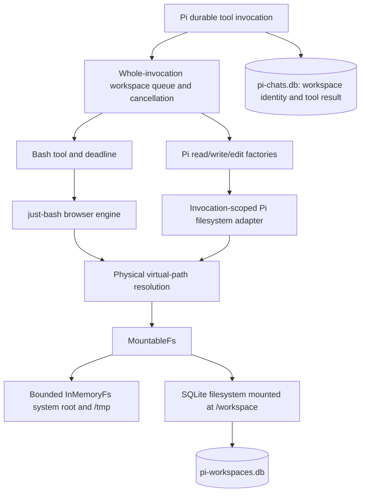

# Local tools and persistent workspaces

Every ordinary Pi chat receives `bash`, `read`, `write`, and `edit` through one workspace extension in `DurableChatService`. Bash runs the pinned `just-bash@3.6.0` interpreter on the device; the file tools use the pinned Pi durable SDK factories over the same mounted filesystem. There is no native process, remote sandbox, JavaScript runtime, Python runtime, or shell network capability. The same extension works with the app's registered model providers.



## User-visible behavior

The default directory and `HOME` are `/workspace`. Its bytes and metadata persist across calls, service shutdown, app backgrounding and process restart. Each invocation gets fresh shell variables, functions, working directory, system files and `/tmp`. Put anything needed by a later call in `/workspace`.

For example, one invocation can run `printf 'hello\n' > notes.txt`, and a later invocation can run `cat notes.txt`. Pipelines, redirection, shell control flow, text processing, jq, SHA/MD5 checksums, base64, gzip/gunzip/zcat, and compressed `rg -z` searches are available. The exact reviewed command list is `BASH_CAPABILITIES` in `src/pi/bash/engine/index.ts`. Shell builtins are provided by the interpreter. This is a useful interpreted shell, not a promise of full GNU Bash or installed Unix software.

Unavailable commands include native programs, network tools, `js-exec`, Python, `sqlite3`, `tar`, `yq`, `xan`, `file`, and `html-to-markdown`. The last two are deliberately excluded because their upstream implementations require stream decompression/DOM capabilities not assumed on Hermes. Using Expo SQLite for storage does not install a SQL shell command. The browser engine also lacks upstream's Node defense-in-depth hooks; the security boundary is the interpreter, reviewed capabilities, virtual filesystem and resource limits.

Output is buffered. The result includes stdout, stderr and exit status. The model/UI receives at most 24 KiB and 800 lines from each stream, with status and artifact paths first. Larger completed output is saved with exclusive private names beneath `/workspace/.bash-output` when quota allows. Those are normal virtual files, readable with `cat`, `head`, or other shell commands; they are not native file URLs. The implemented transcript flow does not require exporting native files, so it introduces no Expo FileSystem materialization or sharing feature. Such a feature would need an explicit bounded BLOB-to-native-file export in the future.

Keep arbitrary binary output in redirected files. Base64 decoding, file copies, compression and BLOB reads preserve bytes. Upstream shell strings are not a general binary terminal: for example, `printf '\377'` produces UTF-8 for U+00FF rather than a raw FF byte. `printf AP9B | base64 -d > bytes.bin` reliably creates bytes `00 FF 41`.

The requested timeout defaults to 10 seconds and is capped at 30. Cancellation/deadlines are cooperative: elapsed-time/work checks and an AbortSignal are both used, but JavaScript is not preempted inside arbitrary synchronous work. A local timeout reports exit 124 and warns that files may already have changed. Upstream can discard already-buffered stdout when aborting; the wrapper does not invent that missing output or promise streaming. Output spills are skipped after timeout. Caller cancellation and service shutdown retain cancellation semantics.

## Ownership and code organization

| Module | Responsibility |
| --- | --- |
| `workspace/document.ts` | Conversation-scoped UUID, fresh-fork policy, existing tool/extension selections |
| `workspace/extension.ts` | Pi workspace extension registration and shared prompt context |
| `workspace/runtime.ts` | Lazy database ownership, workspace invocation queues, cancellation, sealing, draining and shutdown |
| `workspace/database.ts` | Lazy production platform-factory dispatch shared by the service and isolated probes |
| `workspace/execution-env.ts` | Typed Pi filesystem results, mounted paths, strict UTF-8 editing, temporary capabilities |
| `workspace/file-tools.ts` | SDK factory registration, paging validation and whole-tool invocation wrapper |
| `workspace/edit-budget.ts` | Edit input, matching/allocation and pre-mutation diff work admission |
| `workspace/cooperative-work.ts` | Bounded preflight scans that yield to UI events and recheck cancellation |
| `workspace/file-details.ts` | Bounded edit summary/diff details and persistent complete patch artifacts |
| `workspace/mounted-filesystem.ts`, `workspace/mounted-paths.ts` | Resolve physical paths and links before upstream's lexical mount routing |
| `workspace/bounded-system-fs.ts` | Bounded, invocation-local system tree |
| `workspace/native.ts` | Separately owned Expo connection creation |
| `workspace/native.web.ts`, `workspace/shared-database.ts`, `workspace/web-database-lock.ts` | Shared browser transaction queue, reference-counted leases and connection-lifetime Web Lock |
| `workspace/filesystem/` | Public adapter, schema, queued store, namespace operations, paths, encodings, records, content and lifecycle |
| `bash/tool.ts`, `bash/execution.ts` | Bash arguments, replay policy, deadline, timeout result and tool execution |
| `bash/output.ts` | Bounded presentation and textual spill files |
| `bash/engine/` | Capabilities, limits, pinned Metro compatibility, Expo crypto and bounded compression |

The extension uses Pi's direct `defineTool`/`defineExtension` interfaces and the individual `createReadTool`, `createWriteTool`, and `createEditTool` factories. It does not install `CodingTools`, which would also register the SDK's stock bash implementation. Shared workspace infrastructure lives separately from shell execution. The persisted `local-bash` extension name and `app.bash.workspace` document kind remain compatible with existing conversations. No model/provider callback or live database object is persisted in a Pi document.

`WorkspaceRuntime.run(workspaceId, signal, callback)` owns each complete invocation. A callback may use its local `abort(reason)` to seal filesystem access and handle that interruption as a result. Caller cancellation and runtime shutdown still reject the invocation. Bash's execution helper owns the deadline and decides when a local timeout becomes exit status 124; the runtime always seals and drains admitted filesystem work before releasing its queue.

`WorkspaceDoc` stores a stable UUID in the conversation. New chats receive it in the creation hook; existing chats are migrated while scheduling is paused. Document version 2 preserves that UUID and adds a capability revision. Each capability rollout adds the four tool names once, preserving unrelated settings; subsequent explicit exclusions survive reopening. Already checkpointed provider requests are not rewritten retroactively.

Reopening retains the same identity. Archive retains workspace data with the transcript. A fork receives a fresh empty workspace and an explicit prompt warning that files mentioned in inherited messages were not copied or restored. This supports historical conversation forks without falsely treating today's files as historical snapshots. The filesystem exposes an atomic *current-state* copy helper for future deliberate workflows; chat forks do not use it.

There is no new delete/reset UI. `deleteWorkspace` is an explicit storage operation; callers must stop users of that namespace and coordinate its document/transcript policy. Stale adapter handles cannot mutate a replacement namespace. No background orphan collector guesses that unreferenced data is safe to delete: chat and file database commits are separate. Deleting entries releases logical quota and leaves SQLite pages available for reuse; it does not promise immediate shrinkage of the database file. Full `VACUUM` is intentionally absent from foreground tool execution.

## Pi file-tool contracts

| Tool | Arguments | Observable behavior |
| --- | --- | --- |
| `read` | `path`, optional positive integer `offset` and `limit` | Text paging uses 1-based offsets and Pi's 2,000-line/50 KiB output policy, with continuation diagnostics. |
| `write` | `path`, `content` | Creates missing parent directories, creates or overwrites UTF-8 file contents, and follows final symlinks. |
| `edit` | `path`, `edits: [{ oldText, newText }]` | Applies unique non-overlapping replacements against the original file, then commits one final file replacement. Pi's argument repair also accepts its legacy forms. |

Relative paths and `~` start at `/workspace`; absolute paths remain virtual paths. All four tools use the same physical symlink and `..` resolution. Hard-link aliases share bytes. A trailing slash still requires a directory. Absolute `/tmp` paths and persistent symlinks into `/tmp` refer to the current invocation's fresh temporary view, so writing one does not make its bytes available to the next call.

The SDK also repairs tool paths before the adapter sees them: a leading `@` is removed and several Unicode space characters become ASCII spaces. `read` tries additional decomposed-Unicode, quote and date-space filename variants. These are Pi’s conventions, so a literal unusual filename created by bash may need an absolute path (for a leading `@`) or access through bash; the shared filesystem does not remove those SDK repairs.

`read` is text-only in the pinned SDK. Recognized supported image signatures produce an unsupported-image error rather than an attachment. Other bytes use the SDK's UTF-8 decoding behavior, which can display replacement characters for invalid UTF-8. Use bash with base64 or another explicit binary representation when exact bytes matter. Paging bounds output, not input allocation: the SDK loads the complete bounded file first. The app does not truncate a read again after Pi has calculated its continuation offset.

Editing requires valid UTF-8. The adapter preserves leading BOMs and rejects malformed UTF-8 before mutation. Pi tries exact matching, then its normalized matching rules; fuzzy replacements can normalize trailing whitespace and Unicode punctuation on touched lines. A leading BOM and a consistent LF/CRLF convention survive editing, while mixed or CR-only endings follow the SDK's normalization rather than arbitrary byte-for-byte preservation. Missing matches, ambiguous matches, overlaps, or work-budget rejection leave file contents unchanged. A failed `write` can leave newly created empty parent directories.

The typed `ExecutionEnv` adapter returns ordinary filesystem failures as `Result` values. It explicitly reports unsupported file-handle flush/truncate operations and `shell_unavailable` for `exec`; registered bash retains its independent buffered output and timeout contract. The wrapper supplies the environment directly to the SDK execute call. Lock acquisition does not live in `HarnessOptions.env`, which also runs during prompt preparation and has no automatic cleanup hook.

The stable workspace UUID owns the shared queue/storage; an environment ID identifies one invocation's mounted view, including fresh temporary files. Every workspace tool is sequential, and the queue covers the entire SDK edit read/compute/write sequence. Pi's internal per-file mutation queue alone does not coordinate with bash. Shutdown seals and drains that shared invocation before releasing it.

Edit computation and presentation have separate limits. `EDIT_BUDGET` is the authoritative policy: up to 32 replacements and 1 MiB aggregate edit arguments; source/result line ceilings; weighted normalization and matching budgets; occurrence-allocation limits; and a public `diff@8.0.4` preflight with an adaptive maximum line-edit distance before mutation. Summed scalar NFKD lengths conservatively bound normalization allocation. A separate native-search admission counts first-unit frequencies in the original and NFKC/folded text, bounding repeated-prefix `indexOf`/`split` comparisons before Pi's matcher sees the source. Its small normalization correspondence is pinned to Pi 1.0; Pi still owns all actual matching and replacements. The diff preflight reconstructs the exact normalized strings Pi will diff, removing only an originally preserved BOM so a newly inserted BOM remains part of the comparison. Storage still permits 8 MiB files: sufficiently small edits with adequate distinctive surrounding context can operate on the full file. Rejections request a smaller targeted edit, more context, or `write` for a complete replacement.

Unicode has additional computation limits before any whole-string normalization. Positive per-scalar NFKC growth is charged against a 1 MiB expansion-work ceiling, adding all old-text patterns and multiplying source growth by the edit count. Characters such as `é` and CJK ideographs do not consume this growth budget. Decomposed Unicode Mark runs may contain at most 64 UTF-16 units, with the count carried across scalar and scan boundaries; this also detects compatibility characters that turn into combining marks. The sum of squared run lengths has a separate 32 Mi aggregate work ceiling, again charging patterns plus source work multiplied by the edit count. This prevents many legal short runs from accumulating excessive normalization work. The general matching ceiling likewise charges the larger of source UTF-8 bytes and summed NFKD UTF-16 units, multiplied by the edit count, against 32 Mi work units. A per-invocation cache holds at most 4,096 scalar metrics. These are conservative work-admission rules, not an exact whole-string expansion measurement or a universal CPU-time guarantee. Constructor work only validates input size and count; whole source and pattern normalization wait for cooperative admission.

Preflight byte counts, line counts, normalization-allocation scans and search histograms run in bounded chunks. They periodically yield to UI events while retaining the workspace queue, and check both caller and invocation cancellation plus environment cleanup before continuing. Whole-source NFKC normalization stays intact so compositions across chunk boundaries cannot change admission. Explicit yields separate admission from Pi matching, the public diff preflight and filesystem mutation.

These are cooperative work ceilings, not a hard JavaScript execution deadline. The final 28-case Hermes simulator run verified accepted and rejected boundaries, unchanged bytes on rejection, and complete patch artifacts. Its largest observed timer gap was 746 ms for an admitted edit and 760 ms for a rejected edit; full 8 MiB ASCII and mixed-text edits took about 8.4–9.0 seconds overall. Preflight yields improve responsiveness, but synchronous SDK matching and diff generation still cause noticeable pauses. A timer cannot preempt that work, and these sampled simulator results are neither an exhaustive timing bound nor a physical-device guarantee. See the dated results in `bash-tool-verification.md` before changing these limits.

`EDIT_PRESENTATION_LIMITS` separately bounds edit summary text, the numbered diff preview, and serialized details. Small complete patches stay inline; larger ones are exclusively created under `/workspace/.edit-output`. The model receives the artifact path and the UI projects the persisted bounded diff, first changed line, and patch path. A quota or artifact failure warns that the edit succeeded but the complete patch could not be saved. It does not relabel a successful file change as failed. Existing files and guest-created output-directory symlinks are not overwritten by artifact creation.

## SQLite filesystem

`pi-workspaces.db` is separate from Pi's schema-owned `pi-chats.db`. It uses the existing owned-connection Expo driver. The adapter has three normalized tables: workspace identities/counters, inodes containing bytes/metadata, and directory entries mapping `(workspace,parent,name)` to inode identity. Files are `Uint8Array` BLOBs, never base64 or a serialized filesystem snapshot. Empty files use `zeroblob(0)` to avoid native bridges binding an empty external buffer as SQL NULL.

Hard links share the inode, bytes, mode and modification time; unlink reclaims it only after the final entry disappears. Symlinks store their original target. Moving a directory changes its parent entry, not every descendant path. Directory traversal uses indexed parent queries. A bounded cache of namespace metadata supplies synchronous `getAllPaths`; file contents are fetched on demand. Invocation boundaries refresh that cache, while normal operations query current SQLite records.

The full pinned `IFileSystem` contract is implemented, including byte and typed-directory reads and atomic `createExclusive`. UTF-8/ASCII, Latin-1/binary, hex and base64 follow the pinned upstream codec contract. Permission bits and mtime are virtual metadata; this is not a multi-user Unix permissions boundary. The interface exposes mtime, not atime, so `utimes` stores the observable mtime. Raw host URIs, NUL and backslash paths are rejected; all resolution stays in the virtual tree.

The physical-path decorator exists because upstream `MountableFs` normalizes `link/..` before delegating and leaves absolute symlink targets in global coordinates. The decorator resolves components and links in the mounted virtual namespace first, with finite link/depth/work limits. It preserves final links for unlink/rename/exclusive creation and retains the original `readlink` value. Links can refer to the in-memory virtual tree; they never grant access to device paths. Hard links cannot cross mounts. Cross-mount moves validate destination types and directory emptiness before copying, then delete the source only after successful copying. They are not atomic renames: cancellation or failure can leave the source and a partial destination.

Each coherent mutation runs in a short `BEGIN IMMEDIATE` transaction, including entry creation, bytes, metadata, quota checks and counters. Failed operations roll back cache changes as well as SQL. Native independent connections are protected by SQLite writer locking and namespace constraints. The driver serializes every operation on its owned connection, including transaction completion, and does not rely on native-only `withExclusiveTransactionAsync` (unavailable on web).

The installed Expo browser VFS has no-op SQLite connection locks. An actual browser test with two independent connections acknowledged 20 appends but retained only 10 bytes. The web factory therefore returns reference-counted leases over one named connection and one transaction queue. Closing one lease leaves the others usable; the final close drains the driver and releases a Web Lock before reopening is allowed. The corrected browser test retained all 20 writes. Always obtain web workspace connections through this factory; independently wrapping two raw Expo connections defeats its ownership guarantee.

The supported browser boundary is one active app tab. The lifetime Web Lock explicitly prevents competing ownership of the same workspace database, but Expo's OPFS pool is origin-wide and acquires file handles before the chat service opens a workspace. This change does not promise multi-tab Pi storage. Secure contexts, Web Locks, WASM workers, OPFS and the existing cross-origin isolation headers are required.

WAL, foreign keys, a 5-second busy timeout and `synchronous=FULL` are chosen explicitly. The schema version and DDL commit together; future schemas are rejected. FULL requests SQLite's WAL synchronization before acknowledging writes. This provides a stronger durability setting than NORMAL, not an application-level claim of immunity to every device/storage failure. File changes and Pi tool-result commits are still separate transactions.

One BLOB per file keeps the implementation reviewable and matches just-bash's whole-file APIs. Appending reads/copies the existing bytes and rewrites the BLOB, so repeated tiny appends to a large file can be quadratic. The 8 MiB file bound makes that cost finite. Prefer building content once and writing once. Chunking would complicate transactions and would not remove the interpreter's whole-file allocations; introduce it only with measured workloads that justify it.

## Limits and interruption

| Resource | Default ceiling |
| --- | --- |
| Script source | 64 KiB |
| Execution | 10 seconds default, 30 seconds requested maximum |
| Interpreter output / codec input and output | 4 MiB |
| Persistent regular file | 8 MiB |
| Persistent workspace | 64 MiB and 4,096 entries including root |
| Database logical content / namespaces | 256 MiB, 1,024 workspaces and 16,384 entries including roots |
| Queued write allocations per owned store | 16 MiB |
| System filesystem | 4 MiB, 1,024 entries, 64 levels; fresh each call |
| Virtual paths | 4,096 characters, 128 components, 40 followed links |
| Compression | 128 concatenated members, 16 KiB metadata headers |

`engine/limits.ts` also bounds commands, loops, parser/query depth, glob/traversal work, arrays, strings, substitutions and file descriptors. `filesystem/types.ts` is the authoritative persistent-quota definition. Logical content limits exclude SQLite/WAL overhead and are not file-size-on-disk reservations.

`read` is replay-safe: recovery may read the current file state again. `write`, `edit`, and `bash` are replay-unsafe: if the process dies after writing a file but before Pi saves the result, recovery reports interruption and must not repeat the mutation. A shell invocation is never one giant SQL transaction, so earlier successful writes survive a later command failure. A validated edit's final file replacement is transactional, but its file commit and Pi result commit remain separate. Exactly-once tool execution is not promised. Inspect files before retrying interrupted mutations.

The runtime rejects new calls on stop, aborts active and queued invocations, seals further filesystem admission and drains already admitted operations before closing the owned database. A native commit that has already begun may finish; cancellation cannot undo a committed operation. The tool result and prompt explain this partial-success boundary. Workspace command queues are shared by managers in the same JS runtime; separate connections still use SQLite transactions for operation-level consistency.

## Compatibility maintenance

Native imports use `just-bash/browser` explicitly. The published 3.6.0 browser artifact is guarded by SHA-256 `38f1ad1e3283980ecdf68cede8a4eed028c6dff6e8c31793dec1e0af529c446e`. A package upgrade fails the transform until reviewed. The Metro wrapper chains the existing Expo/Pi transformer and narrows `node:zlib` resolution to this one importer. It injects a module-local `Buffer` and replaces exactly the audited digest/randomness call sites with Expo Crypto. No general Node environment is installed.

The same adapter makes narrowly guarded corrections to upstream `cp`, `mv`, `rm` and `ln` entry checks. These commands must inspect the final link inode when copying, renaming, unlinking, replacing or hard-linking a dangling symlink. A small identity facade preserves upstream's conservative alias check, and `-n` still protects an existing destination link. Every replacement requires exactly one match in the fingerprinted artifact; cache revision `pi-bash-v3` includes these corrections. This does not add GNU options: default `cp` preserves links here, and upstream's unsupported `cp -P` remains unsupported. Tests exercise both ordinary files and link targets to prevent fixes from accidentally deleting or overwriting referents.

The fflate adapter exposes only the zlib exports used by the pinned bundle. It validates gzip CRC32, original length and optional header CRC, bounds header/member counts, and feeds small chunks to bound transient decompression allocations before the output ceiling is checked. fflate itself does not verify those integrity fields. Compression remains synchronous: the measured 4 MiB expansion-limit probe occupied the iOS simulator's Hermes thread for about 661 ms. The limit prevents unbounded expansion; it does not promise that heavy codec work never delays the UI.

For an upgrade, inspect the actual published artifact, refresh the hash deliberately, review every enabled command's globals/imports, run the engine and mounted integration suites, then export and run on Hermes and web. A successful rewrite scan or bytecode compilation alone is not native runtime evidence. Browser SQLite needs WASM worker support and cross-origin isolation; the existing Metro/Router headers supply COOP and COEP. Deployment must preserve those headers.

## Verification

Run `pnpm test:compat`, `npx @expo/agent-cli lint`, and `npx @expo/agent-cli typecheck`. The bash suites use real SQLite and the exact adapted browser artifact. Only the Expo crypto boundary is replaced with Node WebCrypto in Node tests; the Pi tests explicitly use scripted model transport.

The workspace-specific Node gate is:

```sh
node --experimental-strip-types --test tests/workspace-*.test.mjs tests/edit-budget.test.mjs tests/file-details.test.mjs tests/file-tool-presentation.test.mjs
```

It covers registered-tool interoperability, physical paths and aliases, image/binary behavior, actual workspace quota rollback, patch artifact persistence/readback, conversation migration, cancellation and unsafe recovery. These are real harness/SQLite/interpreter tests with deterministic model transport, not evidence of a live provider request.

The reusable native probe requires a connected development build:

```sh
node scripts/check-native-bash.mjs --namespace pi-bash-UNIQUE --stage seed
# Terminate and relaunch the app process, then use the same namespace:
node scripts/check-native-bash.mjs --namespace pi-bash-UNIQUE --stage verify
```

It exercises the real Pi service, native Expo SQLite, Hermes shell, BLOBs, links, modes, gzip, checksums and persistence in isolated validation databases. The self-contained probe is also usable in the web Metro runtime. It uses scripted model transport and does not access credentials or issue model HTTP. A real-provider run requires a user-connected provider and is a separate validation claim.

The four-tool native probe additionally exercises file-tool semantics and edit work limits:

```sh
node scripts/check-native-workspace-tools.mjs --namespace pi-workspace-tools-UNIQUE --stage seed
# Terminate and relaunch the app process, retaining the same validation namespace:
node scripts/check-native-workspace-tools.mjs --namespace pi-workspace-tools-UNIQUE --stage verify
node scripts/check-native-workspace-tools.mjs --namespace pi-workspace-tools-UNIQUE --stage performance
```

Run this only against the intended connected development build. Its returned measurements, platform, and pass/failure state must be recorded separately from Node tests and bundle checks; source limits alone do not establish mobile responsiveness.

Expo SQLite 58.0.8 and 58.0.9's browser OPFS pool has six backing-file slots, including journals; the browser implementation is unchanged in that patch. Reuse a validation namespace or delete only its known test databases after testing; accumulating uniquely named test databases can exhaust that pool. Ordinary chat workspaces share a single database and do not consume one OPFS file per chat.

See `bash-tool-verification.md` for the implementation review findings, their fixes and the observed platform gates. The full retained scope is in `bash-tool-implementation-goal.md`.
