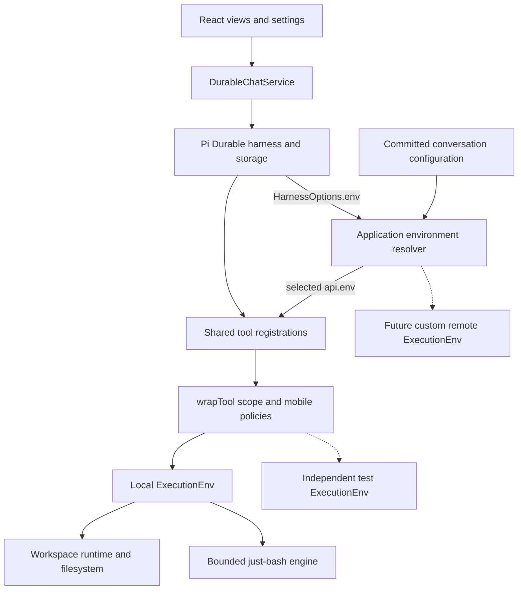

> **Superseded by the pi-agent Cleanup Plan (https://claude.ai/code/artifact/a114f99b-474c-48bc-97ab-69b9a7bd2c66). Do not implement from this file.** It describes the pre-cleanup design and will be rewritten or deleted as the cleanup lands.

# Execution environment architecture refactor

Refactor the mobile application's execution layer so a future custom `ExecutionEnv` plugs into Pi Durable's environment factory and works with the same tools as local execution. Upgrade Pi first, complete the local integration and lifecycle ownership, use Pi's native durable configuration, and prove the boundary with an independent test environment. Production execution remains on the device during this work.

The deliverable is integrated application code and behavioral evidence. Moving files or adding interfaces while retaining tool-local backend selection does not meet the objective. Use the [orchestrator goal prompt](/Users/vikashloomba/pi-react-native/pi-agent/docs/execution-env-refactor-goal.md) with this specification. The [SSH over Tailscale investigation](/Users/vikashloomba/pi-react-native/pi-agent/docs/remote-ssh-execution.md) supplies later feature context: an ordinary SSH connection to a configured Tailscale hostname through the phone's existing VPN. This document defines the prerequisite refactor.

## Upgrade and scope

Work in `/Users/vikashloomba/pi-react-native/pi-agent`. The inspected checkout uses Pi Durable, Pi AI, and Chord `1.0.0`, Expo `~58.0.3`, and React Native `0.88.0-rc.3`. **Upgrade the Pi packages to the verified latest stable release, `1.0.4`, as part of this refactor.** The npm `latest` tags for Durable, AI, and Chord were checked on October 6, 2026. References below target the `1.0.4` release commit, `7c10bd4337495ee613f2224843ecdf349b80d1df`.

Update the application dependencies and the `packages/expo-pi` development dependencies for Pi Durable, Pi AI, Chord, and Pi Agent Core coherently, including the lockfile. Follow the repository's Expo agent CLI installation guidance. Verify that the application and compatibility package test the same Pi generation. Read the [Durable changelog][changelog] and affected package changes; fix actual compatibility issues rather than pinning old APIs or inventing substitutes for new library features. If implementation begins after a newer stable release appears, assess it explicitly and update the pinned references and tests together.

Keep the harness/storage ownership, durable transcript, committed UI projections, provider authentication, workspace filesystem, and bounded just-bash engine. Improve their execution boundaries. Preserve all preexisting uncommitted work, particularly native web-search and Markdown changes.

SSH transport, daemon protocol, host settings, credential/trust storage, remote selector UI, and filesystem synchronization belong to the later feature. A redundant production document containing only a local target is unnecessary. Avoid generic backend registries, another scheduler, and replacement persistence infrastructure.

## Pi patterns and authoritative references

Start with **example 29**: its environment factory reads a conversation document and supplies an environment to ordinary coding tools. Its Node implementation is an example backend, not a dependency to import into the mobile bundle.

| Concern | Documentation and interfaces | Application use |
| --- | --- | --- |
| Environment selection | [Environment documentation][env-docs], [sandbox example 29][sandbox-example], [EnvTarget and HarnessOptions][env-factory] | Resolve from conversation ID, committed documents, and agent cwd in one factory. It also serves prompt sections and `runtime.env()`. |
| Backend contract | [ExecutionEnv and its filesystem/shell interfaces][env-interface] | Implement the structural public interface. Return Pi result/error types and honor Chord cancellation. No inheritance from a Pi concrete environment is required. |
| Common tools | [Tool factory exports][tool-factories], [coding tools example 17][tools-example] | Compose read/write/edit/bash once; file and shell execution use the selected `api.env`. |
| Policies and scope | [Tool wrappers documentation][tool-docs], [wrapTool definition][wrap-definition], [ToolExecutionApi and Extension.wraps][harness-types] | Decorate public registrations. Acquire resources inside the returned `execute`, delegate with the selected/scoped env, and release in `finally`. Wrapper construction is pure. |
| Prompt context | [System prompt documentation][prompt-docs] | Render cwd and execution facts from the selected environment and small application metadata. Shared tools must not describe all backends as the local virtual shell. |
| Durable configuration | [Per-conversation agent documentation][agent-docs], [transactional configure][agent-source] | Keep model, thinking level, cwd, and tool/extension selection in `AgentDoc`. Preserve unrelated fields and explicit selections. |
| Application documents | [Custom state documentation][state-docs], [document history/fork contracts][durable-types], [configuration example 07][configuration-example] | Use `defineDoc`, `tx.doc`, committed reads, `conversationCreated`, and creation `init` when application state is needed. |
| Task access and lifetime | [TaskRuntime.env][durable-types], [tool execution path][tool-execution], [scheduler invocation lifetime][scheduler-source] | Direct task consumers must work. Pi does not supply an automatic env disposer or await application filesystem drainage. |
| Contract verification | [Testing exports][testing-exports], [conformance options/provider][testing-types], [suite implementation][env-conformance] | Run the supplied environment conformance cases, then application-specific lifecycle, limits, and recovery tests. |

Use public package exports in application code. Source links explain behavior; they do not authorize private harness imports. `HarnessOptions.env` receives no tool arguments and returns no disposer. Do not invent an SDK scope hook or treat `beforeTool`/`afterTool` as a guaranteed cleanup pair.

## Changes introduced by the upgrade

The upgrade supplies useful capabilities and also expands the contract the local environment must implement. These are implementation requirements, not reasons to avoid upgrading.

| Pi 1.0.4 capability | Required application work |
| --- | --- |
| `openBinaryReader`, positional reads, `info`, `scanLines`, and independent `close` | Implement the reader contract, including opened-file identity, rename behavior, symlink rules and cancellation. Reuse exported `LineScanner` and decoding helpers where applicable. |
| `openDirReader` | Provide bounded paged enumeration with documented ownership and cleanup. |
| `watch` | Supply the method with truthful capability/error behavior. Prefer a small bounded implementation where the existing filesystem supports it; do not build a general watcher framework. The four current tools do not require watching. An intentional local `not_supported` result must be documented and reported as a conformance limitation, never disguised as successful watch support. |
| String and argv forms of `exec` | Support shell scripts and literal argument execution for the local engine's supported programs. Preserve argument boundaries; do not concatenate argv into unescaped shell syntax or imply external binaries are available. |
| `ShellOutputInfo.stream`, optional output windows and skipped counts | Preserve stdout/stderr identity through the standard callback when needed. Forward accurate metadata. Omitting output is optional; do not claim skipped bytes unless they were actually omitted. |
| Bounded stock read tool | Use the upgraded implementation, which reads the header, a line scan, and displayed ranges. Remove the old assumption that Pi's read tool must materialize every file before paging. |
| Public environment conformance suite | Use `createEnvConformance` or `registerEnvConformance` from `@earendil-works/pi-durable/testing`. Adapt the runner, not the expected behavior. |

The [1.0.3 and 1.0.4 changelog entries][changelog] identify these changes. The upgrade also introduces per-conversation provider session identity; verify the existing auth, native web-search, replay and compaction integration against the new release instead of assuming environment changes are the only affected surface.

Update API-shaped test doubles for `outputWindow` and fully resolved settings fixtures for `progress`. A wrapper that transforms `api.output` must set `outputWindow: undefined`, so omitted text cannot bypass its transformation. Reconcile cancellation at the right boundary: the conformance suite expects typed `aborted` env failures, while the tool scope must still preserve caller cancellation identity and prevent late writes. Do not weaken either contract to satisfy the other. [Tool output contract][tool-output], [conformance cases][env-conformance].

## Current seams to change

| Current code | Required change |
| --- | --- |
| [chat-service.ts](/Users/vikashloomba/pi-react-native/pi-agent/src/pi/chat-service.ts) opens the harness without `env`. | Inject execution composition and install its authoritative resolver in `HarnessOptions.env`, with local execution as the production default. |
| [workspace/file-tools.ts](/Users/vikashloomba/pi-react-native/pi-agent/src/pi/workspace/file-tools.ts) creates local envs inside tools. | Remove backend selection from tool execution. Keep focused argument admission and scope policies around Pi factories. |
| [workspace/execution-env.ts](/Users/vikashloomba/pi-react-native/pi-agent/src/pi/workspace/execution-env.ts) has no working shell; [bash/tool.ts](/Users/vikashloomba/pi-react-native/pi-agent/src/pi/bash/tool.ts) calls the interpreter directly. | Complete local `ExecutionEnv.exec` using the existing engine/deadline code and route bash through `api.env`. |
| [workspace/runtime.ts](/Users/vikashloomba/pi-react-native/pi-agent/src/pi/workspace/runtime.ts) owns queues, temporary trees, cancellation sealing and drain. | Preserve those guarantees with explicit scope ownership that also works for direct env consumers. |
| [edit-budget.ts](/Users/vikashloomba/pi-react-native/pi-agent/src/pi/workspace/edit-budget.ts) subclasses the local backend; [file-details.ts](/Users/vikashloomba/pi-react-native/pi-agent/src/pi/workspace/file-details.ts) mixes formatting and storage. | Make budgeting a delegating env policy and separate formatting from a small artifact-writing capability. |
| [workspace/extension.ts](/Users/vikashloomba/pi-react-native/pi-agent/src/pi/workspace/extension.ts) always describes local execution. | Keep shared registrations and separate environment-specific prompt facts. Preserve the persisted extension identity. |
| [workspace/document.ts](/Users/vikashloomba/pi-react-native/pi-agent/src/pi/workspace/document.ts) and the service creation hook initialize local workspace identity. | Keep initialization focused on current domain state. Let Pi defaults and `AgentDoc` own tool selections; cover owned conversations without capability-rollout bookkeeping or speculative target state. |
| [chat-runtime.ts](/Users/vikashloomba/pi-react-native/pi-agent/src/chat/chat-runtime.ts) serializes lifecycle and operations. | Keep cancellation and unrelated chats responsive during delayed env work. Change queue boundaries where tests show a need while retaining tested authentication ordering. |

## Target architecture



Use a small composition module for resolver/resource ownership, a shared extension with focused policies, and existing local backend modules. The service owns the harness and delegates execution details. The runtime coordinates activation, auth, cancellation, and shutdown. React reads committed projections and submits commands.

Names and file counts are flexible; dependency direction is the requirement. Shared tool execution must not import the local filesystem/interpreter, construct workspaces, select hosts, or silently fall back to local. A scope adapter may bind the already selected local environment, but must not select it again. An external `ExecutionEnv` must work without inheriting an application base class or implementing a second large environment interface.

## Environment and resource lifetime

Resolve metadata cheaply. Rendering `env.cwd` must not open the workspace database, acquire a lock, or leave resources needing disposal. Slow backend initialization belongs to operations that require it.

Preserve one local scope around the whole tool call: read, edit matching, write, formatting, artifact publication, and cleanup. Pi's [file mutation queue][file-queue] covers write/edit, not exclusion against bash. Local `exec` must reuse the bound invocation; entering the same workspace queue again can deadlock. All cwd views and tool scopes in one runtime share the workspace filesystem identity, including its bounded temporary tree.

Resolve direct-access lifetime during implementation, before calling the resolver complete:

- Successive methods on one env can create, write, and read a temporary file until its documented cleanup boundary. A fresh temporary tree for every method is invalid.
- Separate local tool invocations get fresh shell state while sharing the workspace filesystem, including `/tmp`, until runtime shutdown.
- Direct host code and custom Pi tasks using `runtime.env()` can use the interface without being one of the wrapped tools. Compound operations may use a documented application scope helper.
- Text/binary/directory readers and watchers have defined ownership and independent close paths. They must not retain an unbounded workspace queue lease. Respect the upgraded reader consistency contract rather than silently treating every reader as a stale snapshot.
- Cleanup is idempotent, seals resources, and awaits admitted work before shared storage closes. State who owns cleanup for tools, direct callers, task callers, and shared backend resources. A cancelled invocation signal is not an awaited cleanup operation.

A lightweight env with a lazy temporary namespace, short leases for standalone operations, and a whole-call lease for tools is one possible design. Choose the simplest design satisfying the contract and tests. Do not leave an unusable facade or undocumented lifetime as follow-up work. `wrapTool` supplies the public decoration seam; application resource ownership still needs an implementation.

Per-call cancellation/cleanup must not shut down a shared backend used by another call. Pi's shell `cleanup` is owner shutdown; invoke it at the correct ownership boundary. Release request-owned readers and scopes independently, and test that completing one call does not terminate another environment consumer.

Test binary readers against both in-place changes to the opened file and rename followed by recreation of its former path. Subsequent reads follow the original file identity, not an immutable copy of its opening contents or a new file at the old path.

## Shared tools and mobile policies

Keep one registration path and the names `read`, `write`, `edit`, and `bash`. Prefer Pi factories with focused wrappers for admission, scope and presentation. Preserve safe-read versus unsafe-mutation recovery and relevant sequential behavior. Do not copy Pi's matcher or durable tool runner into the app.

Make edit budgeting compose over `ExecutionEnv`, preserving identity and cwd semantics. Retain cooperative cancellation, Unicode correctness, preflight/diff limits, and rejection before mutation. Delegate the expanded interface correctly. Reuse the new bounded reader and scanning abstractions rather than rebuilding them in shared tools. Local quotas still matter; future remote implementations must enforce receiving/materialization limits in their own backend. Display truncation alone is not a memory bound.

Separate artifact formatting from an optional narrow writer capability. A plain environment without that capability must still execute tools and produce an honest bounded preview/artifact-unavailable diagnostic. Local patch/spill paths already promised to users must remain readable after the call and reopen. Preserve exclusive creation, symlink checks, and cancellation; never label an invocation temporary file as a persistent artifact.

### Bash integration

Implement the upgraded shell contract using the existing bounded engine, including cwd, virtual environment variables, argv semantics, deadline, cancellation, output callbacks and spill handling. Preserve supported-program limits and `rawScript` behavior. Do not inherit the phone process environment as if it were a remote computer.

Pi 1.0.4's callback includes stdout/stderr identity. Use this public metadata when preserving current presentation; the earlier 1.0.0 limitation is no longer a reason to invent a private result channel. A caller that needs streams separately must not request a coalesced output window, whose samples may span both streams. The local environment may deliver all output instead of using optional window optimization. [Shell contract][env-interface], [Pi bash implementation][bash-source].

Receiving every callback does not mean retaining every chunk. Keep bounded stream excerpts and incremental byte counts; use backend spill support or the optional artifact writer for full output. If full output cannot be retained, report that honestly. Test an independent env producing far more output than the display budget without unbounded collectors on the phone.

Prefer `createBashTool` plus small wrappers. If the stock factory's combined tail/spill presentation cannot preserve required application details, one shared `defineTool` adapter calling only `api.env.exec` is acceptable with a documented reason. It must not call just-bash or choose a backend. Preserve default/capped timeout, exit/error visibility, cancellation identity, mutation warnings, bounded results, persistent artifacts and rendering of historic rows. Normalize effective timeout before delegation. Decide any intentional presentation changes explicitly and cover them in tests; do not silently weaken existing regressions.

## Persistence and future configuration

Keep current conversation identity, explicit selections and fresh-workspace local fork behavior coherent through Pi's public APIs. New chats leave tool and extension selections unset to follow the host defaults. Initialization assigns workspace identity without rewriting agent selections. Unsupported old chats are outside this refactor: do not add version conversion, startup backfills, capability revisions or rollout-history documents to retain them. Code cleanup does not authorize deleting stored chats. Extract configuration helpers only where they give current domain state a clearer owner.

Production remains local by default. Tests may define a durable selector and inject a per-conversation resolver through the same service composition used in production. Initialize fixture state through Pi transactions/creation hooks. Do not ship fake hosts or test backend kinds in product state.

The later remote feature can add an application target document holding a host reference, read by this resolver. Keep cwd in `AgentDoc` and update both atomically with transactional `configure`. For target selection following the historical agent at a fork, use `history: 'rewindable'` and `fork: 'asOf'`. New task-owned conversations automatically inherit `AgentDoc`; arbitrary application documents need explicit inheritance. [Document/fork contracts][durable-types], [agent implementation][agent-source]. Prove these seams with test-only state now; build product SSH settings later.

Preserve model-settings behavior after offline abort intent. A future environment/cwd change requires old execution resources to settle, but that is not a reason to globally tighten unrelated model updates. Inspection must not resume the scheduler. Configuration stays outside React and has a service boundary the later UI can use.

## Implementation sequence

1. **Upgrade and establish the baseline.** Record dirty files and current failures; upgrade aligned Pi dependencies and lockfile to 1.0.4. Read the expanded interfaces, changelogs and examples. Adapt the local implementation/compatibility layer and establish conformance execution. Record scope/reader/watch ownership and bash compatibility choices in a short implementation note.
2. **Complete the local backend.** Implement the new filesystem methods and shell contract with existing local primitives. Preserve whole-call exclusion and cancellation/drain behavior. Verify direct env operations and custom task access alongside wrapped calls.
3. **Consolidate composition.** Wire the authoritative resolver into the real service, register common tools once, and remove tool-local environment construction and interpreter calls. Compose portable policy, local scope, truthful prompt facts and artifact presentation.
4. **Integrate lifecycle and durable state.** Centralize current creation/configuration behavior and test reopen/forks/owned conversations using the supported schema. Use delayed/failing envs to identify real coordination problems. Remove superseded bypasses and legacy workspace-rollout preservation code after the new path is integrated.
5. **Prove the result.** Run conformance and the acceptance matrix, full compatibility checks and mobile validation. Obtain an independent architecture/regression review, resolve its findings, and document final ownership and the precise future custom-env seam.

Parallelize independent inspection, backend work, policies and validation where file ownership permits. The orchestrator owns integration and the combined result; delegated unit-test reports alone are not completion.

## Acceptance evidence

| Boundary | Required evidence |
| --- | --- |
| Upgrade | Compatible Pi dependencies and lockfile updated; Expo compatibility, provider/auth and native web-search checks pass against the upgraded release. |
| Environment contract | Run upstream conformance against the real local env with truthful provider options, plus app-specific scope/limits tests. Required filesystem/read/shell cases pass; identify any intentional local watch limitation explicitly. No blanket skips, fake success, or claim of full conformance when cases remain unsupported. |
| Real routing | An independent test-only public `ExecutionEnv`, with no local inheritance, runs read/write/edit/bash through the actual service/harness. Assert backend operations and committed tool results. |
| Isolation | Local and test environments serve separate conversations. Calls affect only the selected namespace; a missing/failing resolver never falls back to local. |
| Shared policy | The independent env receives the same argument/edit/output policy and truthful prompt context. Its use does not open the local workspace database. |
| Lifetime | Metadata-only resolution acquires no resources. A task uses `runtime.env()`. Direct temporary operations, reader mutation/rename identity, supported watcher closure, repeated cleanup and stale handles obey the stated ownership model. |
| Local atomicity | Keep edit-versus-bash exclusion around read/match/write/finalize; cancellation while queued/writing and shutdown cannot allow late mutation. |
| Bash and artifacts | Cover string/argv, cwd/env options, default/explicit timeout, nonzero exit, high-output bounded collectors, output metadata, cancellation and spills. Artifacts survive later calls/reopen, and historic tool rows still render. |
| Current durable state | Chats created by the supported implementation retain workspace IDs/files, model/cwd/instructions, selections/exclusions and transcript across reopen. Local forks keep fresh workspaces; owned conversations inherit agent state through Pi. No legacy workspace conversion or capability-rollout repair is required. |
| Selection seam | A test-only committed selector controls routing after reopen. Test atomic selector/cwd updates and appropriate fork/owned inheritance through public APIs. |
| Recovery | A crash after mutation intent cannot automatically repeat write/edit/bash; safe read recovery and committed interruption results remain correct. |
| Lifecycle | A delayed/failing env does not prevent another local chat from progressing. Cancellation/backgrounding stops admission and drains resources; auth replacement and offline model-change behavior remain intact. |
| Mobile | Both platform bundles load without Node-only imports. Run available native Hermes workspace/durable/presentation probes and report platform coverage separately from Node tests. |
| Architecture | One env-selection point, one tool composition, complete local implementation, focused policies and explicit ownership. Adding the independent backend requires no special branch in shared tool bodies. |

Extend existing behavior tests rather than replacing them with implementation-shaped mocks. Start with [workspace env](/Users/vikashloomba/pi-react-native/pi-agent/tests/workspace-env.test.mjs), [workspace tools](/Users/vikashloomba/pi-react-native/pi-agent/tests/workspace-tools.test.mjs), [runtime](/Users/vikashloomba/pi-react-native/pi-agent/tests/workspace-runtime.test.mjs), [lifecycle](/Users/vikashloomba/pi-react-native/pi-agent/tests/workspace-lifecycle.test.mjs), [workspace state](/Users/vikashloomba/pi-react-native/pi-agent/tests/workspace-state.test.mjs), [bash integration](/Users/vikashloomba/pi-react-native/pi-agent/tests/bash-integration.test.mjs), [durable chat](/Users/vikashloomba/pi-react-native/pi-agent/tests/durable-chat.test.mjs), and [chat runtime](/Users/vikashloomba/pi-react-native/pi-agent/tests/chat-runtime.test.mjs).

Run from the package root:

```sh
pnpm test:compat
npx @expo/agent-cli lint
npx @expo/agent-cli typecheck --json
git diff --check
```

Use the upstream `createEnvConformance` case generator with the repository's Node test runner, or `registerEnvConformance` with a compatible runner. Both are supported public APIs. The provider awaits its callback exactly once with a fresh, empty, writable cwd, then performs owner cleanup. Preserve supplied case timeouts. The documented options configure the POSIX shell invocation and symlink support; there is no skip-watch or skip-argv option. Run/report the supplied cases and resolve required behavior failures. If local watching is intentionally unsupported, enumerate those results separately and retain a test for its honest error behavior; do not claim the full suite passed or mask unrelated failures. [Runner signature][conformance-runner], [official Node registration][conformance-example].

Follow `AGENTS.md` and the installed Expo agent CLI for native work. Read `--help` for the [workspace probe runner](/Users/vikashloomba/pi-react-native/pi-agent/scripts/check-native-workspace-tools.mjs) and [durable runner](/Users/vikashloomba/pi-react-native/pi-agent/scripts/check-native-durable.mjs). Exercise workspace seed, process relaunch/verify, bounded edit/performance and changed presentation using isolated databases and scripted models. Update probes for moved modules rather than preserving obsolete exports. Use an existing compatible development build when appropriate; a TypeScript refactor does not itself require installing onto a physical phone. Complete both platform bundle checks and available native runtime checks; identify unavailable gates rather than treating them as passes. Preserve user app data.

## Completion report

Deliver integrated code, dependency upgrade, compatibility/migration work actually required, meaningful regressions, and updated architecture/usage docs. Report the final responsibilities and resource ownership, public API choices, independent-environment proof, intentional behavior changes, conformance results, checks/platform coverage, and any unavailable native gate. Distinguish implementation completion from unverified platform behavior. Do not claim end-to-end completion while required behavioral checks fail or shared tools still choose their own backend.

[changelog]: https://github.com/earendil-works/pi/blob/7c10bd4337495ee613f2224843ecdf349b80d1df/packages/durable/CHANGELOG.md
[env-docs]: https://github.com/earendil-works/pi/blob/7c10bd4337495ee613f2224843ecdf349b80d1df/packages/durable/README.md#environment
[env-factory]: https://github.com/earendil-works/pi/blob/7c10bd4337495ee613f2224843ecdf349b80d1df/packages/durable/src/harness/types.ts#L437-L457
[sandbox-example]: https://github.com/earendil-works/pi/blob/7c10bd4337495ee613f2224843ecdf349b80d1df/packages/durable/test/examples/29-sandbox-per-conversation.ts
[harness-types]: https://github.com/earendil-works/pi/blob/7c10bd4337495ee613f2224843ecdf349b80d1df/packages/durable/src/harness/types.ts
[env-interface]: https://github.com/earendil-works/pi/blob/7c10bd4337495ee613f2224843ecdf349b80d1df/packages/durable/src/env/index.ts
[tool-factories]: https://github.com/earendil-works/pi/blob/7c10bd4337495ee613f2224843ecdf349b80d1df/packages/durable/src/tools/index.ts
[tools-example]: https://github.com/earendil-works/pi/blob/7c10bd4337495ee613f2224843ecdf349b80d1df/packages/durable/test/examples/17-coding-tools.ts
[tool-docs]: https://github.com/earendil-works/pi/blob/7c10bd4337495ee613f2224843ecdf349b80d1df/packages/durable/README.md#tools
[wrap-definition]: https://github.com/earendil-works/pi/blob/7c10bd4337495ee613f2224843ecdf349b80d1df/packages/durable/src/harness/define.ts#L33-L36
[prompt-docs]: https://github.com/earendil-works/pi/blob/7c10bd4337495ee613f2224843ecdf349b80d1df/packages/durable/README.md#system-prompt
[agent-docs]: https://github.com/earendil-works/pi/blob/7c10bd4337495ee613f2224843ecdf349b80d1df/packages/durable/README.md#per-conversation-agent
[agent-source]: https://github.com/earendil-works/pi/blob/7c10bd4337495ee613f2224843ecdf349b80d1df/packages/durable/src/harness/agent.ts
[state-docs]: https://github.com/earendil-works/pi/blob/7c10bd4337495ee613f2224843ecdf349b80d1df/packages/durable/README.md#your-own-state
[durable-types]: https://github.com/earendil-works/pi/blob/7c10bd4337495ee613f2224843ecdf349b80d1df/packages/durable/src/types.ts
[configuration-example]: https://github.com/earendil-works/pi/blob/7c10bd4337495ee613f2224843ecdf349b80d1df/packages/durable/test/examples/07-configuration.ts
[tool-execution]: https://github.com/earendil-works/pi/blob/7c10bd4337495ee613f2224843ecdf349b80d1df/packages/durable/src/harness/tool.ts
[scheduler-source]: https://github.com/earendil-works/pi/blob/7c10bd4337495ee613f2224843ecdf349b80d1df/packages/durable/src/harness/scheduler.ts
[testing-exports]: https://github.com/earendil-works/pi/blob/7c10bd4337495ee613f2224843ecdf349b80d1df/packages/durable/src/testing/index.ts
[testing-types]: https://github.com/earendil-works/pi/blob/7c10bd4337495ee613f2224843ecdf349b80d1df/packages/durable/src/testing/types.ts
[env-conformance]: https://github.com/earendil-works/pi/blob/7c10bd4337495ee613f2224843ecdf349b80d1df/packages/durable/src/testing/env-conformance.ts
[file-queue]: https://github.com/earendil-works/pi/blob/7c10bd4337495ee613f2224843ecdf349b80d1df/packages/durable/src/tools/file-mutation-queue.ts
[bash-source]: https://github.com/earendil-works/pi/blob/7c10bd4337495ee613f2224843ecdf349b80d1df/packages/durable/src/tools/bash.ts
[tool-output]: https://github.com/earendil-works/pi/blob/7c10bd4337495ee613f2224843ecdf349b80d1df/packages/durable/src/harness/types.ts#L174-L186
[conformance-runner]: https://github.com/earendil-works/pi/blob/7c10bd4337495ee613f2224843ecdf349b80d1df/packages/durable/src/testing/runner.ts#L27-L38
[conformance-example]: https://github.com/earendil-works/pi/blob/7c10bd4337495ee613f2224843ecdf349b80d1df/packages/durable/test/env-node-conformance.test.ts#L33-L60
