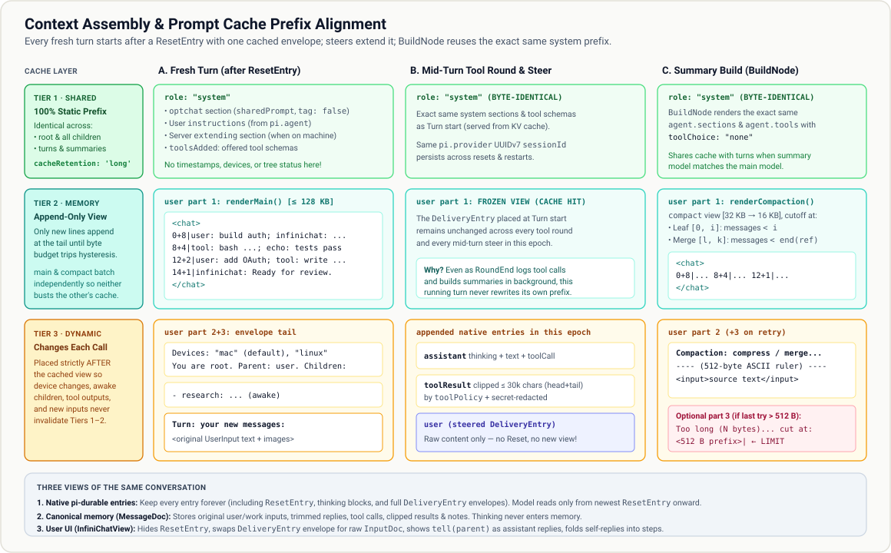
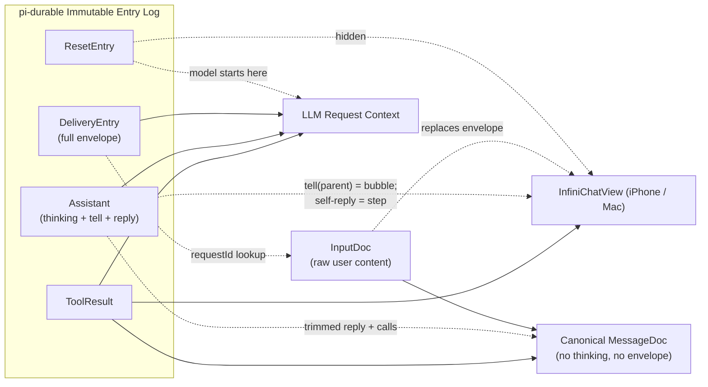

# 01 · Assembling Agent Context & Preserving the Prompt Cache

[← Overview](README.md) · [Next: Turns & Coordinator →](02-turns-and-coordinator.md)

The single biggest architectural difference between an ordinary pi-durable chat and InfiniChat is **how the model's
context window is constructed**. In an ordinary chat, pi-durable appends every user message, assistant turn, and tool
result linearly until a token threshold triggers native compaction. In InfiniChat, native compaction is switched off
(`compaction: { enabled: false }`), and the harness instead **reconstructs a clean, cache-aligned context at the
start of every fresh turn** using pi-durable's `ResetEntry`.



## 1. Why `ResetEntry` Instead of Native Compaction?

In `pi-durable`, a conversation's transcript is an append-only log of immutable entries. When a `pi.reset` entry
(`ResetEntry`) is appended, pi-durable keeps every earlier entry permanently in storage for UI rendering and auditing,
but builds the model's next `ModelContext` starting **strictly from that reset onward**.

InfiniChat exploits this primitive cleanly:

- **Before every fresh turn**, the coordinator appends `ResetEntry` (`{ head: 'self' }`) in its preparation commit
  (`app.ts`).
- **Immediately after that reset**, the coordinator submits a single `DeliveryEntry` whose user message carries the
  frozen **turn envelope**: the rendered `<chat>…</chat>` memory view, followed by dynamic host/tree state, followed
  by the new input.
- **Within that turn**, pi-durable runs its normal multi-round `GenerationTask` + `ToolTask` loop. Tool calls, tool
  results, thinking blocks, and any mid-turn steered messages append naturally after the `DeliveryEntry` without ever
  resetting or rewriting the turn's view.
- **On the next fresh turn**, another `ResetEntry` drops the previous turn's raw tool traces from the model context,
  replacing them with their newly built one-line summaries appended to the tail of `<chat>…</chat>`.

The result: an agent can run for tens of thousands of messages across weeks or months, yet every fresh turn opens with
a compact, cleanly structured prompt whose prefix stays almost completely stable across turns.

## 2. The Three-Tier Prompt Cache Layout

Provider prompt caches (Anthropic's 1-hour cache, OpenAI's 24-hour cache, enabled via `stream: { cacheRetention:
'long' }`) match requests strictly **from byte 0 forward**. Any dynamic text placed early in the prompt invalidates
everything after it. InfiniChat's context assembly enforces a strict three-tier ordering from least volatile to most
volatile:

### Tier 1 — 100% Static System Prefix (Shared Across Every Agent & Every Summary Call)

Every agent in the tree—`root`, every child, and every `BuildNode` summary call—receives the exact same system
message:

- **`optchat` extension section** (`section('optchat', …, { tag: false })` in `app.ts`): renders
  `sharedPrompt(name, hasDeviceTools)` from `prompt.ts`. It explains the `<chat>` format, the six message kinds,
  `zoom`/`date`, `tell`/`spawn`/`ask_user`, device folders (when device tools exist), and the `# Compactions`
  rules—all in one unified prompt. Only a rename in `ConfigDoc.name` changes it.
- **User `instructions`** (`pi.agent.instructions`): propagated to every agent in the tree on save
  (`OptChat.setInstructions`).
- **Host sections** (e.g. `extending` on a machine server, whose text only depends on the runtime path).
- **Offered tool schemas** (`toolsAdded`): identical across agents on the same host (on a machine server,
  `OptChat.offer('codemode')` restricts `modelTools` to `codemode`, `tell`, `spawn`, and `ask_user`, while
  keeping every other tool callable from code-mode scripts; on the phone, all tools are offered directly).

Crucially, **no clock timestamp, no active device list, and no agent name or child list ever enters the system prompt**.
Even `BuildNode` (`summary.ts`) calls `renderedSections(agent, …)` and passes the exact same `toolsAdded` list
with `toolChoice: 'none'`, so when the summary model matches the main model, summary builds reuse the exact same Tier
1 KV cache!

Each conversation also carries its own persisted UUIDv7 in `pi.provider`, forwarded to `pi-ai` as `sessionId` for
provider-side cache routing affinity across resets, retries, and restarts.

### Tier 2 — Append-Only Memory View (`<chat>…</chat>`)

Immediately after the system message comes the first text part of the `DeliveryEntry`'s user message: the rendered
`<chat>` view produced by `renderMain(tx, chat)` (or `renderCompaction(tx, chat, cutoff)` inside `BuildNode`).

```text
<chat>
0+8|user: Set up OAuth login; tool: write auth.ts; echo: ok; infinichat: OAuth live.
8+4|user: Add dark mode; tool: edit theme.ts; echo: ok; infinichat: Done.
12+1|user: Check why CI failed on macOS
13+1|tool: bash {"command":"gh run view 42 --log-failed"}
14+1|echo: error: missing photon_rs_bg.wasm in bundle
</chat>
```

Because `settleViews()` (`memory.ts`) only **appends** new leaves `[0, i]` at the tail until the view exceeds its
high-water byte budget (128,000 bytes for `main`, 32,000 bytes for `compact`), **almost every turn's `<chat>`
block shares an exact byte-for-byte prefix with the previous turn**. Only when the budget overflows does a batch
reduction compress older pairs down to the low-water target (64,000 / 16,000 bytes), amortizing cache invalidations
across dozens of turns. Furthermore, `main` and `compact` batch independently so summary compactions never disturb
the main turn cache.

### Tier 3 — Dynamic Per-Turn Tail (After `<chat>`)

Everything that changes from turn to turn is placed strictly **after** `</chat>` in `envelope()` (`app.ts`):

```ts
function envelope(view: string, content: UserInput, turnState: string, where: string): UserInput {
  const state = turnState ? `${turnState}\n\n` : '';
  return [
    { type: 'text', text: view },
    { type: 'text', text: `\n${state}${where}\n\nTurn: your new messages:\n\n` },
    ...(typeof content === 'string' ? [{ type: 'text' as const, text: content }] : content),
  ];
}
```

1. **`turnState`** (read fresh from the host just before preparing the turn): lists connected devices and their work
   directories (`Devices:
"mac" (holds this chat, the default): …`). Because machines connect and disconnect, keeping
   this outside the system prompt prevents cache churn.
2. **`placeOf(tx, chat)`** (`agents.ts`): injects the agent's identity, direct parent, visible children, which
   children are currently `(awake)`, and how many are hidden:
   ```text
   You are root. Your parent: the user (tell "user"). Your children:
   - research: deep dives and benchmarks (awake)
   - ops: server maintenance
   (1 hidden)
   ```
3. **Header + new message**: `Turn: your new messages:\n\n` distinguishes a live turn from a `Compaction:` call
   under the shared prompt, followed by the original text and any `ImageContent` parts.

Notice what is **deliberately absent**: the current date and time. Including a timestamp would change on every turn;
instead, the agent calls `date(id)` whenever it needs to know when any message occurred.

## 3. Mid-Turn Context: Freezing the View & Accepting Steers

Once a fresh turn's `DeliveryEntry` is placed, the turn enters pi-durable's `GenerationTask` loop:

- Each round appends native `assistant` entries (including reasoning/thinking blocks and `toolCall` blocks) and
  `toolResult` entries.
- If another message arrives while the turn is running (from the user, from a child's `tell`, or from a scheduled
  task), the coordinator submits it with `whenBusy: 'steer', whenIdle: 'reject'` using its **raw `input.content`**—no
  `ResetEntry`, no re-rendered `<chat>` view.
- Pi-durable places all queued steers at the next tool-round boundary (`steeringMode: 'all'`), extending the active
  turn's KV cache cleanly.
- Meanwhile, `RoundEnd` logs the round's entries into `MessageDoc` and builds summaries in the background, ready
  for the *next* fresh turn, without mutating the running turn's frozen prefix.

## 4. Tool Output Clipping, Spill Reading & Secret Redaction (`toolPolicy`)

To prevent any single noisy tool output from blowing out either the turn's active context window or canonical memory,
`optchat.tool-policy` (`tools.ts`) wraps every registered tool and hooks both `ToolTask.afterTool` and
`GenerationTask.beforeRequest`:

- **Wrapper overrides**: forces `executionMode: 'sequential'` and raises pi-durable's retained output window to
  `{ maxBytes: 120_000, maxLines: 30_000, retain: 'tail' }`.
- **`ToolTask.afterTool` hook**:
  - `read` tools are never clipped (since `read` already paginates itself via offset/limit), only redacted if secrets
    are active.
  - Native `bash` and `codemode` spills (`fullOutputPath` in `structuredOutput` or `details`) are read safely
    via bounded head+tail byte windows (at most 120 KB from each end via `ExecutionEnv.openBinaryReader`) so huge
    files never load into RAM, then passed through `clipToolText()` (head 15,000 + tail 14,936 Unicode scalars with a
    `[... N characters cut ...]` marker, total ≤ 30,000).
  - All other tool outputs are passed through `clipToolText()` while preserving any `ImageContent` parts.
  - When `SecretVault.hasActive()` is true, `redactResult()` scrubs every active secret value (≥ 4 chars, longest
    first) from `output`, `structuredOutput`, and `details` before the result is committed to storage.
- **`GenerationTask.beforeRequest` hook**: acts as a second safety net, clipping any non-`read` `toolResult`
  message text before sending to the provider.

## 5. Three Views of One Transcript (Model vs. Memory vs. UI)

A single conversation produces three distinct projections from the exact same durable commit log, with zero duplication
of truth:

| Consumer | Source | What It Sees |
| --- | --- | --- |
| **LLM (Model Context)** | Native entries from latest `ResetEntry` onward | System prompt + `<chat>` view + `turnState` + `place` + new input + current epoch's tool calls, results, thinking, and steers. |
| **Memory Tree (`MessageDoc`)** | `projectEntries()` scanning native entries monotonically via `AppDoc.cursor` | Original `InputDoc` content (never the envelope), trimmed assistant replies (`infinichat`), tool calls paired right before their `echo` results, hosted `web_search` observations, and end notes. **Thinking blocks never enter memory.** |
| **User UI (`InfiniChatView`)** | `ConversationView` + `InputDoc` + `TreeDoc` + `AppDoc` + `MemoryDoc` | Strips `ResetEntry` rows completely; replaces every `DeliveryEntry` envelope with the raw `InputDoc` content (both placed and queued in `pi.inbox` / `AppDoc.pending`); projects `tell(parent, msg)` calls as the agent's visible assistant messages while folding self-replies (`infinichat`) into thinking/step blocks; surfaces `waitingOnMemory` status while a fresh turn waits for summaries. |


