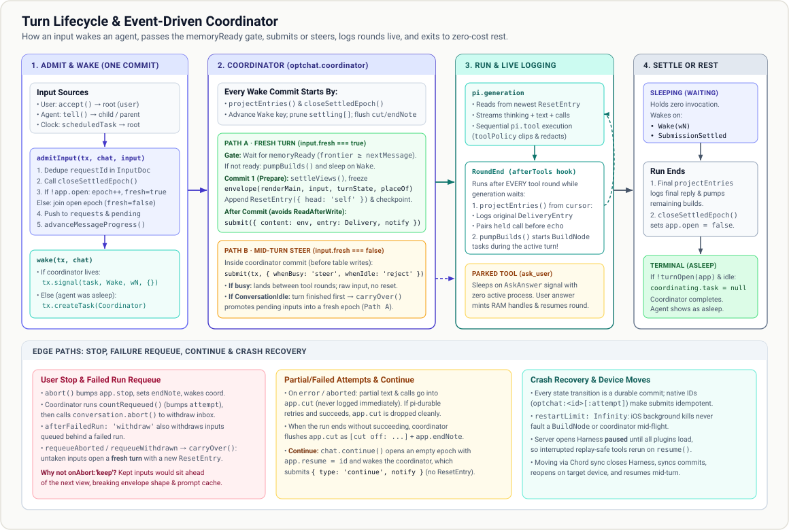
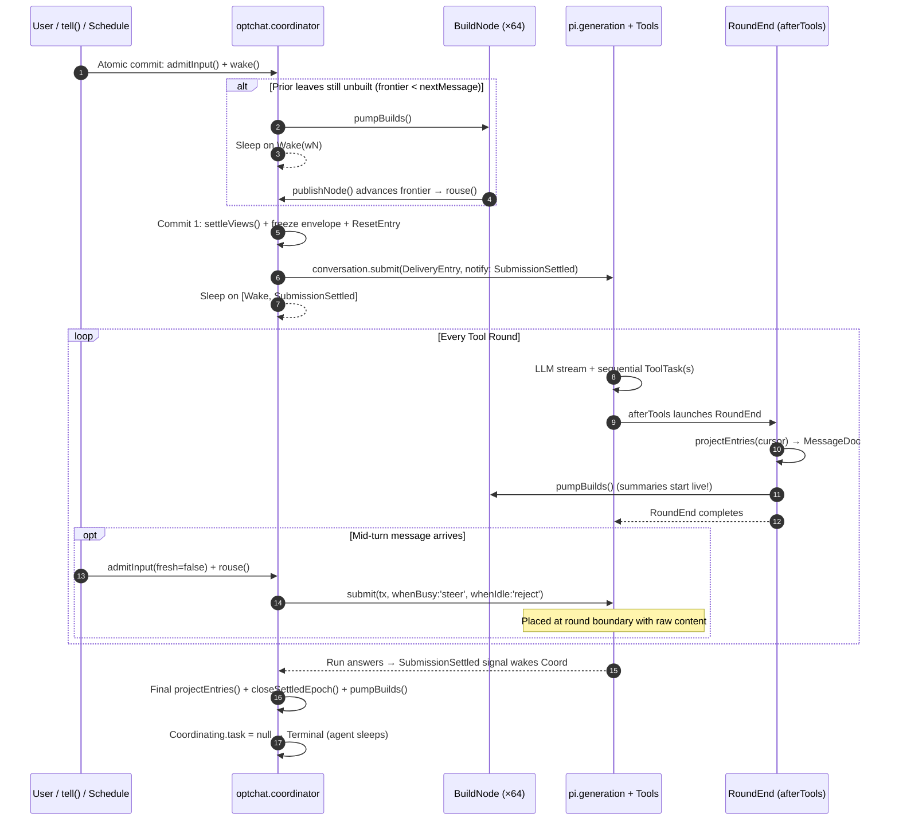

# 02 · How Turns Work: Admission, Coordinator, Steering & Recovery

[← Context & Prompt Cache](01-context-and-prompt-cache.md) · [Overview](README.md) · [Next: Memory, Summaries & Zoom →](03-memory-summaries-and-zoom.md)

Every agent in InfiniChat is driven by an event-driven turn coordinator (`optchat.coordinator`, `app.ts`) built on
`pi-durable` tasks, documents, and signals. An agent has no polling loop and holds no running process while idle:
messages wake it, steer it if it is already running, and let it go back to sleep once its turn settles.



## 1. Terminology: InfiniChat Epochs vs. `pi-durable` Runs & Rounds

Three nested units of execution cooperate during a conversation:

- **Turn (InfiniChat Epoch, `AppDoc.epoch`)**: begins when an input (or `Continue`) arrives while `!app.open`,
  and ends when the resulting `pi-durable` run finishes and all of its entries, cut-off notes, and withdrawn inputs
  have been processed. A turn spans one `ResetEntry` envelope plus every mid-turn steer that joined it.
- **Run (`pi.live.run`)**: pi-durable's native execution of a submitted input, which may loop through multiple
  model calls and tool rounds before settling its submission(s) as `done` or `unanswered`.
- **Tool Round**: one model `GenerationTask` emitting tool calls, the sequential `ToolTask` executions for those
  calls, and InfiniChat's `RoundEnd` hook task (`afterTools`) before the next generation call begins.

`turnOpen(app)` (`app.ts`) reports whether the agent is still busy—either because `app.open` is true, inputs
still sit in `app.pending`, `app.cut` or `app.endNote` have yet to be flushed to memory, or a `Continue` is
queued in `app.resume`. Both the UI busy indicator and the `Continue` guard use `turnOpen(app)`.

## 2. Step 1 — Idempotent Admission & Waking (`admitInput` + `wake`)

Every external event enters an agent's conversation through the exact same atomic helper, `admit(tx, chat, input)`:

- **User message**: `OptChat.accept()` admits to `ROOT_CONVERSATION_ID` with `kind: 'user'`.
- **Parent → child `tell` / `spawn`**: admits to the child's conversation with `kind: 'user'` and request ID
  `tell:<toolTaskId>` or `spawn:<toolTaskId>`.
- **Child → parent `tell`**: admits to the parent's conversation with `kind: 'work'` and content
  `[<childName>]
<message>`.
- **Scheduled task**: root's `optchat.scheduled-task` admits to root with `kind: 'work'`, content
  `[Scheduled task]
<task>`, and request ID `optchat:scheduled:<taskId>[:run]`.
- **Note**: `kind: 'note'` appends a non-waking memory note directly via the coordinator without starting a model run.

Inside one atomic commit:

1. **Idempotency (`InputDoc`)**: looks up `InputDoc(chat, requestId)`. If the same `requestId` already exists with
   the same `kind` and `content`, admission returns immediately (safe across network retries and crash replays). If
   the payload differs, it throws.
2. **Epoch assignment (`AppDoc`)**: calls `closeSettledEpoch(tx, chat)` first to close any prior run that already
   finished. For non-note inputs:
   - If `!app.open`, this input opens a **fresh turn**: `app.epoch++`, `app.open = true`, `app.started = false`,
     `app.requests = []`, and `input.fresh = true`.
   - If `app.open`, this input joins the running epoch as a **steer**: `input.fresh = false`.
   - The `requestId` is appended to `app.requests` and `app.pending`, and `advanceMessageProgress()` bumps
     `MemoryDoc.messageProgress` so any previously failed summary builds are re-enabled immediately.
3. **Waking the coordinator (`wake`)**: calls `rouse(tx, chat)` (`wake.ts`), which delivers `Wake` on key
   `w${coordinating.key}` if a live coordinator exists. If `coordinating.task === null` (or the signal reports the
   task ended), `wake` creates a fresh background `optchat.coordinator` task and records its `TaskId` in
   `CoordinatorDoc.task`.

> **Key invariant**: an agent is considered **"awake"** (both in `placeOf()` for its parent's prompt and in
> `AgentList` for the UI) if and only if its `CoordinatorDoc.task` points to a non-terminal `optchat.coordinator`
> task.

## 3. Step 2 — The Coordinator Loop & The `memoryReady` Gate

`optchat.coordinator` is a single-phase (`coordinate`) durable task. On every wake—whether from `Wake`,
`SubmissionSettled`, or a process restart—it executes one atomic decision commit, optionally performs one external
`conversation` action (`submit` or `abort`), and either loops immediately or goes back to sleep.

### What Every Coordinator Commit Does First

1. **Reads `turnState` outside the commit** (only if `app.pending.length > 0`) so host I/O (such as querying
   connected machines) never blocks a transaction.
2. **Projects any new native entries** via `projectEntries(tx, chat)` (up to 128 entries per commit).
3. **Closes settled epochs** via `closeSettledEpoch(tx, chat)`: checks `LiveDoc.run`, `InboxDoc.items`, and every
   `app.requests` receipt. If the run finished with a `runFailure` (other than `aborted` or
   `nothing_to_answer`), records `app.endNote` (e.g. `No reply: <reason>. Send a message to try again.`) and sets
   `app.open = false`.
4. **Advances signal bookkeeping**: increments `coordinating.key` past the consumed `Wake` key (pi-durable enforces
   one wait per signal key) and prunes settled keys from `coordinating.settling`.
5. **Flushes ended partial/failed attempts**: once no run is active and projection is caught up, logs any buffered
   `app.cut` records tagged `[cut off: <why>]` and any `app.endNote` as a `note` message in memory.

### Path A: Dispatching a Fresh Turn (Two-Step Prepare → Submit)

When the head of `app.pending` has `input.fresh === true`:

1. **The `memoryReady` gate**: checks `memoryReady(tx, chat)` (`MemoryDoc.frontier >= MemoryDoc.nextMessage`).
   - If prior messages still have unbuilt leaf summaries, the coordinator **does not start the turn yet**. It calls
     `pumpBuilds(tx, chat)` and sleeps on `Wake`.
   - Meanwhile, `InfiniChatView` watches `MemoryDoc` and shows *"Writing memory · N lines left"* (or *"Memory can't
     be written: …"* if the summary model is stalled).
   - As soon as the last leaf's `BuildNode` publishes and advances `frontier === nextMessage`, `BuildNode` calls
     `rouse(tx, chat)` in its publish commit, waking the coordinator immediately!
2. **Commit 1 (Prepare + Reset)**: once `projection.caughtUp && memoryReady`, the coordinator calls
   `settleViews(tx, chat)`, freezes `input.envelope = envelope(renderMain, input.content, turnState, placeOf)`,
   sets `input.phase = 'prepared'` and `app.started = true`, and appends `ResetEntry` (`{ head: 'self' }`).
3. **Post-commit submission**: **why isn't `conversation.submit()` called inside Commit 1?** Because `pi-durable`
   enforces that `submit(tx, …)` must occur *before* a commit's table writes (`ReadAfterWrite`), yet an idle
   admission places the delivery entry immediately and must land *after* `ResetEntry`. Checkpointing `phase =
   'prepared'` with the frozen `envelope` solves both atomically and crash-safely: if the process dies between Commit
   1 and `submit()`, the restarted coordinator sees `input.phase === 'prepared'`, reads the committed envelope back
   via `runtime.snapshot(InputDoc, …)`, and submits it with the deterministic native request ID
   `optchat:<requestId>[:attempt]` and `notify: { taskId, key }`.
4. **Commit 2 (Mark Submitted)**: marks `input.phase = 'submitted'`, clears `input.envelope = null` (freeing the
   duplicate copy from `InputDoc`), removes the request from `app.pending`, and records `key` in
   `coordinating.settling`.

### Path B: Mid-Turn Steering (In-Commit Submit + `carryOver` Fallback)

When the head of `app.pending` has `input.fresh === false`:

- Inside the coordinator's commit (before any table write), it calls:
  ```ts
  await conversation.submit(tx, {
    type: 'input',
    requestId: key,
    content: input.content,      // raw content — no ResetEntry, no envelope!
    whenBusy: 'steer',
    whenIdle: 'reject',
    entry: { kind: DeliveryEntry.kind, data: { requestId: input.requestId, kind: input.kind } },
    notify: { taskId: task.id, key },
  });
  ```
- **If the run is still busy**: pi-durable queues the steer in `pi.inbox` and places it after the current tool round.
- **If the run finished just before this commit**: `submit(tx, …)` throws `ConversationIdle` *before* any write. The
  coordinator catches it and calls `carryOver(tx, chat, pendingIds)`, which closes the finished epoch, opens a new
  epoch, flips the first pending input to `fresh = true`, and falls seamlessly into **Path A** on the next iteration!



## 4. Step 3 — Live Entry Projection During a Turn (`RoundEnd` & `projectEntries`)

Why wait until a long 20-step agent turn finishes to build summaries? InfiniChat hooks `GenerationTask`'s
`afterTools` lifecycle event (`app.ts`):

```ts
hook(GenerationTask, {
  afterTools: async () => ({ tasks: [hookTask(RoundEnd, null)] }),
})
```

After every tool round, pi-durable spawns `optchat.round-end` as a child task of the generation and waits for it
before calling the model again. `RoundEnd` scans immutable native entries forward from `AppDoc.cursor` in pages of
128 entries via `projectEntries(tx, chat)` and calls `pumpBuilds(tx, chat)`. Thus, summaries for earlier tool rounds
are already built while the turn is still working—making the next turn start almost instantaneously!

### Careful Details Inside `projectEntries()`

- **Original inputs, never envelopes**: when `DeliveryEntry.is(entry)`, `projectEntries` loads the original
  `InputDoc(chat, requestId)` and appends that raw text + images to `MessageDoc`, ignoring the envelope wrapper.
  (It passes `advanceProgress = false` because `admitInput` already bumped `messageProgress`.)
- **Thinking stays native**: `assistant` blocks of type `thinking` are skipped—they remain in pi-durable's native
  history for the UI transcript, never entering memory or future model calls.
- **Holding tool calls until their results (`app.held`)**: when an assistant message emits a `toolCall`, its record
  is placed in `app.held[block.id]` rather than logged immediately. When the matching `toolResult` arrives, the held
  `tool` record is appended right before its `echo` result, guaranteeing clean call→result adjacency even when an
  assistant emits multiple calls in one message.
- **Buffering failed or aborted attempts (`app.cut`)**: pi-durable commits an assistant message with `stopReason:
  'error' | 'aborted'` before retrying (or stopping). `projectEntries` stores that attempt's partial text/calls in
  `app.cut` without logging them to memory. If pi-durable's retry succeeds, `app.cut` is wiped to `null`, keeping
  transient retries out of memory. Only when the run actually ends without succeeding does the coordinator flush
  `app.cut` with `[cut off: <reason>]` markers.
- **Hosted OpenAI web search**: `SearchObservationEntry` records are projected into a synthetic `tool` + `echo`
  pair right after the reply that triggered them.
- **Output-limit truncation**: if `message.stopReason === 'length'`, sets `app.endNote` noting the cut.

## 5. Step 4 — Sleeping, Going Idle, Stops, Failure Requeueing & `Continue`

### Zero-Cost Sleep & Termination

At the end of a coordinator commit, if no work progressed and no action is queued:

- **Agent rests (Terminal)**: if `!turnOpen(app) && app.stopped >= app.stop && !running` and `InboxDoc` has no
  non-write items, the coordinator sets `CoordinatorDoc.task = null` and returns `status: 'terminal'`. The agent is
  now completely asleep with zero running tasks.
- **External run fallback (Waiting)**: if a run is active that this coordinator did not submit (for example, a run left
  from an earlier version or an `afterRun` plugin hook), it commits `status: 'waiting', on: [live.run.taskId],
  policy: 'allSettled'`.
- **Normal wait (Sleeping)**: otherwise it commits `status: 'sleeping'` on `[Wake.key(wN),
  ...coordinating.settling.map(SubmissionSettled.key)]`.

### Stopping a Turn & Requeueing Untaken Inputs

When the user taps **Stop** (`OptChat.abort(agent)`):

1. An atomic commit increments `app.stop`, appends `"Stopped by the user."` to `app.endNote`, clears
   `app.resume`, and wakes the coordinator. (Only affects that single agent; children and summaries continue.)
2. The coordinator detects `app.stop > app.stopped`, calls `countRequeued(tx, chat)` to increment `input.attempt`
   for any input still `queued` in `pi.inbox`, then calls `conversation.abort()` outside the commit.
3. `conversation.abort()` aborts the active run and withdraws queued inbox submissions.
4. In the follow-up commit, `app.stopped = stop` and `requeueAborted(tx, chat)` gathers all inputs whose new
   `attempt` has no submission yet and calls `carryOver()` to launch them as a **fresh turn** (with a new
   `ResetEntry` and fresh `<chat>` view!).

The exact same recovery applies when a run fails: Harness configures `afterFailedRun: 'withdraw'`, so pi-durable
withdraws queued submissions as `{ status: 'unanswered', reason: 'run_failed' }`. `requeueWithdrawn()` detects
those receipts, bumps `input.attempt`, and runs `carryOver()`.

> **Why not pi-durable's `onAbort: 'keep'`?** Kept inbox items would be placed by pi-durable *ahead* of InfiniChat's
> next `ResetEntry` and `<chat>` view—violating the prompt shape, busting cache alignment, and failing to wake a
> sleeping agent. Requeueing untaken messages through `carryOver()` guarantees that messages from children or
> scheduled tasks are never lost while preserving the exact fresh-turn envelope invariant.

### Continuing a Failed or Stopped Run (`OptChat.continue`)

If a run ends with a `runFailure` (network error, missing model, user stop), the UI offers **Continue**:

- Refused while `turnOpen(app)` is true so the previous turn finishes closing first.
- Opens an epoch with `app.open = true, app.started = true, app.requests = [], app.resume =
  "optchat:continue:<epoch>:<rev>"` and wakes the coordinator.
- The coordinator submits `{ type: 'continue', requestId, notify: { taskId, key } }` without a `ResetEntry`, so the
  model resumes right where the interrupted run left off—and any message arriving meanwhile steers it normally.

## 6. Special Durable Primitives Inside a Turn: `ask_user` & `schedule_task`

### Parked Structured Questions & Ephemeral Secrets (`ask.ts`, `secrets.ts`)

Any agent (root or child) can call `ask_user` with a batch of `text` and `secret` questions:

- On its first call, `ask_user` validates the batch (requiring a non-empty `purpose` on every `secret` item),
  writes its `AskCheckpoint` to `api.details`, and returns `{ sleep: { signals: [AskAnswer.key('answer')],
  checkpoint } }`.
- The `pi.tool` task parks durably—holding no execution worker or QuickJS sandbox—and survives restarts and moves.
- `PendingQuestions` watches the task graph (`harness.inspect`) for parked `pi.tool` tasks sleeping on
  `optchat.ask-answer` across the entire tree and renders a unified banner in iOS and Mac apps.
- When the user submits answers (`answerQuestionBatch`), raw secret values are **minted only into in-memory
  `SecretVault`** (30-minute TTL, wiped on clear/relinquish/restart). The durable `AskAnswer` signal receives only
  opaque handles (`{{secret:s_<hex>}}`).
- Handles are resolved strictly at execution boundaries—`bash` via its `secrets` env-var map (rejecting raw handles
  in `command`), `write`, `edit`, and MCP arguments—while `SecretVault.createStreamRedactor()` and
  `toolPolicy`'s `redactResult()` scrub live secret values across streaming chunks, outputs, and JSON details.

### Scheduled Tasks (`schedule.ts`)

Root alone has the `optchat.master` extension (`schedule_task`, `list_scheduled_tasks`,
`change_scheduled_task`, `cancel_scheduled_task`):

- `schedule_task` creates a conversation-owned background `optchat.scheduled-task` using `api.createTask(…, { key:
  'scheduled' })` so a crash-replayed tool call cannot double-schedule.
- The task sleeps durably on the Harness clock (`runtime.sleepUntil(due, …)`) with zero active invocation.
- When `due <= runtime.now()`, one atomic commit admits `[Scheduled task]
<task>` to root as `kind: 'work'` and
  either completes (one-shot) or computes the next future local-clock occurrence (skipping any missed ticks during
  downtime) and returns `status: 'sleeping'`.
