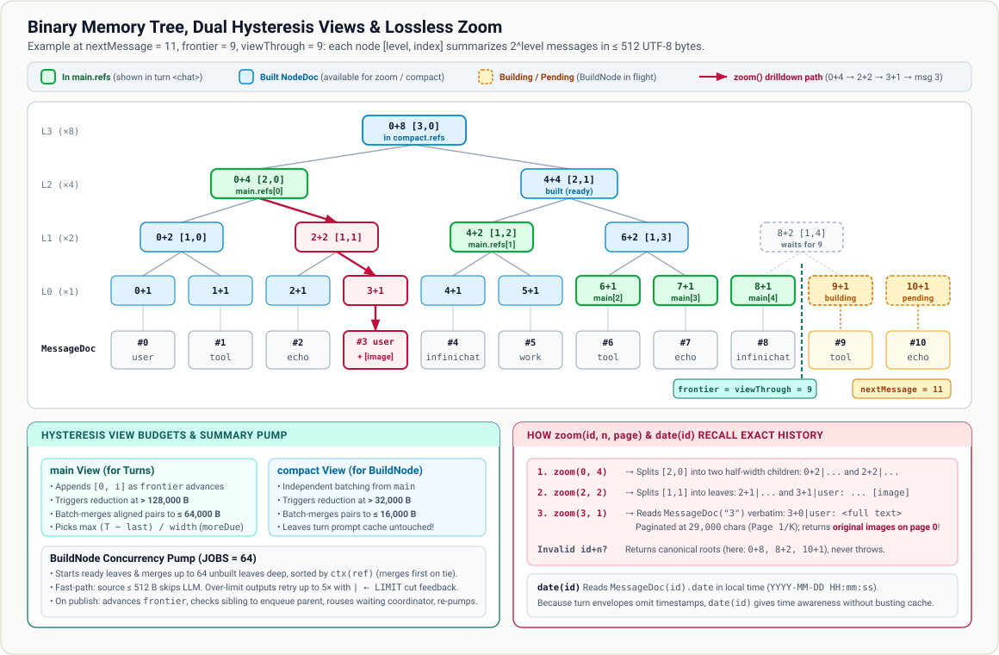
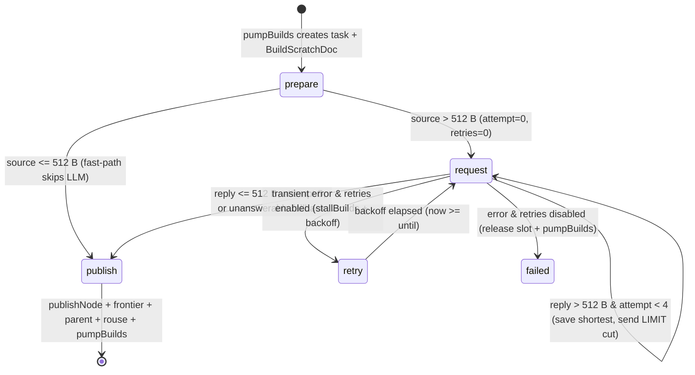

# 03 · The Memory Tree, Background Summaries & Zoom

[← Turns & Coordinator](02-turns-and-coordinator.md) · [Overview](README.md) · [Next: Agent Tree & One Conversation →](04-agent-tree-and-one-conversation.md)

Linear context windows inevitably hit a wall: either you truncate old history or you collapse it into a single lossy
summary that degrades on every subsequent re-summarization. InfiniChat solves this by storing every message verbatim in
a permanent append-only log (`MessageDoc`), building a **complete binary tree of fixed-budget summaries**
(`NodeDoc`) on top of it in the background, projecting two cache-friendly **hysteresis views** (`main` and
`compact`), and exposing `zoom` and `date` so the agent can inspect any detail at full fidelity on demand.



## 1. The Canonical Message Log (`MessageDoc`)

Each agent's conversation maintains its own independent canonical message log in `memory.ts`, indexed sequentially
from `0` to `MemoryDoc.nextMessage - 1`:

```ts
type CanonicalMessage = {
  i: number;
  kind: 'user' | 'infinichat' | 'tool' | 'echo' | 'work' | 'note';
  text: string;
  bytes: number;
  date: string;       // ISO-8601 timestamp
  source: string;     // provenance: "input:<reqId>", "<entryId>:<idx>", "end:<epoch>:<stop>"
  images: { data: string; mimeType: string }[];
};
```

- **Six kinds**:
  - `user`: messages from the agent's parent (the human user for `root`).
  - `work`: reports from children (`[childName]
…`) or scheduled tasks (`[Scheduled task]
…`).
  - `infinichat`: the agent's own trimmed final replies (private notes kept for its future turns).
  - `tool`: tool calls (`<name> <jsonArgs>`), logged immediately before their results.
  - `echo`: tool results (images noted as `[image]`; errors prefixed `error: `).
  - `note`: harness notices (stops, failures) or imported notes.
- **Bounding huge messages (`TEXT_LIMIT = 30,000` Unicode scalars)**:
  - For `kind === 'echo'`, `clipToolText()` keeps the first 15,000 and last 14,936 Unicode scalars with a
    `[... N characters cut ...]` marker so one massive command output stays a single record.
  - For all other kinds, text longer than 30,000 characters is split across consecutive `MessageDoc` entries (with
    attached `images` stored on chunk 0 only).
- **Permanent & immutable**: `MessageDoc` uses `checkpointWhen: () => false` (written once, never mutated) and is
  never pruned—it is the lossless ground truth that `zoom(id, 1)` reads back.

## 2. The Binary Summary Tree (`NodeDoc`)

Over the canonical messages `0 .. nextMessage - 1`, InfiniChat constructs a complete binary tree of summary nodes
(`NodeRef = [level, index]`), stored in `NodeDoc` under key `"${level}:${index}"`:

- **Coverage**: node `[l, i]` covers `width = 2^l` consecutive messages starting at `first = i * 2^l` through
  `end - 1 = first + width - 1`.
- **Rendered line format (`nodeLine`)**:
  ```text
  <first>+<width>|<flattened text>
  ```
  For example, `0+8|user: …` summarizes messages 0 through 7; `12+1|user: …` summarizes message 12 alone.
- **Leaf nodes (`l = 0`)**: compress one canonical message (`shownMessage(m)`, which appends `\n[image]` per
  image so the agent knows an image exists to zoom into) into ≤ **512 UTF-8 bytes**.
- **Parent nodes (`l > 0`)**: merge two aligned adjacent siblings `[l - 1, 2i]` and `[l - 1, 2i + 1]` into one
  line of ≤ **512 UTF-8 bytes**.
- **Bottom-up readiness (`publishNode`)**:
  - When a leaf `[0, i]` publishes, it leaves `pendingLeaves` and advances the contiguous `frontier` pointer
    while every leaf `0 .. frontier - 1` exists.
  - For any published node `[l, i]`, `publishNode` checks its aligned sibling (`i ^ 1`). If the sibling already
    exists, their parent `[l + 1, floor(i / 2)]` is immediately pushed onto `readyParents`.

Because every node in a binary tree of `N` messages has a unique parent, the total number of summary nodes ever built
is at most `2N - 1`—strictly **`O(N)` total work** over the lifetime of an infinite conversation!

## 3. Dual Hysteresis Views (`main` & `compact`)

A naive memory tree that always showed the coarsest possible cover would constantly reshuffle lines as new powers of 2
complete, destroying the LLM's prefix KV cache on every turn. InfiniChat avoids this with **two separate,
hysteresis-controlled views** stored in `MemoryDoc`:

| View | Used By | High-Water Trigger | Low-Water Reduction Target | Purpose |
| --- | --- | --- | --- | --- |
| **`main`** | Fresh turns (`renderMain`) | `> 128,000` bytes | `≤ 64,000` bytes | Gives the active agent a generous ~30–40k-token rolling horizon of recent details plus logarithmic long-term memory. |
| **`compact`** | `BuildNode` summary calls (`renderCompaction`) | `> 32,000` bytes | `≤ 16,000` bytes | Gives summary builds compact context to resolve pronouns/references without paying for a 128 KB window or invalidating the turn cache. |

### How `settleViews()` Preserves Prefix Cache

1. **Advances strictly on contiguous leaves**: `settleViews` loops while `viewThrough < frontier`. For each newly
   available leaf `i`, it appends `[0, i]` to the tail of both `main.refs` and `compact.refs`.
2. **No surprise mid-stream rewrites**: a parent `NodeDoc` finishing in the background never triggers a view change
   on its own. Views only evaluate reduction when a leaf boundary advances `viewThrough`.
3. **Batch hysteresis**: once a view's summed `node.bytes` exceeds its high-water mark (128 KB or 32 KB),
   `view.reducing` flips to `true`, and `reduceView()` repeatedly merges adjacent aligned pairs `([l, 2k], [l,
   2k+1]) → [l+1, k]` whose parent node already exists until total size drops to or below the low-water target (64 KB
   or 16 KB).
4. **The `moreDue` priority heuristic**: among all mergeable sibling pairs currently in `view.refs`, which pair
   gets merged first? `moreDue(a, b, T)` compares:
   ```text
   score(pair) = (T - last) / width
   ```
   where `T = viewThrough`, `width = 2^l` is each child's width, and `last = first(a) + 2 * width - 1` is the
   newest message covered by the pair (computed with exact `BigInt` cross-multiplication `an * bw - bn * aw` to avoid
   floating-point drift; ties go to the oldest `first(a)`).
   - **Intuition**: older pairs have larger `T - last`, and narrower pairs have smaller `width`. Thus the view
     compresses **oldest and finest-grained** history first, producing a smooth logarithmic gradient: recent turns stay
     at full `+1` resolution while weeks-old history collapses into `+64`, `+256`, or `+1024` lines!
5. **Cutoff rendering (`cutoffLines`)**: when `BuildNode` renders context for a node covering up to `cutoff`,
   `cutoffLines()` walks `compact.refs` and recursively splits any node straddling `cutoff` into its children so a
   leaf summary for message `i` only sees messages `0 .. i - 1`, and a merge node sees up to `end(ref) - 1`.

## 4. The Background Summary Engine (`BuildNode` & `pumpBuilds`)

Summaries run as conversation-owned background `pi-durable` tasks (`optchat.build-node`, `summary.ts`).

### Concurrency Pump (`pumpBuilds`, `JOBS = 64`)

Every commit that adds work or finishes a summary calls `pumpBuilds(tx, chat)` (called from `RoundEnd`,
`optchat.coordinator`, and `BuildNode`'s own `publish` phase):

- Waits if `ConfigDoc.summary === null` (no summary model selected yet).
- Caps concurrency at `JOBS = 64` active `BuildNode` tasks per conversation and caps lookahead depth at
  `deepest = pendingLeaves[63] ?? nextMessage`.
- Collects all eligible pending leaves and ready parents with `ctx(ref) <= deepest` (where `ctx([0, i]) = i` and
  `ctx([l, i]) = (i + 1) * 2^l`), sorted by `ctx(ref)` ascending with **merges prioritized on ties** (`b[0] -
  a[0]`).
- For each candidate, `freeze()` snapshots its `source`, prompt `task` (including a 512-hyphen ASCII visual
  ruler), and `compact` `view` into task-scoped `BuildScratchDoc`, starts `BuildNode`, and records its task ID
  in `MemoryDoc.active[key]`.

### The 4-Phase `BuildNode` State Machine



Key design details in `BuildNode`:

- **≤ 512-byte fast path**: short messages (most user turns, short tool calls, short replies) skip the LLM entirely in
  `prepare` and publish verbatim in 0 tokens!
- **Byte-exact 512-byte enforcement**: if the summary model writes more than 512 UTF-8 bytes, `BuildNode` retries up
  to 5 attempts. Rather than sending the whole chain of failed tries, each retry appends one concise feedback part
  showing the exact byte count and exact UTF-8 cut point:
  ```text
  Too long: your last line for this <input> was 584 bytes,
  over the 512-byte limit. Write the whole line again, cutting just
  enough of the least valuable items to fit before this cut:
  <first 512 UTF-8 bytes>| ← LIMIT
  ```
  Across attempts it keeps `d.shortest`, publishing the shortest line obtained if attempt 5 still exceeds 512 bytes.
- **Unanswerable replies vs. transient outages**:
  - If the model refuses, hits output length, returns empty text, or emits a tool call despite `toolChoice: 'none'`
    (`unanswerable()`), retrying won't help: `BuildNode` falls back to `d.shortest ?? prefixUtf8(flat(d.source),
    512)` and publishes immediately so memory never deadlocks.
  - On transient provider/network/auth failures, `BuildNode` records the error in `MemoryDoc.stalled` (visible to
    the user in `InfiniChatView`) and sleeps patiently using pi-ai's `retryDelayMs()` backoff (capped at 1 minute)
    until the provider recovers, clearing `stalled` once any summary succeeds.
- **Separate spend tracking**: every summary request's token usage and cost (even failed ones) is added to root's
  `MemoryUsageDoc` (`optchat.usage`) in the same commit, letting the UI display conversation spend vs. memory spend
  separately.
- **Self-pumping publish**: the `publish` commit atomically writes `NodeDoc`, updates `frontier` / `readyParents`
  / views, calls `rouse(tx, chat)` if `memoryReady()` is now true (waking any waiting turn immediately!), and calls
  `pumpBuilds()` to launch newly unlocked parent merges and queued leaves.

## 5. How `zoom(id, n, page)` and `date(id)` Work (`tools.ts`)

Because every summary line in `<chat>` carries its exact tree address `id+n`, the agent treats `<chat>` as a
clickable index over its entire life history:

### `zoom({ id, n = 1, page = 0 })`

1. **Address validation**: checks that `id` is a non-negative integer (accepting numeric strings too), `n` is a
   power of 2 (`Number.isInteger(Math.log2(n))`), `id % n === 0`, and `id + n <= MemoryDoc.nextMessage`.
2. **Self-correcting error message**: if the model passes an invalid address, `zoom` returns a helpful text answer
   (not a thrown error) listing the tree's exact canonical binary roots via `roots(count)`—e.g. for 11 messages:
   ```text
   No line 3+4: n is a power of 2, id a multiple of n. The tree's roots: 0+8, 8+2, 10+1.
   ```
3. **Expanding an internal summary (`n > 1`)**: computes `l = log2(n) - 1` and reads the two child `NodeDoc`
   records `[l, id / (n / 2)]` and `[l, id / (n / 2) + 1]`. Returns both lines (or
   `"<first>+<width>|(not summarized yet: zoom it)"` if a child is still building, allowing the model to keep zooming
   straight down into raw messages!).
4. **Opening a canonical message (`n === 1`)**: reads `MessageDoc(chat, String(id))` and formats it with the
   UniiChat `+0` verbatim header:
   ```text
   Page 1/1
   3+0|user: Here is the screenshot of the layout bug
   [image]
   ```
   - **Pagination**: text is paginated at `PAGE = 29,000` Unicode scalars (`Page 1/K; call zoom again with page=1`),
     fitting cleanly within `toolPolicy`'s 30,000-character clip limit.
   - **Lossless image recall**: on `page === 0`, `zoom` attaches the original `ImageContent[]` blocks saved in
     `MessageDoc.images` directly into the tool result, so an agent can visually re-inspect a photo or screenshot
     from weeks ago!

### `date({ id })`

Reads `MessageDoc(chat, String(id)).date` and returns it in the host device's local time (`toLocaleString('sv-SE')`,
e.g. `2026-11-24 14:32:08`), or `No message <id>.` if out of bounds. Both `zoom` and `date` are marked
`replay: 'safe'` (pure snapshot reads against the calling conversation's `api.conversationId`).
