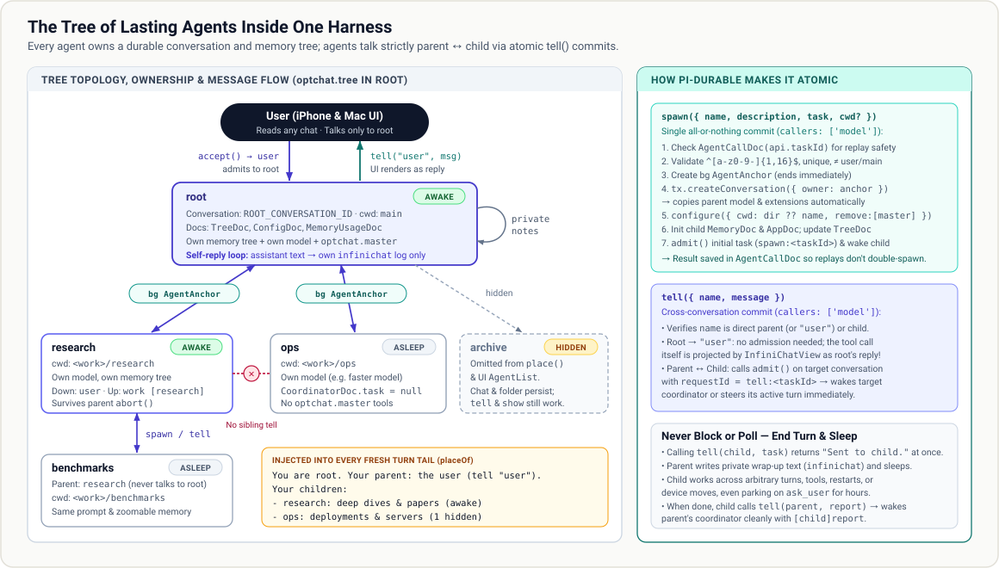

# 04 · Subagents, the Tree of Agents & Putting It All Together

[← Memory, Summaries & Zoom](03-memory-summaries-and-zoom.md) · [Overview](README.md) · [Next: Runtime Topology, Chord & Server →](05-runtime-topology-chord-and-server.md)

The final piece of InfiniChat's architecture is **how a single never-ending conversation scales to handle parallel,
long-lived domains of work** without collapsing everything into one noisy thread or spawning disposable fire-and-forget
subagents that forget what they learned.

In InfiniChat, **every subagent is a permanent citizen of the same durable session**: a tree of lasting agents
(`TreeDoc`), each with its own pi-durable `Conversation`, its own binary memory tree, its own working directory,
and its own model selection—all inside one `Harness` and one Chord store.



## 1. The Agent Tree (`TreeDoc`, `agents.ts`)

Root's conversation stores a single `TreeDoc` (`optchat.tree`) describing the entire hierarchy:

```ts
type TreeAgent = {
  conversationId: ConversationId;
  parent: string | null;          // null for root (whose parent is "user")
  description: string;            // ≤ 128 chars
  cwd?: string;                   // optional project dir ("~/..." or "/...")
  children: { name: string; hidden: boolean }[];
};
type Tree = {
  agents: Record<string, TreeAgent>;
  since: { message: number; at: number } | null; // legacy migration boundary
};
```

Every agent in the tree—`root`, its children, and even grandchildren—shares:

- The **same single `Harness` and Chord store** (`infinichat-store.db`) in one host process.
- The **same static system prompt** (`sharedPrompt`, maximizing Tier 1 KV cache sharing across all agents).
- The **same memory, turn, and zoom machinery** (`MemoryDoc`, `MessageDoc`, `NodeDoc`, `AppDoc`,
  `CoordinatorDoc`, `optchat.coordinator`, `RoundEnd`, `BuildNode`).

And each agent owns independently:

- Its own **pi-durable `Conversation`** and immutable transcript.
- Its own **model and reasoning effort** (`pi.agent`), configurable per agent from the UI (`AgentChat.setModel`).
- Its own **working directory** (`<work>/main` for root; for a child, an optional project `cwd` such as
  `~/expo-pi` when present on the target machine, falling back to its scratch folder `<work>/<name>` where absent
  or on the phone—stored in `pi.agent.cwd` and `TreeAgent.cwd` and resolved in `device-tools.ts`).
- Its own **binary memory tree**—a child's noisy research traces never pollute root's `<chat>` view.

## 2. Atomic `spawn` & Background `AgentAnchor` Ownership

When an agent calls `spawn({ name, description, task, cwd? })` (marked `callers: ['model']` so on a server with code mode
it is always a first-class call visible in the transcript, never buried inside a script), everything happens in **one
atomic pi-durable commit**—whole or not at all:

1. **Replay idempotency**: checks `AgentCallDoc(callerConvId, String(api.taskId))`. If a crash interrupted the tool
   after the commit succeeded but before its result was recorded, the replay returns the saved reply without spawning
   twice.
2. **Validation**: verifies `name` matches `/^[a-z0-9-]{1,16}$/`, is unique across the whole tree, is neither
   `"user"` nor `"main"` (reserved for root's parent and folder), and `description.length <= 128`. Validation
   failures return plain text explanations so the model can self-correct.
3. **Background `AgentAnchor` ownership**:
   ```ts
   const anchor = await tx.createTask(AgentAnchor, null,
     { ownership: { kind: 'conversation' }, background: true });
   const child = await tx.createConversation({ ownership: { kind: 'task', taskId: anchor } });
   ```
   Why create a tiny task (`optchat.agent-anchor`) that completes immediately just to own the child conversation?
   - **Inheritance**: in `pi-durable`, creating a conversation owned by a task copies the owning conversation's
     `AgentDoc` (model, thinking level, extensions, `modelTools`) automatically—so a child starts on its parent's
     model and host tool configuration.
   - **Abort & idle isolation**: in `pi-durable`, a `{ background: true }` task forms an ownership boundary.
     Aborting the parent (`Stop`) never aborts the child, and a child working in the background never blocks the
     parent from finishing its turn and going to sleep!
4. **Child configuration**: `configure(tx, child.id, { cwd: projectDir ?? name, extensions: { remove:
   [setup.master()] } })` sets the child's project directory (or default scratch folder name) and removes
   `optchat.master` (so only `root` can schedule clock tasks).
5. **Initialization, tree registration & first wake**: initializes the child's `MemoryDoc` and `AppDoc`, inserts
   the child into root's `TreeDoc`, admits `task` into the child's conversation with `requestId:
   "spawn:<taskId>"` and `kind: 'user'` (which immediately starts the child's `optchat.coordinator`), and saves
   the reply in `AgentCallDoc`.

*(Note: the `conversationCreated` hook registered in `InfiniChatService.open` also initializes
`SearchPresentationsDoc` on every newly spawned child conversation inside that same commit.)*

## 3. Strict Tree Communication (`tell`) & Private Self-Replies

Two simple communication rules keep multi-agent coordination clean and prevent runaway chat loops:

### Rule 1: Talk Only to Your Direct Parent or Direct Children

`tell({ name, message })` (also `callers: ['model']`, `replay: 'safe'`) checks `TreeDoc` in one commit:

- **Parent → Child**: admits `message` into `child.conversationId` as `kind: 'user'` with `requestId:
  "tell:<api.taskId>"`. If the child is asleep, this spawns its coordinator; if it is already running a turn, the
  message steers it between tool calls.
- **Child → Parent**: admits `"[<self>]\n<message>"` into `parent.conversationId` as `kind: 'work'` with the
  same crash-safe `requestId`.
- **Root → `"user"`**: admits nothing to any other conversation—the `tell("user", message)` tool call itself *is*
  root's reply to the user!
- **Anyone else** (siblings, grandchildren, unknown names): refused with a helpful list of reachable neighbors.

Because `tell` returns `"Sent to <name>."` immediately without waiting, **agents never block or poll**. A parent
delegates work with `tell`, finishes its turn, and sleeps at zero cost until the child calls `tell(parent, …)`
minutes, hours, or days later.

### Rule 2: Normal Replies Stay Private; `tell` Is Your Voice

Every agent's plain assistant text (`infinichat`) is **never delivered to anyone**—it stays strictly in that agent's
own memory as private working notes for its later turns (e.g. what it learned, next steps, or `"Done."`).

In the UI, `InfiniChatView.spoken()` (`infinichat-view.ts`) mirrors this semantics cleanly for every agent screen:

- Any `tell` call addressed to the agent's parent (`"user"` for root, parent name for a child) is projected as a
  **normal assistant message bubble** (even while its JSON arguments stream).
- Plain assistant text (`infinichat`) is folded into the turn's collapsible **thinking / steps** block, so the human
  reader sees clear answers at a glance while still being able to expand any agent's internal reasoning and tool steps.
- The user can open and read **any** visible child's conversation in the Agents menu, stop its turn, or change its
  model, while always conversing with `root`.

### Hiding & Showing Agents (`hide`, `show`, `list`)

When a child's job is done, its parent can call `hide(name)`, flipping `children[].hidden = true` in `TreeDoc`.
Hidden children disappear from `placeOf()` (which shows only `(N hidden)`) and from the UI's `AgentList`, keeping
prompts and sidebars tidy. Their conversation, memory tree, and work folder remain intact: `list()` lists hidden
children, `show(name)` restores them, and `tell()` can still wake them at any time.

## 4. Putting It All Together: Always One Conversation

Here is how every piece—`pi-durable`, Chord storage, context assembly, turns, steering, background summaries,
`zoom`, `ask_user`, `SecretVault`, and subagents—works together in one continuous lifecycle:

```mermaid
sequenceDiagram
  autonumber
  participant User as User (iPhone / Mac)
  participant Root as root Conversation
  participant Res as research Child
  participant Mem as BuildNode Pool
  participant Store as Chord Store (infinichat-store.db)

  User->>Root: "Compare our Q3 benchmark notes with the latest release"
  Note over Root: admitInput() + wake() → optchat.coordinator starts
  Note over Root: memoryReady gate passes → ResetEntry + envelope(main view, Devices, place, input)
  Root->>Root: zoom(0, 8) → zoom(4, 4) → zoom(5, 1) (recalls exact Q3 table + image!)
  Note over Root: RoundEnd (afterTools) logs zoom calls → MessageDoc, pumps BuildNode live
  Root->>Res: tell("research", "Run latest release benchmarks & compare against Q3 numbers")
  Note over Res: Same commit admits input + starts research's coordinator (AWAKE)
  Root->>User: tell("user", "On it — I pulled our Q3 numbers and asked research to run the new benchmarks.")
  Root->>Root: Private reply: "Waiting on research comparison." → Coordinator exits (ASLEEP)

  par Background work continues independently
    Res->>Res: Runs bash/code-mode on Linux machine in work/research
    Res->>User: ask_user([{ kind: "secret", label: "Registry token", purpose: "..." }])
    Note over Res: ToolTask parks on AskAnswer signal (zero active worker)
    User->>Res: Submits token → SecretVault (RAM only) mints {{secret:s_...}} → AskAnswer wakes tool
    Res->>Res: Runs benchmark with secret env var; toolPolicy redacts outputs
    Res->>Root: tell("root", "Benchmarks done: p99 dropped 38% ...")
    Res->>Res: Private reply: "Reported to root." → Coordinator exits (ASLEEP)
  and Summaries build continuously
    Mem->>Store: BuildNode compresses & merges nodes for both root and research
  end

  Note over Root: research's tell() wakes root! New ResetEntry carries updated main view
  Root->>User: tell("user", "Benchmarks are in: p99 dropped 38% vs Q3 ...")
  Root->>Root: Coordinator exits (ASLEEP)

  Note over User,Store: Later, user moves InfiniChat from Mac to iPhone via Chord session sync.<br/>Only recent commits transfer; all conversations, memory trees, parked asks & schedules continue seamlessly.
```

### Why This Creates Something Uniquely "Always One Conversation"

1. **Bounded context, unbounded history.** Every fresh turn resets pi-durable's model context to a compact,
   prefix-cached `<chat>` view while keeping 100% of canonical messages and images intact in `MessageDoc` for
   `O(log N)` `zoom()` recall.
2. **Cache efficiency by construction.** Static prompt sections, shared tool schemas, append-only dual hysteresis
   views, and post-`<chat>` placement of `Devices` and `placeOf()` turn an infinite history into mostly cache hits
   across both turns and summaries.
3. **Zero-idle-cost concurrency.** Ephemeral coordinators, `SubmissionSettled` and `Wake` signals, parked
   `ask_user` tools, and clock-sleeping `optchat.scheduled-task`s mean dozens of lasting agents can exist in the
   tree while consuming zero compute whenever they are not actively turning.
4. **Crash-, abort-, and move-proof durability.** Every transition—input admission, `ResetEntry` preparation, entry
   projection, summary publication, atomic `spawn` and `tell`, stop requeueing—is a `pi-durable` commit in one
   Chord store. Whether an iOS app suspends, a server restarts to reload plugins, or the user moves the conversation
   between an iPhone and a Linux/Mac machine via Chord sync, the entire tree picks up on the exact checkpoint where it
   left off.
