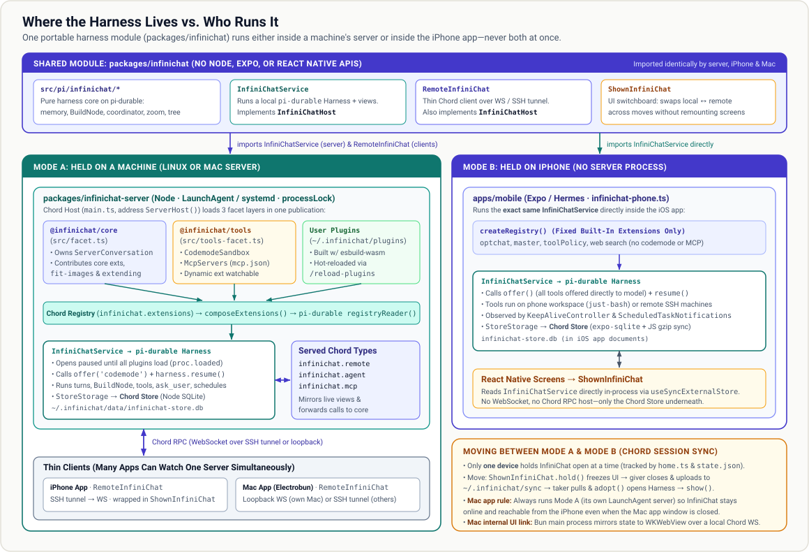
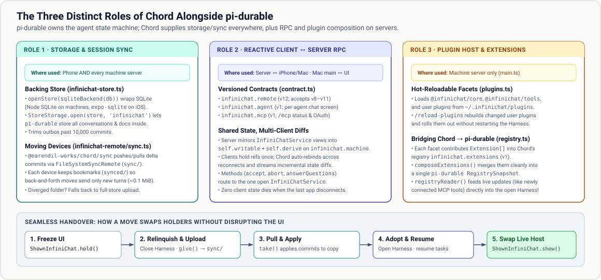
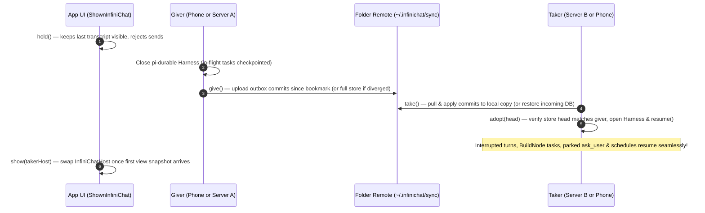

# 05 · Runtime Topology: `packages/infinichat`, `pi-durable`, Chord & the Server

[← Agent Tree & One Conversation](04-agent-tree-and-one-conversation.md) · [Overview](README.md)

The first four chapters describe what runs *inside* the InfiniChat harness. A common follow-up question is **where
that harness actually lives and executes**: does the server hold the harness logic, or do the apps? Is it its own
module? And how do `pi-durable`, `Chord`, and `packages/infinichat-server` divide the work?

The short answer: **the harness is its own portable module in `packages/infinichat/`**, and **whichever device
currently holds the conversation**—a machine's server or the iPhone itself—imports and runs that exact same module.
Only one device holds it open at a time.

## 1. One Portable Module, One `InfiniChatHost` Interface

Everything that defines InfiniChat's behavior lives once inside `packages/infinichat/src/pi/`, with zero Node, Expo,
or React Native dependencies in the shared core:

- **`src/pi/infinichat/*`** — the pure harness rules built on `pi-durable` (`openOptChat`, `optChatParts`,
  memory tree, `BuildNode`, `optchat.coordinator`, `RoundEnd`, `zoom`/`date`, `spawn`/`tell`,
  `ask_user`, `SecretVault`, `schedule_task`, `infiniChatDevices`).
- **`src/pi/infinichat-service.ts` (`InfiniChatService`)** — wraps `openOptChat`, owns the live `pi-durable`
  `Harness` and reactive views (`InfiniChatView`, `AgentList`, `PendingQuestions`, `ScheduledTasks`,
  `MachineList`), and implements the **`InfiniChatHost`** interface.
- **`src/pi/infinichat-remote/client.ts` (`RemoteInfiniChat`)** — implements the **exact same `InfiniChatHost`
  interface**, except instead of opening a local `Harness`, it connects a Chord client host to a machine's server,
  subscribes to reactive state diffs, and forwards calls over the wire.
- **`src/pi/shown-infinichat.ts` (`ShownInfiniChat`)** — a thin switchboard that also implements
  `InfiniChatHost`. Screens subscribe to `ShownInfiniChat` once for the app's entire lifetime. During a move,
  `ShownInfiniChat.hold()` freezes the last rendered values on screen while one holder closes and the other opens,
  and `ShownInfiniChat.show(next)` atomically swaps the backing host (local ↔ remote or machine A ↔ machine B) as
  soon as the new side produces its first snapshot—without remounting screens or losing scroll position or drafts.

## 2. Two Runtime Modes: Machine Server vs. On-Phone

Because `pi-durable` allows only one writing process per database, the home record (`infinichat-remote/home.ts` on
clients, `~/.infinichat/state.json` on servers) determines which single host opens the store.

### Mode A: Held on a Machine (`packages/infinichat-server`)

When InfiniChat lives on a Linux or macOS machine, `packages/infinichat-server` acts as a **headless Node Chord
host shell** around the shared `InfiniChatService`:

1. **Single-writer lock & Chord host (`src/main.ts`)**: acquires `processLock('infinichat-server')`, creates an
   addressable Chord host (`ServerHost()`), creates the process's RAM-only `SecretVault`, and loads three facet
   layers in one publication:
   - **`@infinichat/core` (`src/facet.ts`)** — contributes InfiniChat's core `pi-durable` extensions plus
     server-only `createFitImagesExtension` and `extending` (`reload_plugins`), and serves `infinichat.machine`
     (owning `ServerConversation`, provider credentials/Claude Code, SSH connections to other machines, and
     `InfiniChatService`).
   - **`@infinichat/tools` (`src/tools-facet.ts`)** — owns `CodemodeSandbox`, `McpServers`
     (`~/.infinichat/mcp.json`), and `CuaDriver`, contributing a live watchable list of extensions that updates
     whenever MCP servers connect or change tools.
   - **User plugins (`~/.infinichat/plugins`)** — compiled with `esbuild-wasm` and hot-reloaded via
     `/reload-plugins` without restarting the `Harness`.
2. **Paused start → resume (`src/conversation.ts`)**: `ServerConversation` opens `InfiniChatService` with the
   `Harness` paused until `proc.loaded` settles (ensuring all plugins are registered so recovered replay-safe tool
   calls find their tools), calls `offer('codemode')` so the model uses code mode beside `tell`, `spawn`, and
   `ask_user`, and calls `harness.resume()`.
3. **Multi-client mirroring (`src/facet.ts`)**: `infinichat.machine` mirrors `InfiniChatService`'s stores into
   Chord `self.writable` / `self.derive` state, re-exposed via `infinichat.remote`, `infinichat.agent`, and
   `infinichat.mcp`. Any number of iPhone and Mac clients can connect simultaneously over WebSocket (loopback on the
   same Mac, or an SSH tunnel from another device).

### Mode B: Held on the iPhone (`apps/mobile/src/pi/infinichat-phone.ts`)

When the user moves InfiniChat onto the iPhone, **no server runs at all**:

1. `openPhoneInfiniChat()` builds the exact same `infiniChatExtensions()` using the phone's device list (local
   `just-bash` workspace plus remote SSH machines), installs them into a static `createRegistry()`, and calls the
   exact same `InfiniChatService.open()` over `expo-sqlite`.
2. Because code mode and MCP run only on machines, the phone calls `service.offer()` with no restriction (restoring
   direct model access to every built-in tool, even if the conversation just moved from a server that offered
   `codemode`) and calls `service.harness.resume()`.
3. `KeepAliveController` observes `service.harness` via `infiniChatTasks` (counting foreground turns and background
   `BuildNode` tasks as active work while ignoring sleeping coordinators and scheduled tasks), and
   `ScheduledTaskNotifications` mirrors waiting scheduled tasks to local iOS notifications.
4. `ShownInfiniChat` points straight at the local `InfiniChatService` in-process.

### Why the Mac App Always Uses Mode A (`apps/mac`)

The Electrobun Mac app (`apps/mac/src/main/infinichat.ts`) **never holds InfiniChat inside the desktop app process**.
Instead, it installs and updates the exact same LaunchAgent server (`packages/infinichat-server`) on that Mac and
connects to it over a loopback WebSocket via `RemoteInfiniChat`. That way, InfiniChat keeps running in the
background—and stays reachable from the iPhone—even when the Mac app window is closed. *(Inside the Mac app itself,
the Bun main process also uses a second local loopback Chord host to mirror state into its WKWebView UI.)*

## 3. The Three Distinct Roles of Chord

Much of the apparent complexity disappears once you notice that while **`pi-durable` has one job** (the durable agent
execution engine), **`Chord` plays three completely separate roles** across the stack:

| Role | Chord APIs Used | Where It Runs | How It Connects to `pi-durable` |
| --- | --- | --- | --- |
| **1. Storage & Session Sync** | `openStore`, `sqliteBackend`, `@earendil-works/chord/sync`, `FileSystemSyncRemote` | **Every holder** (iPhone & every server) | `pi-durable`'s `StoreStorage.open(store, 'infinichat')` stores all conversations, entries, docs, and tasks inside the Chord store (`infinichat-store.db`). Moving devices syncs store commits through `~/.infinichat/sync`. |
| **2. Reactive Client ↔ Server RPC** | `remote`, `evolve`, `accepts`, `createHost`, `host.hold`, `self.writable`, `self.derive` | **Server ↔ Apps** (and Mac main ↔ window) | `infinichat.machine` subscribes to `InfiniChatService`'s local views and mirrors them as versioned Chord contracts (`infinichat.remote` v12, `infinichat.agent` v1, `infinichat.mcp` v1). Clients read diffs via `RemoteInfiniChat` without touching storage. |
| **3. Plugin Host & Live Extension Composition** | `defineFacet`, `defineRegistry`, `self.contribute`, `plugins.rollout` | **Machine server only** | Core, tools, and user plugin facets all contribute `Extension[]` into Chord's `infinichat.extensions` registry (`src/registry.ts`). `composeExtensions()` builds a `pi-durable` `RegistrySnapshot`, and `registryReader()` feeds live updates straight into the open `Harness`. |

## 4. What Happens During a Move (`InfiniChatMoves` + Chord Sync)

Moving InfiniChat—whether from iPhone → machine, machine → iPhone, or machine A → machine B—coordinates all three
layers in a strict sequence (`packages/infinichat/src/pi/infinichat-remote/move.ts` & `sync.ts`):

Because every piece of InfiniChat state—root and child conversations, canonical messages, summary nodes, coordinator
checkpoints, parked `ask_user` signals, and waiting scheduled tasks—lives inside the single Chord store under
`pi-durable`, **no custom migration or state serialization exists for moves**. Closing the giver's `Harness`,
syncing the store commits, and opening the taker's `Harness` hands the entire living agent tree to the new device
intact (with only RAM-only `SecretVault` values intentionally wiped on relinquish).

## 5. Summary Table: Who Owns What

| Responsibility | Owned By | Key Files |
| --- | --- | --- |
| Agent loop, context assembly, memory tree, `zoom`, subagents | `packages/infinichat` (shared module) | `src/pi/infinichat/*.ts` |
| Local `Harness` lifecycle & UI projections (`InfiniChatHost`) | `packages/infinichat` (shared module) | `infinichat-service.ts`, `infinichat-view.ts`, `infinichat-agents.ts` |
| Remote `InfiniChatHost` client & seamless UI switching | `packages/infinichat` (shared module) | `infinichat-remote/client.ts`, `shown-infinichat.ts` |
| Durable commits, tasks, signals, recovery, extension registry | `@earendil-works/pi-durable` 1.6.0 | Executed inside whichever holder opens `InfiniChatService` |
| Backing store & delta moves across devices | `@earendil-works/chord` 1.6.0 | `infinichat-store.ts`, `infinichat-remote/sync.ts`, `move.ts` |
| Headless server shell, plugins, MCP, code mode, multi-client RPC | `packages/infinichat-server` (on Chord) | `src/main.ts`, `facet.ts`, `tools-facet.ts`, `conversation.ts`, `registry.ts` |
| On-phone `InfiniChatService` host + keep-alive + local notifications | `apps/mobile` | `src/pi/infinichat-phone.ts`, `src/chat/chat-provider.tsx` |
| Desktop client + local LaunchAgent server dialer + window RPC | `apps/mac` | `src/main/infinichat.ts`, `src/main/host.ts`, `src/main/serve-infinichat.ts` |
