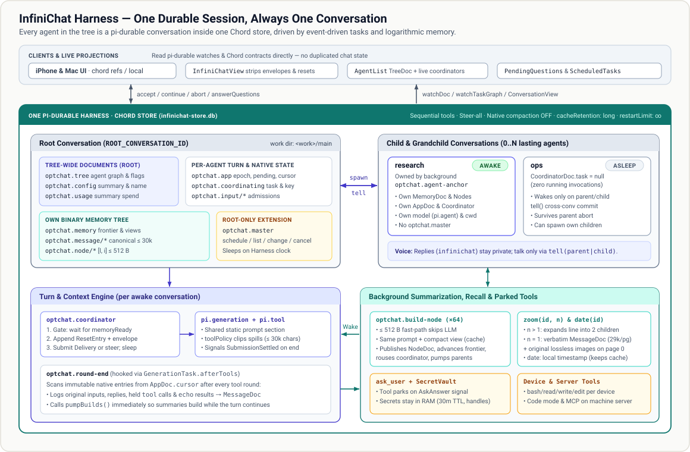

# How the InfiniChat Harness Works

InfiniChat is an AI agent built around one radical product invariant: **there is always one conversation that never
ends**. Instead of starting fresh chat threads when a context window fills up—or losing history to lossy one-shot
compaction—InfiniChat gives an agent a permanent, lossless canonical log, maintains a continuously built binary tree of
summaries over that log, and lets the agent spawn lasting child agents that each have their own never-ending
conversation inside the same durable store.

Under the hood, InfiniChat is built on **`@earendil-works/pi-durable` 1.6.0** and **`@earendil-works/chord` 1.6.0**
(with the core harness in `packages/infinichat/src/pi/infinichat/`, the host service and UI projections in
`packages/infinichat/src/pi/infinichat-*.ts`, and the server host in `packages/infinichat-server/src/`). For the
comparison against Victor Taelin's UniiChat design and details on Chord session-sync moves, see
[`docs/infinichat-design.md`](../infinichat-design.md). For machine plugins, MCP, and code mode, see
[`docs/server-plugins.md`](../server-plugins.md).

## The Core Idea: Why Every Piece Needs the Others

Most agent harnesses treat context management, turn execution, and subagents as loosely coupled add-ons. InfiniChat's
harness is designed as a single closed loop where five mechanisms reinforce one another:

1. **One durable session, many conversations.** The entire agent tree lives inside one `pi-durable` `Harness` backed
   by a single Chord store (`infinichat-store.db`). Root and every spawned child each have their own `Conversation`,
   their own memory tree, their own model settings, and their own working folder—yet any cross-agent action (`spawn`,
   `tell`) executes as one atomic database commit across conversations.
2. **Explicit `ResetEntry` boundaries instead of linear context growth.** Native pi-durable compaction is disabled
   (`compaction: { enabled: false }`). Every fresh turn appends a `ResetEntry` and starts with a single `DeliveryEntry`
   carrying the agent's compressed memory view (`<chat>…</chat>`), live turn state, tree placement, and new input.
   Because older entries remain immutable in storage, the UI shows one continuous transcript while the model only ever
   sees a bounded, prompt-cached window.
3. **A continuously built binary summary tree with dual hysteresis views.** After every tool round—not just when a turn
   ends—a hook task (`optchat.round-end`) projects new entries into canonical `MessageDoc` records and pumps up to 64
   parallel `BuildNode` tasks. Leaves summarize single messages into ≤ 512 UTF-8 bytes; adjacent aligned nodes merge
   in pairs up the binary tree. Two independent views (`main` at 128 KB → 64 KB and `compact` at 32 KB → 16 KB) grow
   strictly at their tail until crossing a high-water mark, preserving long-lived LLM KV caches.
4. **Lossless recall on demand via `zoom` and `date`.** Because summaries are strictly an index over permanent
   `MessageDoc` records, nothing is ever truly forgotten. An agent drills down any summary line `id+n` in
   `O(log n)` calls via `zoom(id, n)` down to `zoom(id, 1)` to recover the exact text (paginated) and original
   lossless images, and calls `date(id)` for timestamps without putting changing clocks into its cached prompt.
5. **Event-driven agents that sleep at zero cost.** An agent is "awake" only while an ephemeral `optchat.coordinator`
   task lives in its conversation. Messages wake it (or steer an active run between tool calls); when a turn settles,
   the coordinator exits. Agents never block or poll waiting on children—they call `tell`, log private notes in their
   own reply, and go to sleep until a child's `tell` wakes them again.

## Reading Guide

| Document | Covers | Diagrams |
| --- | --- | --- |
| [01 · Context Assembly & Prompt Caching](01-context-and-prompt-cache.md) | `ResetEntry`, `envelope()`, 3-tier KV-cache prefix alignment, `DeliveryEntry` vs `InputDoc`, `toolPolicy`, `InfiniChatView` projection | [`context-assembly.svg`](diagrams/context-assembly.svg) |
| [02 · Turns, Coordinator & Recovery](02-turns-and-coordinator.md) | Epochs vs runs, `admitInput`, ephemeral `optchat.coordinator`, `memoryReady` gate, steering, `RoundEnd` hook, stop/requeue, `Continue`, `ask_user`, `schedule_task` | [`turn-lifecycle.svg`](diagrams/turn-lifecycle.svg) + Mermaid sequences |
| [03 · Memory Tree, Summaries & Zoom](03-memory-summaries-and-zoom.md) | Canonical `MessageDoc`, binary `NodeDoc` tree, dual hysteresis views (`moreDue`), `BuildNode` (`JOBS=64`) + 512 B retries, `zoom` & `date` | [`memory-tree-and-zoom.svg`](diagrams/memory-tree-and-zoom.svg) + Mermaid state machine |
| [04 · Agent Tree & One Conversation](04-agent-tree-and-one-conversation.md) | `TreeDoc`, `AgentAnchor`, atomic `spawn` & `tell`, private replies vs spoken replies, `hide`/`show`/`list`, end-to-end walkthrough across devices | [`agent-tree-and-flow.svg`](diagrams/agent-tree-and-flow.svg) + Mermaid E2E sequence |
| [05 · Runtime Topology, Chord & Server](05-runtime-topology-chord-and-server.md) | Where the harness module lives vs. who runs it (server vs. iPhone vs. Mac), `InfiniChatHost` / `ShownInfiniChat`, Chord's 3 roles (storage/sync, RPC, plugin registry), move handover | [`runtime-topology.svg`](diagrams/runtime-topology.svg), [`chord-three-roles.svg`](diagrams/chord-three-roles.svg) + Mermaid move sequence |

## Complete Map of `pi-durable` Primitives Used

Everything persistent in the InfiniChat harness is defined declaratively through `pi-durable`'s typed document,
entry, task, signal, hook, and extension APIs. Nothing lives in ad-hoc side tables or mutable in-memory caches (except
`SecretVault`, which intentionally stays in RAM only).

### Harness-Wide Settings (`openOptChat` in `app.ts`)

| Setting | Value | Why |
| --- | --- | --- |
| `toolExecution` | `'sequential'` | Matches UniiChat's linear call→result trace and deterministic `RoundEnd` logging. |
| `steeringMode` / `followUpMode` | `'all'` | Places all queued mid-turn steers together at the next tool-round boundary. |
| `compaction` | `{ enabled: false }` | Replaced entirely by InfiniChat's binary memory tree and explicit `ResetEntry` turns. |
| `stream.cacheRetention` | `'long'` | Maximizes provider KV cache TTL (1 hour on Anthropic, 1 day on OpenAI) for the append-only view. |
| `afterFailedRun` | `'withdraw'` | Withdraws inputs queued behind a failed run so InfiniChat can requeue them cleanly into a fresh turn. |
| `restartLimit` | `Infinity` | Prevents iOS background app kills from permanently faulting in-flight `BuildNode` or coordinator tasks. |

### Durable Documents

| Kind | Scope | Version | Defined In | Purpose |
| --- | --- | --- | --- | --- |
| `optchat.tree` | Root conversation | 1 | `agents.ts` | Canonical registry of all agents (`conversationId`, `parent`, `description`, `children[].hidden`) and legacy `since` cutoff. |
| `optchat.config` | Root conversation | 4 | `summary.ts` | Tree-wide summary model/thinking selection (`summary`) and user-chosen program `name`. |
| `optchat.usage` | Root conversation | 1 | `usage.ts` | Spend ledger for summary `BuildNode` calls (separate from `pi.usage`, which tracks turn generations). |
| `optchat.app` | Per conversation | 7 | `app.ts` | Turn state machine: `epoch`, `open`, `started`, `requests`, `pending`, `cursor`, `resume`, `stop`/`stopped`, `endNote`, `held`, `cut`. |
| `optchat.coordinating` | Per conversation | 1 | `wake.ts` | Current live coordinator `task` ID (`null` when asleep), monotonic `Wake` signal `key`, and unsettled `settling[]` request keys. |
| `optchat.input` *(family)* | Per conversation | 3 | `app.ts` | Keyed by `requestId`. Stores original `UserInput`, `kind`, `date`, `epoch`, `fresh`, `phase`, frozen `envelope`, and `attempt`. |
| `optchat.memory` | Per conversation | 3 | `memory.ts` | `nextMessage`, `frontier`, `viewThrough`, `pendingLeaves`, `readyParents`, `active`, `failed`, `main` & `compact` views, `stalled`. |
| `optchat.message` *(family)* | Per conversation | 2 | `memory.ts` | Keyed by stringified 0-based index `i`. Immutable canonical message record (text ≤ 30,000 Unicode scalars, kind, date, images). |
| `optchat.node` *(family)* | Per conversation | 2 | `memory.ts` | Keyed by `"${level}:${index}"`. Built summary line (`ref`, `text`, `bytes`, `builder` task ID). |
| `optchat.agent-launch` *(family)* | Per conversation | 2 | `agents.ts` | Keyed by tool `taskId`. Records `spawn`'s reply so a crash-replayed tool call never spawns a duplicate child. |
| `optchat.build-scratch` | Per `BuildNode` task | 3 | `summary.ts` | Frozen `source`, `task` prompt, `compact` `view`, `selection`, previous too-long `last` line, and `shortest` candidate. |

*(Native pi-durable documents also used per conversation: `pi.agent`, `pi.live`, `pi.inbox`, `pi.provider`, and
`pi.usage`.)*

### Custom Entries, Tasks, Signals & Hooks

| Primitive | Name | Defined In | Role |
| --- | --- | --- | --- |
| Entry | `optchat.delivery` | `app.ts` | Marks a placed turn or steer user message. Carries `{ requestId, kind }`; model sees envelope, memory & UI read original from `InputDoc`. |
| Native Entry | `pi.reset` (`ResetEntry`) | pi-durable | Appended with `{ head: 'self' }` before every fresh turn so the model drops prior raw turns and starts from the new `<chat>` view. |
| Task | `optchat.coordinator` (v2) | `app.ts` | Ephemeral per-turn driver. Gates fresh turns on `memoryReady`, dispatches/steers inputs, flushes end notes, exits when idle. |
| Task | `optchat.round-end` (v1) | `app.ts` | Launched by `GenerationTask.afterTools` hook after each tool round to project new entries into memory and pump summary builds live. |
| Task | `optchat.build-node` (v2) | `summary.ts` | 4-phase (`prepare → request → retry → publish`) background summarizer for one leaf or binary merge node. |
| Task | `optchat.agent-anchor` (v1) | `agents.ts` | Background ownership anchor that completes immediately, isolating a child conversation's lifetime from its parent's aborts. |
| Task | `optchat.scheduled-task` (v2) | `schedule.ts` | Root-only background timer sleeping on the Harness clock; admits `[Scheduled task]` work messages and reschedules repeats atomically. |
| Signal | `optchat.wake` (v1) | `wake.ts` | Zero-payload signal (monotonic keys `w0, w1, …`) delivered by admissions, aborts, continues, and `BuildNode` publishes to wake a sleeping coordinator. |
| Native Signal | `SubmissionSettled` | pi-durable | Delivered via `notify: { taskId, key }` when a submitted run settles, waking the coordinator without polling. |
| Signal | `optchat.ask-answer` (v1) | `ask.ts` | Delivered by `answerQuestionBatch()` to a parked `ask_user` `ToolTask`; carries text answers and opaque RAM secret handles only. |
| Extension | `optchat` | `app.ts` | Shared prompt section (`sharedPrompt`), memory/device/tree/`ask_user` tools, all core tasks, and the `GenerationTask.afterTools` hook. |
| Extension | `optchat.master` | `app.ts` | Root-only schedule tools (`schedule_task`, `list_scheduled_tasks`, `change_scheduled_task`, `cancel_scheduled_task`), removed on child `spawn`. |
| Extension | `optchat.tool-policy` | `tools.ts` | Wraps tools to enforce sequential mode, clips spilled `bash`/code-mode outputs to 30,000 chars head+tail, and redacts active `SecretVault` values. |

## Source Map

- `packages/infinichat/src/pi/infinichat/app.ts` — `openOptChat`, `optChatParts`, `AppDoc`, `InputDoc`,
  `DeliveryEntry`, `admitInput`, `projectEntries`, `RoundEnd`, and `optchat.coordinator`.
- `packages/infinichat/src/pi/infinichat/memory.ts` — `MemoryDoc`, `MessageDoc`, `NodeDoc`, `appendMessage`,
  `publishNode`, `settleViews`, `reduceView`, `moreDue`, `renderMain`, `renderCompaction`.
- `packages/infinichat/src/pi/infinichat/summary.ts` — `ConfigDoc`, `BuildScratchDoc`, `pumpBuilds`, `BuildNode`.
- `packages/infinichat/src/pi/infinichat/tools.ts` — `zoom`, `date`, `toolPolicy`, `clippedSpill`, secret
  redaction.
- `packages/infinichat/src/pi/infinichat/agents.ts` — `TreeDoc`, `AgentAnchor`, `AgentCallDoc`, `place`,
  `spawn`, `tell`, `hide`, `show`, `list`.
- `packages/infinichat/src/pi/infinichat/wake.ts` — `Wake`, `CoordinatorDoc`, `rouse`.
- `packages/infinichat/src/pi/infinichat/prompt.ts` — `sharedPrompt` (turns, devices, children, compactions).
- `packages/infinichat/src/pi/infinichat/ask.ts` & `secrets.ts` — parked `ask_user` tool and RAM-only
  `SecretVault`.
- `packages/infinichat/src/pi/infinichat/schedule.ts` — root-only `optchat.scheduled-task` and schedule tools.
- `packages/infinichat/src/pi/infinichat/device-tools.ts` — per-device `bash`/`read`/`write`/`edit` wrappers.
- `packages/infinichat/src/pi/infinichat-service.ts`, `infinichat-view.ts`, `infinichat-agents.ts`,
  `infinichat-store.ts` — host lifecycle, live transcript projection, agent tree store, and Chord store setup.
