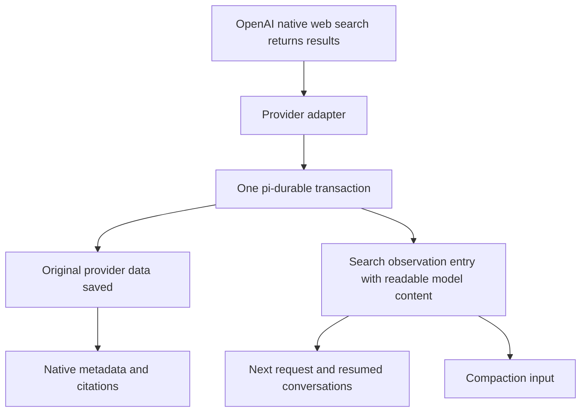

# Native web search implementation goal

Redo the native OpenAI web_search implementation in /Users/vikashloomba/pi-react-native/pi-agent using pi-durable's existing public entry and transaction APIs. Deliver the implementation, migration, UI integration, and meaningful validation. Preserve maintainability, clear abstractions, focused modules, readability, and existing user work. Redesign and refactor the affected integration as needed.

This specification is incorporated in full into the active goal. The following answer is reproduced verbatim at the user's request, including all four steps, the table, source links, and Mermaid diagram.

## Verbatim architectural answer

**Yes. At the conversation-context layer, that is a fair description of the current implementation. Pi-durable is not the limiting factor.** We used its persistence correctly, but did not integrate the search findings into the conversation content it manages.

I also need to correct my previous recommendation: **an SDK change is not required, and the findings do not need to be stuffed into the assistant’s answer.** I treated “commit the search observation and the final assistant answer together” as a requirement. It isn’t. A completed search result is already a valid observation, even before the assistant finishes answering.

The distinction is straightforward:

- **Application storage:** “Keep this JSON so the app can retrieve it later.”
- **Conversation context:** “Include this information when constructing the model’s next request.”

Our implementation did the first, then tried to accomplish the second by replaying OpenAI’s raw output objects. Your phone data shows why that was insufficient: the snippets were saved, but the historical web-call objects contributed only a small amount of model input.

**The idiomatic implementation is to record completed searches as first-class conversation entries using pi-durable’s existing APIs.**

Pi-durable explicitly supports application-defined entries with two separate fields:

| Field | Purpose |
|---|---|
| `model` | Messages that contribute to the model’s conversation context |
| `data` | Structured information for the application, UI, provenance, and bookkeeping |

That is the documented [`EntryRecord` contract](/Users/vikashloomba/pi-react-native/pi-agent/node_modules/@earendil-works/pi-durable/dist/types.d.ts:271). Its public transaction API already supports updating documents and appending those entries in the same commit.

The implementation would work like this:

1. **OpenAI executes native `web_search`.**
   The provider adapter observes the returned results. Search remains an OpenAI-hosted tool.

2. **The integration records a completed search observation.**
   In one pi-durable transaction, it saves the original provider data and appends an application-defined entry—for example, `SearchObservationEntry`.

   That entry contains:
   - In `data`: the search identity, response identity, URLs, titles, and provenance.
   - In `model`: the actual retrieved text, clearly labelled as external source material.

3. **Pi-durable includes the observation in subsequent context.**
   On the next request, including after reopening the app, the findings are already part of the durable transcript. Compaction can read them too. Their availability no longer depends exclusively on an OpenAI-specific request rewrite.

4. **The UI renders the observation appropriately.**
   It can appear as a search activity/source component. It does not have to appear as assistant prose or a pretend human message.

Conceptually:

The public [`Tx.appendEntry()` and `Tx.doc()` APIs](/Users/vikashloomba/pi-react-native/pi-agent/node_modules/@earendil-works/pi-durable/dist/types.d.ts:663) support this directly. In fact, our current bridge already calls `harness.commit()` to save the native archive. The missing architectural piece is the corresponding **model-facing transcript entry**.

There are ordinary implementation details to handle: deduplicate observations during recovery, associate them with their originating response, coordinate conversation edits with their associated observations, and test token budgeting. Those belong in the integration; they do not require changing pi-durable.

For maintainability, I would separate this into a provider adapter, a pure result-to-observation converter, a small durable persistence module, and a UI projection. Native replay would continue to handle provider-specific state such as encrypted reasoning, while readable search findings would use the SDK’s normal conversation machinery.

**That is the design I recommend: use pi-durable’s custom transcript entries to persist model-readable search observations.** My earlier explanation made the problem sound like a limitation of its hooks, when the appropriate existing abstraction was its entry-and-transaction API.

## Implementation and completion requirements

These requirements supplement the verbatim design above.

1. Keep OpenAI web_search provider-hosted. Preserve the existing native OpenAI authentication integration and custom Swift OAuth callback module. Use public pi-durable APIs. Do not invent local function-tool calls or function_call_output records for hosted search, depend on private SDK internals, place callbacks in durable JSON settings, or require an SDK modification for this design.

2. Create a typed application-defined search observation entry with supported model-facing message content and structured application-facing data. Identify retrieved snippets as external evidence. Preserve source title and URL, native search and response identities, result order, completeness, and provenance. Do not represent excerpts as complete pages.

3. Atomically persist original native response data, observation entries, and their identity/digest bookkeeping through public transactions. Completed search observations remain valid when the assistant later fails or is interrupted; they need not share a transaction with the final assistant answer.

4. Handle duplicate stream events, retries, cancellation, shutdown, restart, concurrent conversations, and recovery. Associate observations with the correct request, response, native item, conversation, and logical turn. Deduplicate repeated delivery of the same observation without dropping legitimate distinct searches.

5. Handle late enrichment using explicit completion rules or immutable correction entries with supported ContextEdit operations. Keep archive and projection bookkeeping consistent in the same transaction.

6. Respect active context and request cutoffs. Ensure reset, fork, rewind, omission, replacement, and logical-turn edits include or exclude associated evidence deliberately. Omitting an assistant does not automatically omit independent evidence; implement the intended logical-turn policy explicitly. Do not resurrect evidence outside the selected context.

7. Ensure observations remain readable after closing/reopening SQLite and across supported model/provider changes. Keep compatibility rules for opaque provider-specific reasoning separate from portable source text.

8. Feed evidence through canonical context into actual compaction. Verify that facts present only in source results reach the summarizer and survive a meaningful summary. A canned summary or archive-retention assertion does not validate this behavior.

9. Address token budgeting deliberately. The installed SDK's context estimate can use the newest assistant's reported usage plus later messages; evidence inserted before that assistant may not be reflected accurately. Inspect and handle this behavior using supported APIs. Define an explicit, deterministic evidence sizing/deduplication policy that preserves full raw results and makes any context truncation honest. Do not silently discard returned content.

10. Separate provider capture/transport, pure evidence conversion, durable persistence/lifecycle, native replay, and UI projection into focused, cohesive modules. Preserve maintainability, proper abstractions, readability, and clear ownership. Refactor unsuitable existing code and tests rather than assuming they are idiomatic. Avoid a monolithic service, duplicate sources of truth, ad hoc synthetic boundaries, or a growing collection of request-only patches. Native replay must not replace away or duplicate canonical readable evidence.

11. Preserve the streaming/search UI, stable activity identity, source/citation rendering, and completed/interrupted state. Observations must not display as pretend human messages or be mixed into assistant answer prose. Keep opaque encrypted state out of UI projections.

12. Implement an idempotent migration/backfill for existing saved chats from retained actual snippets and valid active-history associations. The diagnosed phone conversation already retains its source content. Preserve original history and raw data. Account for old edits, forks, resets, compaction, and records missing association metadata.

13. Add behaviorally meaningful regression coverage using realistic results with unique facts absent from assistant answer text. Verify canonical context after restart, request construction, actual compaction input, meaningful post-compaction continuation, model changes, interruption/recovery, deduplication, late enrichment, migrations, and relevant UI behavior. Outgoing raw JSON equality alone is insufficient.

14. Follow repository AGENTS.md and matching Expo guidance. Run required lint/typecheck and focused integration/regression checks, plus appropriate native bundle and SQLite lifecycle validation. Distinguish source review, synthetic HTTP/provider tests, native lifecycle checks, and live authenticated model-context verification. Do not claim live recall from synthetic round trips. Report material remaining validation limits explicitly.

15. Preserve pre-existing uncommitted changes. Use isolated fixtures for migration and lifecycle checks. Do not modify the user's real conversations or install/deploy a new app merely for investigation without authorization in the ongoing task. Document the resulting architecture and validation evidence.

## Completion criteria

The goal is complete only when the redesigned integration, necessary migration and lifecycle behavior, and UI work are implemented; meaningful checks pass; and material remaining limitations are clearly reported. Creating this specification alone does not complete the implementation goal.
