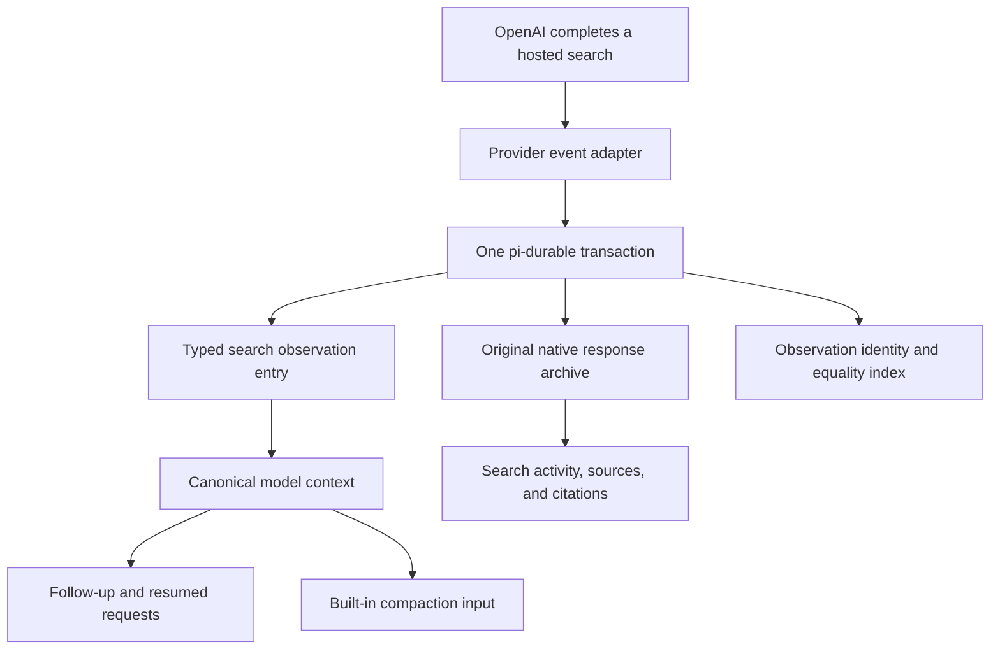

# Native web search and durable source evidence

OpenAI executes `web_search` as a hosted Responses tool. The application captures the returned provider data and commits completed searches as ordinary pi-durable conversation entries. Their model-facing content contains readable, attributed source excerpts. Subsequent requests, reopened chats, provider changes, and compaction therefore receive the findings through the same canonical context machinery as the rest of the conversation.

The implementation uses the installed public pi-ai and pi-durable APIs. It does not create local function calls for hosted search, invent matching function outputs, modify the SDK, or put callbacks in durable JSON settings. Authentication and the custom Swift OAuth callback remain separate from this integration.

## Why raw output replay was insufficient

The original integration durably archived native output and inserted those raw objects into later Responses requests. The read-only phone audit found four historical search calls containing 39 returned results and 98,615 characters of snippets. The reconstructed request retained those objects exactly, but the historical server attribution counted only 186 input tokens across the four old search items. All saved assistant fingerprints matched, the model was unchanged, and no compaction had occurred.

That evidence identified a gap between preserving response JSON and supplying readable model input. The redacted local audit report is [`.expo/web-search-audit/evidence.json`](../.expo/web-search-audit/evidence.json). It records counts, hashes, and usage attribution without prompts, source bodies, URLs, or encrypted payloads. The historical outgoing HTTP body was not separately logged, and the server's final model prompt is not observable; the report distinguishes reconstructed input from historical response metadata.

The former raw-history rewrite and its synthetic boundary markers have been removed. Pi now owns ordinary request conversion, tool pairing, and opaque reasoning compatibility. Readable search evidence is represented explicitly in conversation context.

## Ownership and data flow

| Module | Responsibility |
| --- | --- |
| [`provider.ts`](../src/pi/native-web-search/provider.ts), [`bindings.ts`](../src/pi/native-web-search/bindings.ts) | Scope native integration to the durable request's cancellation signal. Unbound provider requests remain ordinary Pi requests. |
| [`wrapper-stream.ts`](../src/pi/native-web-search/wrapper-stream.ts) | Compose native tool/include fields with caller hooks; await persistence before publishing corresponding normalized events; preserve terminal failure and cancellation behavior. |
| [`archive.ts`](../src/pi/native-web-search/archive.ts) | Capture structural provider events and ordered item snapshots, including terminal-envelope enrichment. |
| [`normalization.ts`](../src/pi/native-web-search/normalization.ts) | Reconcile terminal-only text, reasoning, and function items through Pi's public Responses parser. Preserve provider usage and Pi's normal signatures. |
| [`evidence.ts`](../src/pi/native-web-search/evidence.ts) | Pure conversion from completed native calls to bounded, attributed external evidence, with deterministic equality and honest completeness metadata. |
| [`documents.ts`](../src/pi/native-web-search/documents.ts), [`observations.ts`](../src/pi/native-web-search/observations.ts) | Define raw archive/live/index documents and typed immutable evidence/correction entries. Deduplicate and enrich observations transactionally. |
| [`persistence.ts`](../src/pi/native-web-search/persistence.ts), [`lifecycle.ts`](../src/pi/native-web-search/lifecycle.ts), [`edits.ts`](../src/pi/native-web-search/edits.ts) | Atomically persist archive, observations, and index; capture genuine user-turn origins; respect active-context boundaries and deliberate logical-turn edits. |
| [`durable.ts`](../src/pi/native-web-search/durable.ts) | Connect public generation hooks, pinned request identity, cancellation, recovery, migration, and provider persistence. |
| [`migration.ts`](../src/pi/native-web-search/migration.ts) | Conservatively backfill retained legacy snippets against canonical active history and handle already-prepared request cutoffs. |
| [`budget.ts`](../src/pi/native-web-search/budget.ts) | Define evidence sizing and request-capacity policy without changing successful provider usage records. |
| [`projection.ts`](../src/pi/native-web-search/projection.ts), [`chat-projection.ts`](../src/pi/chat-projection.ts) | Derive activity, citations, sources, and chat rows. Keep model-facing evidence out of human-message and assistant-answer presentation. |

`SearchObservationEntry` has kind `app.openai.search-observation`. Its `model` field contains a supported Pi user-role message explicitly labelled as untrusted external source material. This is the SDK's model-input representation; it is not a human-authored chat row. Its `data` field records request, response, task, native item, output position, source title/URL, result order, and completeness. Text is described as retrieved excerpts or snippets, never as a verified complete page.

The archive remains authoritative for full provider data. The observation entry is authoritative for readable conversation evidence. `SearchObservationsDoc` is an index of entry identities and canonical equality signatures, not a second transcript.

## Completion, recovery, edits, and migration

A search observation requires a completed native `web_search_call` and stable response/item identities. A completed search remains a valid observation if its enclosing assistant later fails or is interrupted. The archive update, observation entry, and index update share the same public `harness.commit` transaction. A persistence failure prevents the corresponding result from being presented as successfully saved.

Identity is scoped to the request and native item. Repeated delivery does not append another observation. Distinct searches retain distinct identities even when they return similar text. Late enrichment produces an immutable `SearchObservationChangeEntry` (`app.openai.search-observation-change`) with a supported `ContextEdit`; it replaces the earlier entry's contribution instead of duplicating its text. The equality signature includes source material beyond any rendered truncation boundary, so enrichment of an omitted tail remains detectable.

Raw archives, evidence, and their index use rewindable, as-of fork semantics. The in-flight presentation document is not inherited by a fork. Request cutoffs and public head markers prevent a late response from appending evidence into a context that has reset or advanced past its request. The original provider record remains available even when its evidence is no longer eligible for active context.

An assistant-only context edit does not automatically erase an independently completed search observation. The application `editSearchTurn` helper in `edits.ts` implements the explicit logical-turn policy using public transactions: it accepts a genuine user submission or any assistant in that turn, preserves the requested replacement/omission for that target, and omits the turn's other assistant responses, local tool results, and search observations. Adjacent turns remain unchanged. Generation and tool rounds share `originEntryId`, captured from the actual `pi.user` entry; an evidence message's user role cannot accidentally start a new logical turn.

The helper records an edit watermark for the originating user entry and disables the old responses and observation references. Requests pinned before that watermark cannot revive the edited turn, even through native item IDs that did not exist when the edit committed. A new generation prepared after the edit can search again using that same replaced user entry. Legacy requests without a recorded cutoff remain conservatively excluded by the watermark. Legacy observations can be associated through their source answer or response identity, using the preceding genuine user submission where available. A compacted turn fragment without its original user entry is edited only within the retained active history. Callers implementing a whole-turn edit should use this helper rather than assuming Pi automatically couples independent entries.

Legacy migration is idempotent and conservative. It resolves the current public `Conversation.context()` view, including head markers, forks, omissions, replacements, and excluded assistant stop reasons. A record is eligible only when it has an unambiguous response identity and its saved normalized content exactly matches an active source assistant. A stored request cutoff must also remain within the current head boundary. Missing fingerprints, ambiguous identities, edited or absent answers, excluded requests, and unreadable result bodies are reported by reason instead of guessed.

The migration transaction rechecks the context tail before committing, retrying a raced append or edit. It backfills only missing items backed by actual source text, retaining an explicit omission notice when the bounded projection cannot include that text. It preserves the original archive and never re-enables deliberately disabled turns or observations. Existing indexed records avoid re-rendering large source bodies on each generation. The returned report contains counts and reason names, not source bodies.

For a recovered generation, startup migration may have appended evidence after the request's pinned cutoff. `migrateSearchObservations` accepts that cutoff and the prepared messages, and returns eligible active evidence that needs forwarding across this boundary. It checks both the source turn and the current canonical evidence contribution, and excludes evidence already present in the request. This compatibility path does not authorize replay of arbitrary old archive records.

The UI filters both observation entry kinds by type. They cannot become a human message, generated chat title, preview, or list-order timestamp. The native archive continues to supply one stable search activity/source presentation, including a completed search with no final assistant answer.

## Sizing and compaction

The evidence converter preserves provider order and removes exact duplicate source results only within a native call, retaining their original result indices. Distinct searches remain distinct. It extracts supported readable fields, source titles, and URLs; arbitrary provider fields and encrypted reasoning never become source text.

The sizing policy is deterministic and independent of provider token billing:

- One result retains at most 65,536 UTF-16 code units of excerpt text. Each call's complete rendered evidence is capped at 131,072 UTF-8 bytes, including JSON escaping and provenance. Source metadata fields are bounded separately.
- Each response has an aggregate rendered-byte allowance pinned from the actual source model's context window. Text plus a 256-token framing allowance per selected evidence message stays within the smaller of one quarter of that window and 262,144. At most 32 calls are selected, with a minimum 512-byte call allocation; later calls that do not fit are reported as omitted.
- An unknown model window uses an 8,192-token sizing policy. Unpinned legacy archives use the bounded 1,048,576-window policy so migration does not silently shrink previously saved research to a newly selected model's size.
- Excerpt shortening, omitted results/calls, unreadable fields, and shortened metadata are explicit in the model-facing completeness report and structured data. A tiny allocation can contain an omission notice instead of source text. The original provider response stays unchanged in the archive.
- Prefix trimming respects Unicode boundaries. The bounds limit readable model projection; they do not delete raw source text.

Pi's normal context estimate can start from the newest assistant's reported request usage. Evidence committed before that assistant may nevertheless have arrived after its request was sent, so that measurement can omit the new text. The application therefore binds a capacity guard to generation requests at the public `Models.streamSimple` seam. It compares the larger of (a) Pi's usage-based estimate plus all active evidence's UTF-8 bytes and message framing, and (b) a full transcript recount using Pi's ordinary estimator with the same explicit evidence bound. Reserving all evidence may count already-measured source text again; this intentionally favors earlier compaction over missing an unmeasured addition.

The guard uses the current model's real context window, reserving the smaller of 16,384 tokens and one quarter of that window for an answer. If the canonical request exceeds that input allowance, it returns a local `context_length_exceeded` result with zero usage and makes no provider request. Pi-durable then owns its normal overflow-compaction and retry path. Successful provider usage, prices, model catalog values, and shared compaction settings are not falsified to trigger this behavior.

The same Models boundary gates request preparation for every provider. A failed migration or preparation step cannot silently continue through a different provider with incomplete context. The wrapper preserves the original Models object's receiver and public methods instead of replacing it with a partial object.

Built-in summarization calls are deliberately unbound, so the guard does not recursively block the compactor. Their input is the canonical transcript, including evidence. This is still an estimate rather than provider-specific tokenization: non-evidence content uses Pi's estimator. Switching to a much smaller model can also leave the summarization request itself too large for that model. Such a provider failure remains a real limitation, rather than a reason to silently discard archive content or claim successful compaction.

## Validation and evidence limits

The regression suites check semantic source preservation using facts absent from assistant answer text:

| Suite | Main coverage |
| --- | --- |
| [`native-web-search.test.mjs`](../tests/native-web-search.test.mjs) | Real Pi Responses parsing with scripted HTTP, ordinary model-input evidence after SQLite reopen, local-tool interleaving, concurrent chats, cancellation/recovery, provider changes, logical edits, and actual built-in compaction. |
| [`search-evidence.test.mjs`](../tests/search-evidence.test.mjs) | Realistic result extraction, provenance, stable identity/equality, deduplication, completion requirements, per-model aggregate bounds, Unicode, explicit truncation, and local capacity checks. |
| [`native-search-normalization.test.mjs`](../tests/native-search-normalization.test.mjs) | Terminal-only output reconciliation, same-model opaque signatures, cross-model readable evidence, unchanged usage, and failure/incomplete behavior. |
| [`native-search-migration.test.mjs`](../tests/native-search-migration.test.mjs) | Actual temporary SQLite, idempotent backfill/reopen, active-history restrictions, legacy forks, missing association metadata, request cutoffs, concurrent edits, and startup migration before recovered requests. |
| [`native-search-projection.test.mjs`](../tests/native-search-projection.test.mjs) | Evidence hidden from human/answer rows, stable activity identity, source/citation preservation, interruption, enrichment, and reopen stability. |
| [`native-search-lifecycle.test.mjs`](../tests/native-search-lifecycle.test.mjs) | Atomic rollback, duplicate delivery and enrichment, whole-turn edits across tool rounds, regeneration after edits, fork/reset boundaries, and out-of-order budget reconciliation. |

The compaction regression uses the real built-in summarization path. Its scripted provider derives a summary from a source-only fact present in the actual summarizer request; the later scripted continuation checks that summary. It does not replace compaction with a canned `beforeCompact` answer.

Node SQLite lifecycle tests establish durable behavior against actual SQLite files through the app's storage adapter. They do not establish execution by the native Expo SQLite module on a device. Hermes exports establish native bundle compatibility, not authentication, hosted-search entitlement, or model recall. Scripted HTTP tests establish parsing, persistence, and request construction, not live semantic recall by OpenAI. A live authenticated continuation is a separate validation step, and should use an isolated conversation rather than modifying a user's existing history.

Required repository checks remain `npx @expo/agent-cli lint` and `npx @expo/agent-cli typecheck`. Focused regression tests run with `node --experimental-strip-types --test`. Build, native lifecycle, and live-account outcomes must be reported separately; an older successful device install is not proof of this refactor's behavior.

### Verification on 2026-10-05

- Application regression suite: **472 tests passed**, no failures or skips. This includes actual OpenAI-to-Anthropic request conversion after reopening SQLite, with a source-only fact retained exactly once and incompatible opaque reasoning excluded.
- `@automatalabs/expo-pi` compatibility suite: **37 tests passed**.
- Expo Agent CLI lint and typecheck passed; typecheck reported zero diagnostics. `git diff --check` passed.
- Production exports for **iOS and Android** produced Hermes bytecode and source maps. Export metadata is in [`.expo/web-search-export/metadata.json`](../.expo/web-search-export/metadata.json).
- The native probe ran the current JavaScript in Hermes on a new, isolated iOS 27 simulator using an existing development binary and a unique Expo SQLite fixture database. It passed streaming search visibility, stable row identity, sources/citations, close/reopen presentation, a source-only fact entering ordinary next-request text exactly once, Pi-managed encrypted reasoning, and absence of opaque state in UI. The [native report](../.expo/web-search-audit/native-results.json) records these checks. No account credentials or live model requests were used.
- A subsequent two-second runtime error observation returned zero errors. This bounded observation is separate from the probe's behavior assertions.

The [local validation directory](../.expo/web-search-audit/) contains command reports; it is ignored build/test output rather than a committed copy of user data. The test simulator and development server were created for this validation and cleaned up afterward. The user's phone and its saved conversations were not updated. Live authenticated OpenAI semantic recall and Android device execution remain untested; neither is inferred from scripted responses or bytecode exports.
