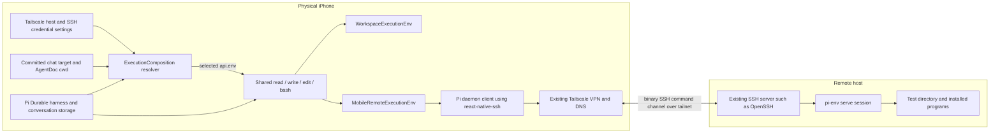

> **Superseded by the pi-agent Cleanup Plan (https://claude.ai/code/artifact/a114f99b-474c-48bc-97ab-69b9a7bd2c66). Do not implement from this file.** It describes the pre-cleanup design and will be rewritten or deleted as the cleanup lands.

# Remote execution over SSH through Tailscale

Updated October 7, 2026, against the current working tree. **The remote feature and automatic daemon setup are implemented in the production application.** Host management, secure SSH credentials and trust, the mobile `ExecutionEnv`, the combined composition and durable per-chat selection use the completed Pi 1.0.4 execution seams. Implementation status and verification status are separate: the original completion criteria, transport-only evidence and first manual-install production validation are preserved below. Automatic provisioning has separate verification evidence.

The harness, model access, durable conversation storage, and tool orchestration stay on the phone. A chat chooses its on-device workspace or a configured remote machine. For remote execution, the user enters that machine's Tailscale hostname or address, and the app connects to its existing SSH server through the phone's already-running Tailscale VPN. Remote file and shell operations run through the unchanged Pi Env daemon on that machine.

**Product scope: SSH over Tailscale is the single remote connection path.** Tailscale provides private connectivity and DNS; the machine's SSH server, such as OpenSSH, handles SSH authentication and command execution. The Mac's GUI Tailscale app works with this design. The separately named **Tailscale SSH server feature is outside scope**: there is no requirement to replace the GUI app with an open-source `tailscaled` server, use `auth: none`, or implement Tailscale SSH policy/check-mode approval. Use “SSH over Tailscale” throughout implementation handoffs to avoid confusing these two meanings. [SSH over Tailscale][tailscale-ordinary-ssh].

**SSH implementation decision:** use **`@osuki-dev/react-native-ssh`** for the SSH connection and native binary channel. Do not build an application-owned SSH implementation or native SSH bridge. Our custom code implements Pi's `ExecutionEnv` and connects the existing Pi daemon protocol to the library's public API. The library owns SSH encryption, negotiation, authentication mechanisms and channel transport; the app supplies host configuration, SSH credentials, trust decisions and lifecycle ownership. [SSH API][ssh-api].

**The physical iPhone has already connected to this Mac over the intended SSH-over-Tailscale path.** MagicDNS resolution, SSH authentication, binary channels, real Pi daemon file/exec operations, and normal cancellation passed. That earlier transport-only run predates the production host settings, custom `ExecutionEnv` and chat-flow implementation; it does not establish their device validation. See [physical transport validation](#physical-transport-validation).

The application uses the phone's existing Tailscale VPN and the SSH library directly. It does not embed a Tailscale SDK, create a VPN extension, manage tailnet membership, or provide a separate public-internet/direct-LAN connection mode. Host settings, connection tests and error messages describe the configured Tailscale endpoint and ordinary SSH account.

## Using remote execution

1. Keep the phone and machine connected to their existing Tailscale clients. Enable an ordinary SSH server on the machine and allow the configured SSH port through tailnet policy. The Mac GUI Tailscale app plus OpenSSH is a supported setup for this connection design. Use macOS or Linux on arm64 or x86-64 with a writable account home. The app installs its bundled execution daemon automatically; no Node/npm or Rust installation is needed on the machine.
2. Open **Account → Remote machines → Add remote machine**. Enter a display name, Tailscale hostname/address, SSH port (22 by default) and SSH username. Prefer the full MagicDNS name, such as `machine.tailnet.ts.net`. Choose **Password** or **Private key**; private keys may include a passphrase. Save the machine. Machine settings have no working directory, daemon executable path or other daemon override.
3. Choose **Test connection**. For an unknown or changed SSH key, compare the displayed fingerprint with the server's key using a trusted source, then accept or reject it. Acceptance saves the exact algorithm, fingerprint and public key in secure storage. After SSH authentication and trust, the test detects the machine, verifies or prepares the bundled daemon and checks Pi hello. It does not require or validate a project directory. Progress reports these setup stages, and success displays the daemon version and platform. The test can be cancelled; leaving the screen or backgrounding cancels it.
4. Open a chat's settings, choose **Execution environment**, select the machine and set **Working directory**, or leave it blank to use the SSH account's home directory. **Save** connects using the accepted server key, resolves the chosen directory and confirms that it exists before atomically committing this chat's target and absolute cwd after prior work settles. A failed check leaves saved settings unchanged. Reopening shows the committed absolute path; switching targets within the editor preserves each draft. **On this device** remains the initial choice and uses `/workspace`. Merely opening settings or preparing prompts does not contact SSH.
5. Subsequent `read`, `write`, `edit`, `bash` and direct task environment operations use that selection. Ordinary remote files persist on the machine. A directory is a starting location, not a filesystem sandbox. Switching environments does not copy files; remote forks inherit target/cwd history while seeing current remote files.

**Edit machine** applies settings to subsequent admissions. Credential fields left blank retain the existing credential of the same type. Work already admitted keeps an immutable host/credential/trust snapshot. **Reset accepted SSH key** requires a fresh explicit connection test before a new production admission can use that host. **Remove machine** retires its saved credential record and leaves selected chats visibly unavailable until the user chooses another environment. Local execution remains available.

Connection feedback distinguishes SSH authentication/key rejection, private-key unlocking, recognizable DNS failures, reachability, timeout, unsupported machines, setup/upload/verification failures and unavailable working directories. Check the existing Tailscale VPN and full hostname, SSH port/account, home-directory permissions and available disk space. The account needs a POSIX shell and `sha256sum`, `shasum`, or `openssl` for remote verification. The app does not administer VPN membership or tailnet policy. Remote SSH is a native mobile feature; the web screen reports that limitation.

## Current implementation

The [architecture and ownership guide](execution-environments.md) describes the current composition. The [refactor specification](execution-env-refactor.md) and [refactor goal](execution-env-refactor-goal.md) remain historical prerequisite documents. Their before-state descriptions are not the current code.

| Boundary | Production implementation |
| --- | --- |
| Composition and provider | [remote/composition.ts](../src/pi/execution/remote/composition.ts) combines local and remote resolution and lifecycle ownership; [chat-provider.tsx](../src/chat/chat-provider.tsx) installs it through the existing execution factory. |
| Durable target and cwd | [execution/document.ts](../src/pi/execution/document.ts) defines the rewindable, `asOf` selector. [chat-service.ts](../src/pi/chat-service.ts) commits target and `AgentDoc.cwd` together, explicitly inherits task-owned selection and projects committed changes through the runtime. |
| Machine settings and secrets | [hosts.ts](../src/pi/execution/remote/hosts.ts) owns public metadata, immutable admission and credential retirement. [host-storage.ts](../src/pi/execution/remote/host-storage.ts) separates Expo SQLite metadata from Expo SecureStore credentials and accepted keys. |
| Settings and connection testing | [remote-hosts.tsx](../src/app/remote-hosts.tsx), [remote-host-form.tsx](../src/components/chat/remote-host-form.tsx) and [test-host.ts](../src/pi/execution/remote/test-host.ts) implement host management and explicit fingerprint decisions. [Chat settings](../src/app/chat-settings/[id].tsx) provides per-chat selection and cwd. |
| Public Pi environment | [environment.ts](../src/pi/execution/remote/environment.ts), [readers.ts](../src/pi/execution/remote/readers.ts), [watch.ts](../src/pi/execution/remote/watch.ts), [paths.ts](../src/pi/execution/remote/paths.ts), [utf8.ts](../src/pi/execution/remote/utf8.ts) and [errors.ts](../src/pi/execution/remote/errors.ts) implement the installed public contract with portable helpers. |
| SSH and daemon protocol | [channel.ts](../src/pi/execution/remote/channel.ts) owns the library's SSH connection/channel; [connection.ts](../src/pi/execution/remote/connection.ts) and [protocol.ts](../src/pi/execution/remote/protocol.ts) speak the unchanged daemon protocol. |
| Automatic daemon setup | [provisioning.ts](../src/pi/execution/remote/provisioning.ts) detects the remote target and verifies/installs the daemon through [command-channel.ts](../src/pi/execution/remote/command-channel.ts). [daemon-assets.ts](../src/pi/execution/remote/daemon-assets.ts) loads the matching bundled asset using the pinned [manifest](../src/pi/execution/remote/daemon-manifest.ts). |
| Shared tools | The existing [file tools](../src/pi/workspace/file-tools.ts) and [bash adapter](../src/pi/bash/tool.ts) consume `api.env`. The remote composition supplies ownership and prompt facts without adding backend branches to those tools. |

The settled product choices are password plus private-key authentication, secure storage of accepted SSH keys, explicit trust decisions only during settings tests, and immutable admitted configuration. A change to connection settings fails a previously resolved environment's first admission instead of silently retargeting it. Already-admitted environments retain their snapshot, including across session recovery. New resolutions use the current connection settings and cwd; entries with earlier settings stay owned until service close for existing borrowers. Display-name-only edits preserve the connection, and no numeric revision is stored or compared. Removing a machine blocks new resolution without interrupting already-admitted work. Namespace IDs change with endpoint, account or accepted server identity, but not with cwd.

Working directories belong to chats through `AgentDoc.cwd`. Two chats can use one saved machine with different project directories. The machine record has no default cwd; it represents how to connect, authenticate and verify that server. Saving a changed remote chat directory uses [resolveRemoteWorkingDirectory](../src/pi/execution/remote/test-host.ts) and compares the checked connection settings with the saved settings before committing. A remote execution facade missing an absolute committed chat cwd fails explicitly without connecting or choosing a machine fallback. The cached daemon binary is shared, while running daemon processes belong to their SSH channels. Each exec carries a request-specific cwd and file operations send resolved paths; changing a command's directory does not change another chat's context.

The composition owns a lazy environment registry keyed by host ID, filesystem namespace ID, hostname, port, username, saved credential reference and committed cwd. Tools, prompt sections and tasks borrow the same environment for the same key, reusing its SSH/Pi session. Different directories have separate environment entries with fixed cwd; registry identity is distinct from the shared filesystem namespace. Prompt-only resolution and ordinary POSIX path composition open no SSH channel. Finishing a tool or task leaves the shared session available. Borrowers close readers and watches they opened and cancel individual operations through their call context; they do not call shared environment `cleanup()`. Environment-created temporary files survive between operations using the entry until owner shutdown. Separate shell invocations still have separate variables and process cwd.

The service stops admission and closes the composition, which drains all retained environments, readers and watches, kills owned command groups and attempts temporary/spill cleanup. A one-second shutdown grace closes a stuck owned channel, including when the daemon is blocked in a non-cancellable filesystem call. Explicit connection tests and directory validation own their separate environments and close them when finished. Session-bound handles cannot reach replacement daemons. Watch reconnect reports overflow; uncertain mutations fail without automatic replay. If no session remains reachable, cleanup cannot guarantee removal of already-created remote temporary paths. This follows the ownership pattern of upstream's [`ExecutionEnvs` registry][upstream-env-owner] and [runtime shutdown][upstream-runtime-close], adapted to mobile SSH and saved connection settings; those examples do not supply a drop-in remote mobile implementation.

Automatic setup supports macOS and Linux on arm64 and x86-64. Windows and other remote targets remain unsupported. The mobile adapter uses POSIX remote paths. The remote composition deliberately provides no persistent artifact writer. Shared read/edit/output bounds remain in force, stdout and stderr stay separate, and complete output/artifact unavailability is reported. Native/platform coverage is determined by recorded tests, not by a successful JavaScript bundle.

## Automatic daemon deployment

The standalone app includes four unchanged Pi Env **1.0.4** binaries, totaling **4,175,264 bytes**, for those supported remote targets. The phone reads only the detected target and checks its byte length and SHA-256 before upload. An accepted SSH key and successful authentication precede every setup command. Resolving prompt facts and opening settings remain lazy and perform no SSH setup. Saving a changed remote chat directory explicitly connects to verify that directory.

Each new SSH session detects the OS, architecture and account home, then verifies the executable at `~/.pi/mobile/tools/pi-env-<first 32 SHA-256 hex characters>` using the full expected hash. A verified executable is reused. A missing, non-executable or corrupt entry is replaced by uploading to a unique temporary file, verifying its bytes and atomically renaming it into place with owner-only executable permissions. Setup keeps concurrent clients' uploads and other daemon versions intact. Cancellation closes its owned channel; incomplete uploads are never intentionally launched, and a later attempt verifies the cache again. Abrupt loss can leave temporary files when the remote shell cannot run cleanup.

The binary is launched as a non-PTY SSH command with a fresh Pi synchronization token after verification. It needs no daemon TCP port or system service. The remote machine downloads no package, and the phone needs no package-registry connection at runtime. The maintainer-only [sync script](../scripts/sync-pi-daemon-assets.mjs) checks a pinned npm tarball SHA-512 before extracting the four assets and generating their manifest. Run `node scripts/sync-pi-daemon-assets.mjs --check` to verify checked-in assets offline. [Upstream license notice](../assets/pi-env/NOTICE.txt) is included. An upgrade changes the packaged assets and manifest together; users cannot select a custom binary, daemon path or version.

Upstream's Node `connectSsh`/`sshConnection` provides similar automatic deployment. The app keeps its portable Pi client and native SSH transport because the published upstream module graph imports Node APIs and spawns local `ssh` processes; it cannot be used directly in Hermes. This implements the supported mobile setup behavior while preserving the unchanged daemon protocol. Upstream also supports remote Windows and Android/Termux; those targets are not included in this mobile implementation. [Upstream deployment][env-ssh], [reference environment][env-remote].

The earlier local-refactor cleanup passed **562 application tests and 37 compatibility tests**. That historical baseline, and the transport-only record below, are preserved independently of the final remote-feature validation.

### Environment ownership and simplification validation

The implementation follows the upstream service-owned registry pattern, shares local temporary files until runtime shutdown, and compares actual saved connection settings without a host revision counter. Verification passed **714 application tests and 37 compatibility tests**, with no failures or skipped tests, plus Expo Agent CLI lint and typecheck. The real-daemon composition regressions exercise one retained session across shared tools, filesystem-reading prompt sections and durable tasks; surviving readers, watches and temporary files; cancellation isolation between chats sharing a target; credential/trust changes; admission retry; and owner shutdown. Local production service/harness tests cover temporary files shared across tasks, prompt sections, tools and cwd views, cumulative storage bounds, workspace isolation, and reopening with persistent workspace files but fresh temporary files. Host tests cover renaming without reconnecting or rewriting credentials, stale connection settings, and restoring existing records while ignoring the obsolete revision field. Watcher disposal and temporary-root replacement have dedicated environment regressions.

These checks use the real Pi daemon over a local test pipe and scripted model responses through the production service/harness. They do not establish a new physical-device SSH or background-runtime result. The native probes have been updated to the borrowing contract and shared temporary-file lifetime, but were not rerun for this correction. Independent source review checked the resolver and environment cleanup against the installed Pi 1.0.4 contract and the linked upstream owner example. The repository's `AGENTS.md` requires that comparison, behavioral ownership checks, and a concrete requirement or demonstrated correctness need for additional policies, counters and ownership layers.

## Architecture and responsibility boundaries



| Owner | Responsibility |
| --- | --- |
| Pi Durable | Public environment contract, harness environment lookup, tools and edit algorithms, durable state/history, task scheduling and replay policy. |
| Pi Env daemon | Remote filesystem system calls, reader/directory handles, line scanning, watching, process execution and process-group cancellation. |
| `@osuki-dev/react-native-ssh` | SSH connection, authentication, host-key verification callback, binary channel transport and disconnection. |
| Existing Tailscale clients | Tailnet connectivity, VPN routing, DNS and network access policy. The app receives a configured Tailscale hostname/address. |
| Remote SSH server | Authenticate the configured OS account and start its non-PTY command channel. |
| Application mobile adapter | Implement `ExecutionEnv`; map its client semantics to the documented daemon protocol over the native channel; own mobile resources and typed failures. |
| Application product integration | Host/credential/trust configuration, durable chat selection, composition, committed UI projections and lifecycle. |

`MobileRemoteExecutionEnv` directly implements Pi's public `ExecutionEnv`, following the pinned `RemoteExecutionEnv` reference. The mobile adapter preserves the daemon protocol and uses portable path/decoding helpers. The Node reference client imports Node modules and spawns a process; it is not used as the phone's transport. No application base class or Pi library fork is required. [Public contract][execution-env], [reference environment][env-remote], [reference connection][env-connection].

## Original implementation requirements (retained)

The following handoff requirements guided this implementation and remain useful review criteria. The current implementation and settled product choices are described above; imperative wording in this preserved section is not an indication that those components are still missing.

### 1. Host configuration and durable chat selection

Add a focused remote-host repository and settings screen using existing application storage, SecureStore conventions, and Expo Router. A host has a stable ID, display name, Tailscale hostname/address, SSH port (default 22), SSH username and credential reference. Subsequent decisions removed the original daemon-path field and machine default directory: deployment is automatic and working directories belong to chats. Prefer a full MagicDNS name such as `<machine>.<tailnet>.ts.net`; short names depend on DNS search domains, and shared nodes require their full name. Keep SSH secrets and accepted host-key material out of conversation documents, model context and logs. The library supplies authentication and verification callbacks; the app owns their persistence and user interaction. Provide add/edit/remove and an explicit connection test. [SSH API][ssh-api], [MagicDNS][tailscale-magicdns].

The phone and host must already have Tailscale connectivity, hostname connections require working Tailscale DNS settings, and tailnet network policy must allow the configured SSH port. The remote SSH server must accept the chosen account's credentials. Connection feedback should distinguish name-resolution/reachability failure from SSH trust/authentication failure without trying to administer Tailscale. [Client DNS preferences][tailscale-preferences], [SSH over Tailscale][tailscale-ordinary-ssh].

Keep the per-chat execution selection in a small `defineDoc`: `{ kind: 'local' }` or `{ kind: 'ssh', machineId }`, with local as the initial value. Use `history: 'rewindable'` and `fork: 'asOf'` so it follows historical agent configuration. Keep cwd in `AgentDoc`. Call the existing `configureExecution` transaction to save target and cwd together after old work settles; do not create a parallel cwd store or write execution state directly from React. Explicitly inherit the selector for task-owned conversations in `conversationCreated`, following the existing independent-backend fixture. [Application document contracts][durable-types], [transactional configure][agent-source], [configuration example][configuration-example].

Project the committed target/cwd through the service and runtime. Add the environment choice and working-directory draft to [chat settings](../src/app/chat-settings/[id].tsx), and connect host management from [global settings](../src/app/account.tsx). The [provider](../src/chat/chat-provider.tsx) is the production composition entry point. Settings may inspect configuration without contacting SSH; connection testing and execution are explicit operations.

A deleted or unreachable selected host produces an actionable error while retaining that selection. Host edits must not silently retarget active work: drain affected resources before accepting endpoint/account/credential changes, or retain an immutable configuration for admitted work and apply the edit to subsequent sessions. The implementation should choose one clear policy and cover it in tests.

Switching execution changes where subsequent tools run; it does not copy files. Local forks retain their existing fresh-workspace behavior. Remote forks inherit the historical target/cwd and see that machine's current files. Durable transcript history is not a remote filesystem snapshot. Do not add legacy-chat conversion, rollout backfills, or preservation layers.

### 2. Mobile environment and daemon client

Keep three focused responsibilities: ownership of the channel returned by `react-native-ssh`, a Pi daemon connection implementing the documented wire contract, and `MobileRemoteExecutionEnv` implementing the public environment contract. These can live under `src/pi/execution/remote/`; module names are flexible. The daemon connection sends Pi protocol messages through the library's channel; it does not implement SSH. Keep host settings and UI out of the adapter, and keep backend selection out of shared tools.

Use the unchanged daemon for the actual filesystem/process operations. The mobile client must preserve the reference behavior for remote path resolution, error mapping, bounded readers, shell output metadata, cancellation and cleanup. The upstream [semantics document][env-semantics] explicitly assigns these client/daemon responsibilities; follow it rather than designing another remote-filesystem abstraction. Implement the full installed public interface, including direct `runtime.env()` use. Report genuinely unsupported operations with the corresponding typed result.

Return a lightweight facade from the resolver. Resolving the environment for prompt metadata or inspecting settings must not open SSH or hold disposable resources. Resolve paths locally where the required remote facts are already known; an operation needing remote metadata may lazily connect and obtain `hello`. Do not assume the phone's home directory or path rules describe the remote machine. Supply truthful remote cwd/capability facts through the existing policy. The environment's `id` must identify its actual file namespace; a cwd change alone does not imply a different namespace. Follow the contract's identity rules rather than reusing the local workspace UUID. [Environment contract][execution-env], [harness resolver][harness-types], [reference path resolution][env-remote].

The composition owns admission, stop and awaited close for both local and remote resources. Remote environments are registered by their actual connection settings and cwd, following the upstream owner/borrower pattern. Tools, prompt sections and tasks borrow them; tool scopes release only invocation resources in `finally`, and callers close their own readers and watches. Environment cleanup belongs to the registry owner and must not run when an individual borrower finishes or cancels. New resolutions use current configuration, while previously admitted environments remain available to existing borrowers until owner shutdown. Pi does not automatically dispose environments. [Current ownership record](execution-environments.md), [upstream environment owner][upstream-env-owner], [tool execution source][tool-execution].

Keep the existing mobile read/edit/output bounds. Remote files and program output can greatly exceed local workspace limits. The optional `ArtifactWriter` can initially be absent for remote execution; current tools already report unavailable complete output honestly. If implemented, returned remote artifact paths must survive invocation cleanup. Prompt facts must describe the actual choice.

### 3. Native SSH integration

Use **`@osuki-dev/react-native-ssh@0.3.0`**, the selected SSH library and latest npm release when checked on October 6. Its native API supports the required channel:

- `connect({ host, port, username, auth, verifyHostKey, signal, onDisconnected })`.
- `openShell({ term: '', command }, { onData, onStderr, onClosed })` for a command without a PTY.
- Binary `write(Uint8Array | ArrayBuffer)`, plus explicit channel close and connection disconnect.

Connect to the configured Tailscale endpoint using the configured SSH port and account credentials. The tested library supports password and private-key authentication; select the product's initial credential support from those validated mechanisms. Implement `verifyHostKey` using the app's accepted fingerprint/key record. Tailscale connectivity does not replace SSH account authentication or this library's server-trust callback. [SSH API][ssh-api].

Supply `onStderr`: the native implementation otherwise routes diagnostic stderr into `onData`, corrupting the framed stdout protocol. Preserve binary bytes and honor the callback-buffer lifetime documented by the package. [Public API][ssh-api], [no-PTY command implementation][ssh-channel], [stderr routing][ssh-stderr].

The SSH library and its Nitro dependency have been added through the repository's Expo Agent CLI install workflow. Upstream's example uses Expo 57 / RN 0.86.2; this app now uses Expo 58.0.6 / RN 0.88.0-rc.3 / Nitro 0.37.1. Simulator and physical iOS native builds pass on this stack, and SSH transport and Pi daemon operations over Tailscale have been exercised on the phone. Future dependency changes must rebuild the native app. [Requirements][ssh-readme], [example dependencies][ssh-example].

The intended SSH connection is routed through the phone's existing Tailscale VPN. Apple excludes VPN interfaces from its definition of the local network, so do not add a blanket local-network-permission requirement solely for a tailnet address. Historical USB-network testing and Metro access are development paths; the development build already includes Expo's local-network description. [Apple local network guidance][apple-local-network], [Expo 58 app config][expo-config].

## Package installation and validation workflow

This section preserves the native dependency preflight and transport setup recorded before production remote integration. Its counts and native outcomes describe that earlier run; they are not final feature-validation results. The commands remain useful for reproducing the native setup.

The dependency preflight uses Expo Agent CLI, as required by this repository. It adds the library and its native peer without a custom native bridge or SSH config plugin:

```sh
npx @expo/agent-cli install @osuki-dev/react-native-ssh@0.3.0 react-native-nitro-modules --json
npx @expo/agent-cli install --check --json
npx @expo/agent-cli doctor --json
```

The install resolved SSH **0.3.0** and Nitro **0.37.1**. The CLI classified both as native modules requiring prebuild and a native build. It does not establish binary compatibility merely by resolving their wildcard peer ranges.

Doctor also identified 13 existing Expo patch mismatches. `npx @expo/agent-cli install --fix --json` aligned the app to Expo **58.0.6** and its recommended package patches. The workspace `packages/expo-pi` was then aligned using the same CLI (`expo@~58.0.6 --dev` and `expo-crypto@~58.0.5`) so the native dependency graph has one Expo and crypto version. Doctor subsequently passed **20/20** checks, and all **37 compatibility + 562 application tests** passed again. The package manager still reports the upstream `expo-modules-core` Worklets peer-range warning already present before adding SSH; Doctor's SDK version check accepts the installed Worklets version.

Validation recorded October 6, 2026:

| Check | Result and boundary |
| --- | --- |
| Dependency graph and SDK alignment | Expo Doctor **20/20**; one installed Expo/crypto version and the required Nitro peer. |
| Existing behavior | **599 tests passed** (37 compatibility, 562 application); lint and typecheck passed. |
| iOS native integration | Xcode build succeeded and installed on the iPhone 18 Pro simulator; compiled Nitro 0.37.1 and OsukiSsh, including its prebuilt Rust core. No application-owned native bridge or generated-native-file edits. |
| Native APIs in Hermes | Isolated simulator probe passed: Nitro native/JS versions agree, SSH native registration works, Ed25519 generation/inspection round-trips, and invalid key/connection input produces the expected typed errors. Existing app module identities remain intact. |
| App runtime smoke | Expo Agent CLI smoke passed after the probe: bundle and runtime checks succeeded, with zero errors in its three-second observation window. This check reused the running app without reloading it. |
| Production JavaScript bundles | Fresh Android and iOS Hermes exports passed with `--clear`; this does not prove Android native linkage. |
| Actual SSH connection and Pi daemon | Physical phone connected to OpenSSH through the Mac's Tailscale MagicDNS hostname; authentication, binary transport, Pi file/exec operations and normal cancellation passed. See the record below. |

Local command results are retained under `.expo/ssh-validation/` (ignored by Git), including `doctor.json`, `regression-tests.log`, `export-current.log`, `native-probe.json`, and `smoke.json`. The native build output is in `.expo/dev/logs/dev-detached.log`. These are local evidence paths; the recorded outcomes and reproducible commands live in this document.

Use the CLI's local development workflow for native verification:

```sh
npx @expo/agent-cli dev --ios --local --plan --json
npx @expo/agent-cli dev --ios --local --detach --wait-ready --localhost --json
```

`--wait-ready` can expire while the detached native build continues. Read `npx @expo/agent-cli dev:logs` and wait for build completion rather than starting another build. That happened during this run: the readiness wrapper expired, but Xcode subsequently compiled Nitro and OsukiSsh, reported `Build Succeeded`, and installed the app. After dependency upgrades, clear Metro caches before accepting bundle evidence, or export with `--clear`.

For reproducible simulator runtime checks on this Mac, stop the detached server after the build, then start Metro with IPv4 loopback in one terminal:

```sh
npx @expo/agent-cli dev:stop --json
NODE_OPTIONS=--dns-result-order=ipv4first npx @expo/agent-cli start --localhost --clear --dev-client
```

In a second terminal:

```sh
npx @expo/agent-cli navigate / --ios --dev-server-url http://127.0.0.1:8081 --json
node scripts/check-native-ssh.mjs --platform ios --dev-server-url http://127.0.0.1:8081
npx @expo/agent-cli smoke --ios --no-start --no-reload --no-screenshot --dev-server-url http://127.0.0.1:8081 --json
```

Stop this foreground Metro process with Ctrl-C after verification. The explicit IPv4 setup addresses an observed Expo CLI 58.1.5 / Agent CLI 1.0.18 inspector issue: `--localhost` otherwise bound `::1` here, while Expo's debugger origin check expected `127.0.0.1`. HTTP navigation through `localhost` worked, but debugger WebSockets were immediately terminated and `runtime:eval` reported `No target found`. Binding and addressing the server consistently at `127.0.0.1` restored evaluation without application changes.

`--localhost` is appropriate for the simulator check; a physical phone needs a reachable development-server address or a standalone build. The CLI owns CNG/prebuild and native compilation. Do not hand-edit generated `ios` or `android` files. An Expo Go run or a JavaScript export cannot establish that this native package is usable.

The [native package probe](../scripts/check-native-ssh.mjs) loads an isolated [Metro entry](../tests/helpers/native-ssh-probe.js) from the running app's own bundler and invokes it through `runtime:eval`. It matches development module definitions by source path because separate Expo entries have separate numeric module IDs, preserving the app's existing module instances. It does not change the product entry point or chat implementation. It checks Hermes, Nitro JavaScript/native version agreement, SSH native registration, ephemeral Ed25519 key generation/inspection, and native typed-error conversion. It never saves or prints the generated private key, accesses account credentials, or opens an SSH socket. This verifies native integration, not an SSH connection. The SSH npm package version is `0.3.0`; `nativeVersion()` independently reports the Rust core's `0.1.0`, so those two fields are not required to match.

Transport validation used the package's own [`rnssh-testserver` fixture][ssh-testserver] for password/trust tests and an isolated OpenSSH server for real command channels and Pi. The upstream fixture provides scripted behavior; it does not launch Pi. OpenSSH reached through Tailscale is the intended server/transport arrangement. Both temporary test services were stopped after the run.

For Android, the package includes prebuilt `arm64-v8a` and `x86_64` Rust libraries. Validate native compilation/runtime on a supported ABI before claiming Android support; an Android Hermes export proves the JavaScript bundle only. The physical transport results below are iOS-specific.

## Physical transport validation

Recorded October 6, 2026 on **iPhoneV, a physical iPhone 15 Pro running iOS 27**, using a signed Debug build of this application, Hermes, SSH 0.3.0 and Nitro 0.37.1. The first run used the Mac's USB-network address. The SSH-over-Tailscale run used **`macbook-pro.tail59b538.ts.net`** for both SSH fixtures. Mac-side OpenSSH logs independently recorded the phone's Tailscale address `100.120.231.24` connecting to the Mac's Tailscale address `100.96.82.46:2224`. Metro/inspection used USB networking; SSH used the VPN but terminated at OpenSSH. No VPN or tailnet-policy changes were made.

| Physical-phone test | Result |
| --- | --- |
| MagicDNS hostname and existing phone VPN | Connected successfully to the test servers over the Tailscale VPN. |
| Password and disposable private-key authentication | Passed; incorrect password rejected with `AUTH_FAILED`. Password behavior used the upstream fixture; real Pi command channels used private-key authentication against OpenSSH. |
| Host-key verification | Correct fingerprint accepted; rejection produced `HOST_KEY_REJECTED`. |
| Cancellation during pending trust verification | Rejected with `CANCELLED`. |
| Non-PTY binary stream | **262,181 bytes across 65 writes** round-tripped exactly, including NUL, invalid UTF-8, offset typed-array views, and input mutation after writes. |
| Output separation and termination | stdout/stderr remained separate; exit codes and normal one-time closure callbacks passed. |
| Normal channel/connection lifecycle | Idle channel cancellation, ordinary disconnect, server-initiated disconnect and a fresh authenticated connection passed. |
| Real Pi Env 1.0.4 | Sync/hello passed; **65,553 binary bytes** written/read/removed; exec stdout/stderr and exit7 passed; immediate exec cancellation returned `aborted`; the daemon remained usable and exited cleanly on EOF. Both fragmented and coalesced frames were observed. |

The reusable test entry is [native-ssh-transport-probe.js](../tests/helpers/native-ssh-transport-probe.js), with an isolated [Pi protocol probe](../tests/helpers/native-ssh-daemon-probe.js). Neither is imported by the product app. A disposable fixture configuration supplies Tailscale addresses, pinned fingerprints, test SSH credentials and commands, and daemon/scratch paths. The recorded invocation was:

```sh
node scripts/check-native-ssh.mjs --platform ios \
  --dev-server-url http://169.254.251.101:8081 \
  --transport-config .expo/ssh-validation/sshd-fixture/phone-tailscale.json
```

The configuration is private temporary input, not a checked-in artifact; regenerate test keys/configuration when rerunning. The fixture used current-user OpenSSH with separate host keys, `authorized_keys` and configuration, without changing system Remote Login or global SSH files. The Pi daemon was built locally from source matching the installed 1.0.4 daemon/protocol, and launched only through a test SSH command channel. The sanitized `.expo/ssh-validation/sshd-fixture/manifest.json` records the exact fixture commands and source revisions.

After validation, both temporary servers, their remaining session children and the test daemon were stopped. All disposable keys, authorization files, credential-bearing configurations and scratch files were removed. Cleanup verification is recorded in `.expo/ssh-validation/sshd-fixture/cleanup.json`.

The phone was then returned to a signed standalone Release build using Expo Agent CLI. The build/install passed, code signing verified, the embedded bundle was present, and the app cold-launched with Metro stopped. This restores normal app use; the transport assertions above were run in the inspectable Debug build, not a standalone Release transport harness.

Server-side connection evidence is retained locally in `.expo/ssh-validation/sshd-fixture/tailscale-server-evidence.log` and `tailscale-socket-evidence.log`. The completed functional checks are recorded in the table above. Expo lint/typecheck and syntax checks passed. A Hermes-specific test-code issue was corrected before the final runs: `Buffer.subarray()` produced a `Uint8Array`, so JSON decoding now uses an explicit Buffer text range and retained slices are explicitly converted. Use the same verified byte-handling pattern in the mobile daemon client.

At the time of this transport-only run, application host settings and the full `ExecutionEnv` had not been implemented. They are now implemented as described above. Their production chat flow, background/foreground and network transitions, and standalone release validation are separate gates; this historical record does not claim those results. Record Android native execution separately from these iOS-specific checks.

## First end-to-end environment: this Mac and the physical phone

**Historical manual-install preparation.** This section records the setup used before automatic provisioning was implemented. The current app no longer requires this npm installation or accepts a daemon-path setting; use [Using remote execution](#using-remote-execution) and [Automatic daemon deployment](#automatic-daemon-deployment) above. The original recipe is retained to interpret the earlier transport and production validation records.

This Mac is Darwin arm64. Pi Env 1.0.4's published package contains `bin/pi-env-darwin-arm64/pi-env`, so no Rust build is needed for this host. The app's Pi dependencies are already 1.0.4. Use that matching daemon version for the first test. [Package metadata][env-package], [binary selection][env-ssh].

**Server prerequisite:** the Mac runs its existing Tailscale client and an SSH server reachable at the configured tailnet address and port. The GUI Tailscale app used in validation is suitable. The validation fixture used isolated current-user OpenSSH; an already-configured system SSH service is also suitable. The phone remains connected to its existing Tailscale VPN. [SSH over Tailscale][tailscale-ordinary-ssh].

**Historical daemon deployment assumption:** the machine already has an accessible SSH server and the Pi daemon binary installed. Each connection starts `'<absolute daemon path>' serve --token <fresh hex>` through its non-PTY SSH command channel. Pi speaks framed stdin/stdout to that session; it does not attach to an arbitrary daemon process already running elsewhere. No separate daemon TCP port or service manager is needed for this setup. The mobile Pi daemon-protocol client performs Pi protocol synchronization/hello and liveness. [Wire protocol][env-protocol].

Daemon preparation recipe (installation is a prerequisite, not evidence of completed application/device validation):

```sh
npm install --prefix "$HOME/.local/share/pi-env-test" --save-exact @earendil-works/pi-env@1.0.4
mkdir -p "$HOME/pi-env-phone-test"
```

This installs the daemon package outside the app repository. Node/npm retrieves it; the shipped Rust binary runs directly. The package has no npm `bin` entry, so use its executable path rather than an `npx pi-env` command. On this Mac, configure:

| Setting | Initial test value |
| --- | --- |
| Address | The Mac's Tailscale MagicDNS hostname or Tailscale IP, reachable through the phone's existing VPN. Validation used `macbook-pro.tail59b538.ts.net`. The phone and Mac do not need to share local Wi-Fi. |
| SSH service | Existing SSH server, such as OpenSSH, accepting the chosen account on the configured tailnet port. Validation used an isolated current-user OpenSSH service. |
| User | The permitted existing Mac OS account; `vikashloomba` if using the current account. |
| Port | Configured SSH port, default 22. The temporary validation fixture used 2224. |
| Daemon | `/Users/vikashloomba/.local/share/pi-env-test/node_modules/@earendil-works/pi-env/bin/pi-env-darwin-arm64/pi-env` |
| Working directory | `/Users/vikashloomba/pi-env-phone-test` |
| Authentication | SSH credentials accepted by that account; real Pi command-channel validation used a disposable private key. |
| Server trust | The SSH server's verified host-key fingerprint; exercise rejection separately. |

Use paths belonging to the chosen account if it differs. The working directory is a starting location, not a filesystem sandbox. [Daemon package][env-package].

Exercise the validated SSH-over-Tailscale transport through the production host configuration, service/harness and shared tools. Finish with a signed standalone iPhone build and verify the actual remote feature without a Metro connection.

The protocol sends pings every five seconds. After stdin closes or 30 seconds without incoming bytes, the daemon exits and kills command groups it started. Phone suspension/network loss must therefore be treated as connection loss, not promised background execution. Invalidate old handles and fail uncertain in-flight operations; reconnect for subsequent requests without automatically replaying mutations. [Protocol liveness and cancellation][env-protocol].

## Completion criteria

Use Pi **1.0.4's exported `createEnvConformance` from `@earendil-works/pi-durable/testing`**. It is installed and already used by [local conformance tests](../tests/workspace-env-conformance.test.mjs). Give each remote case a fresh writable test directory and accurate shell/symlink capabilities. Exercise applicable reader, directory, shell and watch cases; report any real unsupported behavior explicitly. Upstream's [SSH conformance test][env-ssh-test] and [differential tests][env-differential] are the reference patterns.

| Area | Evidence required before calling the feature complete |
| --- | --- |
| Native transport | Exact Expo/RN build succeeds; phone connects to the configured Tailscale hostname and existing SSH server; binary integrity, stderr separation, SSH trust/authentication and normal channel lifecycle pass. |
| Real harness routing | All four tools execute through the production remote composition; files and shell effects are independently observed in the Mac test directory. Committed tool results reach the following model request. Direct task environment access works. |
| Durable selection | Local is the default. Target/cwd changes are atomic and reject unsettled work. Reopen, historical forks and owned conversations use the intended selection; removed hosts fail visibly. |
| Backend isolation | Local and remote chats can progress independently. Remote tools do not open the local workspace database. Shared tools do not gain backend branches. |
| Resource lifetime | Connect/operation cancellation, daemon exit, Wi-Fi loss, background/foreground and app relaunch clean up correctly. Closed/stale handles cannot address a replacement session. |
| Tool limits | Remote file and command results preserve the existing read/edit/output limits through the shared tools. |
| Recovery | Connection loss after a mutation does not claim the command never started and does not automatically retry it. A later operation can establish a clean session. |
| Product flow | Add/edit/remove/test Tailscale host, SSH credential/trust configuration, per-chat choice/cwd, VPN/DNS/reachability failure and unavailable-host feedback are exercised through the UI. |
| Regression/release | Existing app and compatibility suites, Pi remote conformance, Expo lint/typecheck, Android/iOS exports and the physical iPhone scenario pass. Record Android runtime coverage separately when available. |

## Validation entry points and scope

The automated checks are split by the boundary they establish:

- [remote-hosts.test.mjs](../tests/remote-hosts.test.mjs) and [remote-host-test.test.mjs](../tests/remote-host-test.test.mjs) cover settings persistence, secure credentials/trust, immutable admission, cleanup and explicit connection testing.
- [execution-selection.test.mjs](../tests/execution-selection.test.mjs) and [remote-composition.test.mjs](../tests/remote-composition.test.mjs) exercise committed selection/cwd and production composition through the actual service/harness, including two chats sharing a machine with distinct directories and no machine cwd, persistence after reopen, and missing chat cwd failing before SSH admission.
- [remote-connection.test.mjs](../tests/remote-connection.test.mjs) covers binary framing, transport ownership, liveness/cancellation, uncertain mutation outcomes and real daemon interoperability.
- [remote-provisioning.test.mjs](../tests/remote-provisioning.test.mjs) covers bounded setup channels, cancellation and transport races. [remote-provisioning.integration.test.mjs](../tests/remote-provisioning.integration.test.mjs) runs the actual setup shell scripts and packaged daemon under isolated homes for pristine install, reuse, corruption repair, concurrent clients, failed verification, interrupted upload/retry, trust rejection and unsupported platforms. Its local shell connector substitutes SSH; native SSH and VPN behavior need their own device evidence.
- [remote-environment.test.mjs](../tests/remote-environment.test.mjs) adds file-growth, decoding, shell, stale-handle, watch recovery and cleanup regressions. [remote-environment-conformance.test.mjs](../tests/remote-environment-conformance.test.mjs) runs Pi's exported suite, including watches, against a fresh real-daemon directory per case.
- [check-native-remote-execution.mjs](../scripts/check-native-remote-execution.mjs) and [native-ssh-execution-probe.js](../tests/helpers/native-ssh-execution-probe.js) provide the production adapter/composition phone probe. Running these is separate from the historical transport probe above; retain sanitized results and explicit platform/build coverage.

The new provisioning integration tests use checked-in packaged assets and require no external daemon installation. The older daemon-backed environment/conformance tests accept the documented external daemon or `PI_ENV_DAEMON`; those tests state an explicit skip reason when no binary is available, and a skipped case does not establish conformance. Run the repository's compatibility/application suites, Expo lint/typecheck, both Hermes exports and the physical production/standalone checks before closing the completion criteria. Node fixtures substitute transport only; native SSH, the phone VPN and product UI require their own evidence.

The implemented architectural choices remain public `ExecutionEnv`, existing composition and shared tools, durable selector plus `AgentDoc.cwd`, the unchanged Pi daemon, and **SSH over the user's existing Tailscale VPN**. Record remote-OS and mobile-platform support from actual tests; a Mac/iPhone result does not establish other platform combinations.

Scope uses directories already present on configured machines and now includes automatic daemon provisioning. File synchronization, remote workspace snapshots, interactive terminal UI and continuous background execution remain separate capabilities. This document requires no additional local execution refactor or chat compatibility layer.

## Chat directory ownership validation — October 6, 2026

The final automated run after removing the machine-directory setting passed **37 compatibility tests and 698 application tests with no failures or skips**. Expo lint was clean, typecheck reported zero errors, and exports passed for **Android/iOS Hermes and web**.

The **13 focused composition cases** include real-daemon writes/reads from two chats using the same machine with independent directories, persistence after SQLite reopen, and missing chat cwd failing before SSH or credential admission. Host and directory-resolution tests separately cover machine authentication/setup, a blank chat draft resolving to the remote account's home, unavailable paths, cancellation and host-revision checks before committing a directory.

Native validation exposed a command-completion race: `sendEof()` could report `CLOSED` before queued output and exit callbacks reached JavaScript. Setup now drains those callbacks under its existing cancellation/deadline bounds without replaying the command. [Bootstrap regressions](../tests/remote-provisioning.test.mjs) also verify that rejected binary writes, missing exit status and invalid setup markers remain failures.

The **simulator native UI probe passed all 17 checks** using actual Hermes, native SSH, mounted product callbacks and native settings storage, with application module identities preserved. It verified no daemon-path or working-directory field in the machine form; fingerprint verification, trust rejection/acceptance and automatic setup without a project directory; and blank chat cwd resolving on Save to `/Users/vikashloomba`, matching the independently queried remote account home. That absolute home persisted across reopen. An invalid directory kept settings open without changing committed settings, a valid directory saved/reopened, and local/remote draft switching plus cancellation retained the intended drafts and committed selection. Evidence: [chat-cwd-native-ui.json](../.expo/remote-implementation/chat-cwd-native-ui.json). These are simulator native callback results; they do not establish physical pointer interaction, screenshot/layout behavior or physical-phone VPN behavior.

A fresh **Release** was built through Expo Agent CLI and installed through `devicectl` in place on **iPhoneV**, preserving existing app data. Signature verification passed; the embedded bundle is **11,967,434 bytes**, `EXUpdatesEnabled=false`, and all four bundled daemon SHA-256 hashes match the pinned manifest. A `devicectl` launch with `--terminate-existing` succeeded with no Metro listeners on ports **8081 or 8082** before or after launch; PID **30268** remained running at least 15 seconds later. Evidence: [chat-cwd-final-release-artifact-verification.json](../.expo/remote-implementation/chat-cwd-final-release-artifact-verification.json), [chat-cwd-final-device-install.json](../.expo/remote-implementation/chat-cwd-final-device-install.json) and [chat-cwd-final-standalone-verification.json](../.expo/remote-implementation/chat-cwd-final-standalone-verification.json).

This establishes physical Release installation and standalone startup. The remote settings and directory assertions above remain **simulator** feature evidence; physical-phone remote UI/provisioning behavior was not revalidated for this revision. Actual Wi-Fi/VPN loss, background/foreground transitions, Linux execution, Android native execution, live provider generation and the user's standalone feature test remain outside this run. The automatic-provisioning and manual-install records below describe earlier revisions and their separate artifacts.

## Automatic provisioning validation — October 6, 2026

This historical record predates removal of the machine's default-directory field. Current machine setup is connection-only and chat Save validates its own directory, as described in the separate validation section above.

The focused bootstrap suite passed **25 tests with no skips**: 14 independent integration cases and 11 transport cases. The integration fixture runs the exact production setup commands in real local POSIX shells with a private home containing spaces and an apostrophe, transfers the packaged binary through stdin, then exchanges real Pi protocol requests with the unchanged macOS arm64 daemon. It verifies pristine installation, reuse without another upload, corrupt and non-executable cache repair, independent concurrent clients, cancellation during upload and recovery, wrong-hash refusal, trust rejection before commands or asset loading, missing hash tools, unsupported OS/architecture and explicit Android rejection. Directory and symlink cache destinations are refused while preserving unrelated owner files. The transport cases exercise bounded owned output, backpressure, EOF ordering, failed writes, immediate cancellation before command admission, cancellation during writes, late channel disposal, deadlines and missing exit status.

`node scripts/sync-pi-daemon-assets.mjs --check` passed for all four assets, and a separate byte comparison confirmed that each matches the published Pi Env 1.0.4 package. The local fixture substitutes the native SSH connector; this run proves the shell scripts, packaged macOS arm64 executable and protocol behavior. It does not prove native SSH transfer, phone VPN behavior, Linux execution, Android native execution or standalone asset loading. Physical bootstrap and final application gates must be recorded separately from this focused run and from the historical manual-install results below.

The final full `pnpm test:compat` run passed **37 compatibility tests and 681 application tests, with no failures or skips**. Expo lint was clean and typecheck reported zero errors. All-platform exports succeeded for Android/iOS Hermes and web, including all four bundled binary assets. Independently reviewed focused checks also passed: four asset-loader tests, 28 host tests and 35 transport tests; these overlap the full suite rather than adding to its count.

A fresh native Debug build produced through Expo Agent CLI on the **iOS 27 iPhone 18 Pro simulator** passed the actual `@osuki-dev/react-native-ssh` and Expo asset-loader bootstrap probe. Starting with the Mac cache verified absent, it uploaded **904,656 bytes**, confirmed the expected SHA-256 and launched Pi Env **1.0.4**. Reconnecting reused the verified cache without changing its inode or mtime. After deliberate cache corruption, the following session repaired the binary before execution. The probe connected to the Mac's OpenSSH server on port **2224** at the same Tailscale hostname, using the simulator's desktop network. This establishes simulator native SSH/asset-loading behavior, not the physical phone's VPN path. Evidence: [simulator-bootstrap.json](../.expo/remote-implementation/simulator-bootstrap.json).

The same **simulator** passed all **24 Pi environment conformance cases** and the production execution probe: all four shared tools, committed results appearing in the next scripted model request, direct tasks, forks, SQLite reopen, local workspace database isolation, cancellation, actual daemon loss without mutation replay, stale-handle failures and removed-host behavior. Mac-side file effects were independently checked. A separate mounted UI handler probe passed the host form without a daemon-path field, authentication, trust rejection and acceptance, automatic setup, invalid-cwd feedback and saving/reopening per-chat settings. These are simulator native execution and mounted callback results; they do not claim physical pointer interaction, screenshot/layout verification or live provider generation. Evidence: [simulator-provision-execution.json](../.expo/remote-implementation/simulator-provision-execution.json), [provision-mac-side-effects.json](../.expo/remote-implementation/provision-mac-side-effects.json) and [simulator-provision-ui.json](../.expo/remote-implementation/simulator-provision-ui.json).

The updated **Release** build completed through Expo Agent CLI `--configuration Release --no-bundler`, but its phone-lock guard stopped installation and launch. A separate `xcrun devicectl device install app` then **successfully installed it in place**, preserving existing app data; [provision-release-install.json](../.expo/remote-implementation/provision-release-install.json) records the install result and device bundle path. Deep strict code-signature verification passed. The embedded `main.jsbundle` is **11,961,836 bytes**, `EXUpdatesEnabled=false`, and SHA-256 checks matched all four packaged daemon assets totaling **4,175,264 bytes**. See [provision-release-verification.json](../.expo/remote-implementation/provision-release-verification.json). Metro listeners on ports 8081 and 8082 were stopped and the simulator app terminated after verification.

The final CoreDevice cold-launch attempt after successful installation was **refused because iPhoneV was locked**; [provision-release-launch.json](../.expo/remote-implementation/provision-release-launch.json) and [its log](../.expo/remote-implementation/provision-release-launch.log) record that result. **Automatic provisioning on the physical phone and cold launch of the updated Release remain unverified.** The earlier attempted Debug installation is not claimed: the CLI lock guard did not prove that installation. Simulator feature results and physical Release installation are separate evidence boundaries. Prior physical-phone feature and cold-launch results below apply to the earlier manual-install version only. Actual Wi-Fi/VPN loss, background/foreground transitions, Linux execution, Android native execution and the user's standalone feature test also remain unverified for the provisioning change.

## Production validation and standalone handoff — October 6, 2026

This record predates automatic provisioning. It establishes the original feature against an explicitly installed daemon and the earlier standalone build, not the subsequent bundled-daemon setup flow.

The final automated run passed **37 compatibility tests and 645 application tests, with no skips**. Expo lint and typecheck passed. The all-platform Expo export completed for Android and iOS Hermes and web. These results are separate from the historical prerequisite counts above.

| Validation boundary | Recorded result |
| --- | --- |
| Physical iPhone, Debug build, actual SSH over Tailscale | The production adapter connected through the phone's existing VPN to the unchanged Pi Env 1.0.4 daemon on this Mac. All **24 Pi environment conformance cases**, including every watch case, passed. |
| Production service/harness and durable state on the phone | All four shared tools ran remotely; committed results appeared in the next scripted model request. Direct task environments, forks, SQLite reopen and zero local workspace database opens passed. |
| Cancellation and uncertain mutation recovery | Cancellation passed. The probe killed the actual daemon after an applied mutation and verified later reconnect without replay, stale-handle errors and removed-host behavior. This exercised daemon loss; it did not simulate every real network transition. |
| Mounted native product callbacks | The UI handler probe used real SQLite and SecureStore to save a host, reject then accept an independently verified fingerprint, test the connection, report invalid cwd, and save/reopen per-chat execution settings. It invoked mounted product callbacks; no physical pointer interaction or screenshot-based layout proof was collected. |
| Physical iPhone, standalone Release installation/startup | Expo Agent CLI `run:ios --configuration Release --no-bundler` built and installed the app. Code signing verified; the embedded `main.jsbundle` was **11,883,462 bytes**; `EXUpdatesEnabled=false`; no process listened on port 8081; and a `devicectl` cold launch succeeded. A subsequent process listing confirmed the app running as PID 28857. |

The functional feature assertions above ran in the inspectable **Debug** build. The **Release** evidence establishes installation, signing, embedded-bundle configuration and standalone startup. It does not establish a second run of the remote-feature assertions in Release. The user explicitly requested the standalone installation to perform the remaining interactive feature test themselves, and that test is handed over to them.

Real Wi-Fi/VPN loss, background/foreground transitions, Android native execution and the user's standalone feature test remain **unverified**. Model-request continuation used a scripted provider; no live provider generation was tested. The original completion criteria remain broader than the evidence collected here and are not all claimed as proven.

Sanitized local evidence is retained under the ignored `.expo/remote-implementation/` directory: [phone-probe.json](../.expo/remote-implementation/phone-probe.json), [phone-ui.json](../.expo/remote-implementation/phone-ui.json), [regression-final.log](../.expo/remote-implementation/regression-final.log), [release-verification.json](../.expo/remote-implementation/release-verification.json) and [release-launch.json](../.expo/remote-implementation/release-launch.json). These local artifacts supplement this committed record and are not repository-distributed files.

## Pinned sources

Pi contract and daemon links target stable 1.0.4 at `7c10bd4337495ee613f2224843ecdf349b80d1df`; the current coding-agent ownership example is pinned separately at `eb326d265ae0b88489a6d10319307780df827cdf`. SSH links target 0.3.0 at `f22c9d7685842afa76815a56d2b8e41923e6cd36`. Both npm release versions were rechecked on October 6, 2026. Re-check relevant changes when upgrading, while keeping the app contract and daemon/protocol test baseline aligned.

- [Pi environment documentation][durable-env-docs] and [sandbox environment example][sandbox-example]: custom environment injection.
- [ExecutionEnv interface][execution-env] and [HarnessOptions/EnvTarget][harness-types]: the production adapter and resolver contracts.
- [Custom state and TaskRuntime contracts][durable-types], [agent configure implementation][agent-source], and [configuration example][configuration-example]: persistence and configuration ownership.
- [Pi Env README][env-readme], [protocol][env-protocol], [semantics][env-semantics], and [reference client][env-remote]: daemon interoperability.
- [SSH API][ssh-api], [native channel][ssh-channel], and [SSH example][ssh-example]: mobile transport integration.
- [SSH over Tailscale][tailscale-ordinary-ssh], [MagicDNS][tailscale-magicdns] and [client DNS preferences][tailscale-preferences]: the existing VPN transport used by this feature.

[execution-env]: https://github.com/earendil-works/pi/blob/7c10bd4337495ee613f2224843ecdf349b80d1df/packages/durable/src/env/index.ts
[durable-env-docs]: https://github.com/earendil-works/pi/blob/7c10bd4337495ee613f2224843ecdf349b80d1df/packages/durable/README.md#environment
[harness-types]: https://github.com/earendil-works/pi/blob/7c10bd4337495ee613f2224843ecdf349b80d1df/packages/durable/src/harness/types.ts
[durable-types]: https://github.com/earendil-works/pi/blob/7c10bd4337495ee613f2224843ecdf349b80d1df/packages/durable/src/types.ts
[agent-source]: https://github.com/earendil-works/pi/blob/7c10bd4337495ee613f2224843ecdf349b80d1df/packages/durable/src/harness/agent.ts
[configuration-example]: https://github.com/earendil-works/pi/blob/7c10bd4337495ee613f2224843ecdf349b80d1df/packages/durable/test/examples/07-configuration.ts
[sandbox-example]: https://github.com/earendil-works/pi/blob/7c10bd4337495ee613f2224843ecdf349b80d1df/packages/durable/test/examples/29-sandbox-per-conversation.ts
[tool-execution]: https://github.com/earendil-works/pi/blob/7c10bd4337495ee613f2224843ecdf349b80d1df/packages/durable/src/harness/tool.ts
[upstream-env-owner]: https://github.com/earendil-works/pi/blob/eb326d265ae0b88489a6d10319307780df827cdf/packages/coding-agent/src/experimental/durable/harness-setup.ts#L59-L81
[upstream-runtime-close]: https://github.com/earendil-works/pi/blob/eb326d265ae0b88489a6d10319307780df827cdf/packages/coding-agent/src/experimental/durable/runtime.ts#L345-L355
[env-remote]: https://github.com/earendil-works/pi/blob/7c10bd4337495ee613f2224843ecdf349b80d1df/packages/env/src/remote-env.ts
[env-connection]: https://github.com/earendil-works/pi/blob/7c10bd4337495ee613f2224843ecdf349b80d1df/packages/env/src/connection.ts
[env-package]: https://github.com/earendil-works/pi/blob/7c10bd4337495ee613f2224843ecdf349b80d1df/packages/env/package.json
[env-readme]: https://github.com/earendil-works/pi/blob/7c10bd4337495ee613f2224843ecdf349b80d1df/packages/env/README.md
[env-protocol]: https://github.com/earendil-works/pi/blob/7c10bd4337495ee613f2224843ecdf349b80d1df/packages/env/docs/protocol.md
[env-semantics]: https://github.com/earendil-works/pi/blob/7c10bd4337495ee613f2224843ecdf349b80d1df/packages/env/docs/semantics.md
[env-ssh]: https://github.com/earendil-works/pi/blob/7c10bd4337495ee613f2224843ecdf349b80d1df/packages/env/src/ssh.ts
[env-ssh-test]: https://github.com/earendil-works/pi/blob/7c10bd4337495ee613f2224843ecdf349b80d1df/packages/env/test/ssh-external.test.ts
[env-differential]: https://github.com/earendil-works/pi/blob/7c10bd4337495ee613f2224843ecdf349b80d1df/packages/env/test/differential.test.ts
[ssh-api]: https://github.com/osuki-dev/react-native-ssh/blob/f22c9d7685842afa76815a56d2b8e41923e6cd36/src/index.ts
[ssh-readme]: https://github.com/osuki-dev/react-native-ssh/blob/f22c9d7685842afa76815a56d2b8e41923e6cd36/README.md
[ssh-channel]: https://github.com/osuki-dev/react-native-ssh/blob/f22c9d7685842afa76815a56d2b8e41923e6cd36/rust/rnssh-core/src/shell.rs#L119-L158
[ssh-stderr]: https://github.com/osuki-dev/react-native-ssh/blob/f22c9d7685842afa76815a56d2b8e41923e6cd36/cpp/HybridSshShell.cpp#L56-L63
[ssh-example]: https://github.com/osuki-dev/react-native-ssh/blob/f22c9d7685842afa76815a56d2b8e41923e6cd36/example/package.json
[apple-local-network]: https://developer.apple.com/documentation/technotes/tn3179-understanding-local-network-privacy
[expo-config]: https://docs.expo.dev/versions/v58.0.0/config/app/#infoplist

[ssh-testserver]: https://github.com/osuki-dev/react-native-ssh/blob/f22c9d7685842afa76815a56d2b8e41923e6cd36/rust/rnssh-testserver/src/main.rs
[tailscale-magicdns]: https://tailscale.com/docs/features/magicdns
[tailscale-preferences]: https://tailscale.com/docs/features/client/manage-preferences?tab=ios
[tailscale-ordinary-ssh]: https://tailscale.com/docs/reference/ssh-over-tailscale
