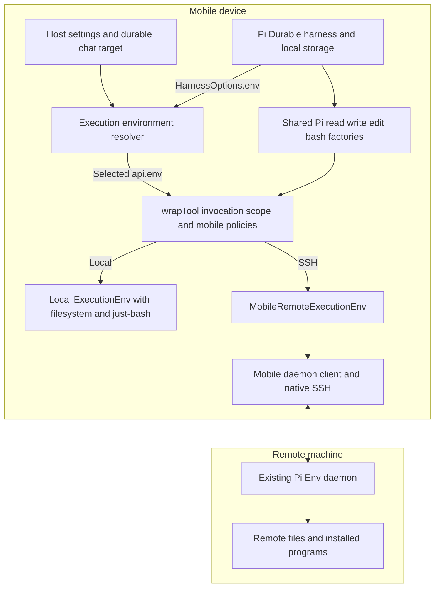

# Remote execution over SSH

A chat can use either its existing on-device workspace or a configured remote machine while the Pi Durable harness, model access, and conversation storage remain on the device. The remote option is technically feasible using Pi's existing execution abstractions and a native SSH transport.

The application work has three parts: configure remote hosts, implement a mobile remote `ExecutionEnv`, and make chat configuration and tool selection support both environments. Pi already supports custom environments. The mobile implementation can communicate with the existing Pi Env daemon over native SSH without changing Pi libraries or importing their Node SSH client.

This is a source-backed proposal dated October 6, 2026. Native SSH execution has not yet been validated in this application.

The prerequisite [execution environment refactor specification](/Users/vikashloomba/pi-react-native/pi-agent/docs/execution-env-refactor.md) and [orchestrator goal prompt](/Users/vikashloomba/pi-react-native/pi-agent/docs/execution-env-refactor-goal.md) require upgrading Pi to stable `1.0.4` before completing the architecture work. That handoff defines the local refactor scope; SSH implementation follows later.

## Library and application responsibilities

| Component | Existing responsibility | Work for this feature |
| --- | --- | --- |
| Pi Durable `ExecutionEnv` | Common filesystem and shell contract used by tools | Implement this public interface in `MobileRemoteExecutionEnv`. |
| Pi Durable harness | Environment injection through `HarnessOptions.env`, tool execution, output publication, persistence, and recovery | Supply the environment resolver and save the chat's selection using existing configuration/document APIs. |
| Pi Durable tools | `read`, `write`, `edit`, and `bash` factories that operate on `api.env` | Register shared factories for both environments. |
| Pi Env | Remote daemon, documented wire protocol, and a Node `RemoteExecutionEnv` client implementation | Use the unchanged daemon and protocol; use the Node client as an implementation reference. |
| Native SSH library | SSH authentication, host-key verification callback, and binary command channel | Connect it to the mobile environment's daemon client and the app's credential/trust settings. |
| Mobile application | Settings, chat configuration, current local workspace, and app lifecycle | Consolidate execution routing, then add host management and the mobile environment/client. |

The extension point is [ExecutionEnv][execution-env], supplied through [HarnessOptions.env][harness-types] and consumed through [api.env][tool-env]. Pi's [environment documentation][durable-env-docs] explicitly describes custom implementations and their conformance tests. `RemoteExecutionEnv` is one implementation of this contract, not a required base class. The mobile environment's daemon communication stays behind that interface.

## Assessment of the current architecture

The durable foundation supports the feature, but the execution path needs a focused refactor before adding another backend. The target design is one environment-selection path and one set of tools. Adding a separate remote extension around the current local bypasses would work as an incremental feature, but would preserve two different execution paths to maintain.

Keep the existing harness/storage ownership, committed-state UI projections, `defineDoc`/`configure` configuration, React settings drafts, and mobile lifecycle coordinator. Also retain the local filesystem, just-bash integration, and workspace runtime's isolation and cancellation behavior. These are useful implementations behind the new boundary.

| Current finding | Architectural consequence | Refactor |
| --- | --- | --- |
| [Harness.open](../src/pi/chat-service.ts#L97) has no env resolver. [File-tool wrappers](../src/pi/workspace/file-tools.ts#L40) construct their own local environment. | Tool implementations choose the backend; prompt sections and other harness consumers do not get the same environment. | Make `HarnessOptions.env` the authoritative selection point for local and remote execution. |
| [WorkspaceExecutionEnv.exec](../src/pi/workspace/execution-env.ts#L296) returns `shell_unavailable`; [local bash](../src/pi/bash/tool.ts#L16) invokes just-bash directly. | The environment is not the common filesystem-and-shell implementation used by all four tools. | Implement local `exec` using the existing engine/deadline code, and have bash consume `api.env`. |
| [WorkspaceRuntime.run](../src/pi/workspace/runtime.ts#L55) surrounds the entire tool call. | Its queue, fresh temporary filesystem, and cancellation drain are necessary behavior, not disposable wrappers. | Preserve that scope around the delegated Pi tool using `wrapTool`; do not lock each filesystem method separately. |
| [EditExecutionEnv](../src/pi/workspace/edit-budget.ts#L254) inherits from the local environment; [patch formatting](../src/pi/workspace/file-details.ts#L85) accepts a mounted local filesystem. | Phone CPU/memory policies are tied to local storage even though remote read/edit processing still happens on the phone. | Make edit budgeting an `ExecutionEnv` decorator and separate common result formatting from backend artifact storage. |
| [Workspace migration](../src/pi/workspace/document.ts#L48) adds local execution capabilities; the [prompt](../src/pi/workspace/extension.ts#L8) assumes local-only execution. | Creation, forks, and prompt context encode local execution as a universal assumption. | Initialize/migrate execution configuration centrally and render capabilities from the selected environment. |
| [ChatRuntime.operate](../src/chat/chat-runtime.ts#L257) and [service commands](../src/pi/chat-service.ts#L321) serialize operations across chats. | Adding slow SSH connection or drain waits there would delay unrelated chats and lifecycle shutdown. | Keep lifecycle coordination, but keep remote I/O outside its global queue and order dependent send/configuration operations per chat. |

## Proposed architecture

Backend choice lives in one durable execution document. Both backends implement `ExecutionEnv`; the shared tool registrations consume `api.env`. `MobileRemoteExecutionEnv` can use the unchanged daemon protocol without inheriting the Node implementation. Environment-specific capabilities and restrictions belong in prompt sections and small policies, rather than duplicated tool implementations.

### Environment resolution and invocation lifetime

Introduce one application-owned environment service that resolves the saved target, owns backend resources, and supplies `HarnessOptions.env`. The factory should return a lightweight environment without opening SSH or acquiring a workspace lock just to render a prompt. Pi also calls it for sections and explicit task environment access, so it cannot be treated as a tool-only acquisition hook.

Use Pi's public `wrapTool` to establish the actual tool invocation scope around `execute`, including result finalization and `finally` cleanup. The wrapper uses the already selected environment; it must not independently choose a host or fall back to a local workspace. Local execution enters the existing `WorkspaceRuntime.run`, binds the invocation filesystem/context, and delegates the Pi factory with that scoped `api.env`. The remote scope delegates to its remote environment and owns request-local resources. This scope helper is application code built with Pi's wrapper API. [Tool wrappers][durable-wraps], [tool invocation contract][installed-tool-api].

Keep local read, edit, bash, and artifact finalization inside the same workspace scope. Pi's file mutation queue covers write/edit but does not lock against bash. The local environment's `exec` must use the already bound invocation, without acquiring the same queue again. The persistent workspace key coordinates calls; its per-invocation mounted namespace also contains a fresh `/tmp`, so these two identities should remain distinct.

The local environment must also remain usable by direct host/task callers. Its lazy facade needs a defined lifetime for standalone operations and returned readers, while compound operations use the same explicit invocation helper. It must not require an undocumented tool wrapper merely to function. Prove this lifecycle during the local refactor before treating the resolver as complete.

Pi does not automatically call `env.cleanup()` after each tool. A `beforeTool`/`afterTool` pair is not a reliable substitute for `try/finally` on cancellation. The application retains ownership of per-call scopes and shared backend shutdown. [Installed execution path][installed-tool-execute].

### Shared tools and mobile policies

Register shared read/write/edit/bash tools once, using Pi factories with `wrapTool` policies for argument validation, invocation lifetime, and presentation. A thin shared bash adapter may be justified to preserve stream-aware presentation, but it must execute only through `api.env.exec`. Preserve safe-read versus unsafe-mutation recovery behavior. Complete local `exec` before switching bash to this path; the engine, limits, and cancellation mechanisms remain reusable.

There are two compatibility details to handle deliberately:

- Stock Pi bash formatting differs from the current local tool's separate stdout/stderr presentation. Pi `1.0.4` supplies stream identity in its public output callback, so a thin shared adapter can use that metadata without a local-only result channel. Normalize effective timeouts, preserve deadlines and persistent spills, and account for the fact that output-window samples can combine streams. A raw factory replacement is not exact presentation compatibility. [Shell contract][execution-env].
- Remote files can be much larger than the local workspace allows. Pi `1.0.4` supplies bounded binary readers and line scanning, and its read tool uses those to fetch displayed ranges. Reuse that abstraction. Edit matching/diffing still runs on the phone and needs cooperative admission limits; the remote implementation must bound transfers and materialization internally. Display truncation alone is not a memory bound. [Upgraded read implementation][upgraded-read].

Refactor `EditExecutionEnv` into a delegating decorator over `ExecutionEnv`, preserving the wrapped environment's identity and cwd. Split patch preview formatting from a small backend artifact writer. Local artifacts must retain exclusive creation and durable storage; a reported spill path cannot disappear with invocation `/tmp`. Keep these real policies while removing their dependency on a particular backend class.

### Configuration and lifecycle

Persist only application-specific execution choice in an `ExecutionTargetDoc`, such as `{ kind: 'local' }` or `{ kind: 'ssh', machineId }`. Keep cwd, model settings, and ordinary tool/extension selection in `AgentDoc`. With shared tools, do not also persist a separate local-versus-remote extension choice. Save target and cwd together through a Pi commit and public `configure`.

Host settings contain a stable ID, name, SSH endpoint/user, daemon path, default cwd, and credential reference. Secure storage and the host trust store supply authentication material and accepted keys. Connection testing is a settings operation; opening chat history must not connect to every host.

Execution changes require a stronger readiness check than model settings. The current model-settings flow deliberately allows changes after offline abort intent; an abort-marked task can still await cleanup. Preserve that model behavior, but require old environment work to settle before changing target/cwd or replacing an in-use host connection. Use committed Pi documents/tasks and active resource state, not only UI busy flags. Do not call a scheduling API merely to inspect readiness.

Keep app activation, credential replacement, and shutdown in `ChatRuntime`. Make cancellation/backgrounding stop new environment work and cancel pending connections immediately. Network work must not hold the global lifecycle queue. An offline remote host should fail its own operation through Pi's normal tool result path rather than block an unrelated local chat.

New/existing chats default to local. Configure execution-document fork history to agree with `AgentDoc`; remote forks share current remote files, while local forks keep their existing fresh-workspace policy. Task-owned conversations need explicit execution-target inheritance alongside Pi's built-in agent inheritance. Migration must cover those conversations too, rather than only the visible-chat cache.

### Cohesive module boundaries

| Module | Responsibility |
| --- | --- |
| Existing `chat-service.ts` | Own the harness, expose chat commands, and publish committed projections. Delegate backend details. |
| Proposed `conversation-configuration.ts` | Execution document, composed settings, atomic changes, inheritance, and migrations. |
| Proposed `execution/environments.ts` | Resolve local/remote environments and own their lifecycle. Two explicit backends are sufficient. |
| Proposed `execution/tools.ts` and focused policy helpers | One set of Pi factories, `wrapTool` scopes, mobile limits, and capability prompt sections. |
| Existing `workspace/` and `bash/` | Local implementation, including complete `exec`, the workspace queue, virtual filesystem, and interpreter. |
| Proposed `remote/` | Mobile `ExecutionEnv`, daemon client, native SSH, and host configuration services. |
| Existing runtime/provider/settings UI | Native lifecycle, subscriptions, and settings drafts. No backend execution in React. |

### Refactor sequence

1. Upgrade aligned Pi dependencies to stable `1.0.4`, implement the expanded local environment contract, and use the public environment conformance suite.
2. Consolidate local execution: complete `exec`, separate portable policy from local storage, and route shared tools through the harness-selected environment. Verify direct use and an independent test environment through the actual service. Preserve persisted identities and existing state.
3. Add remote execution configuration, the custom mobile environment/SSH client, host settings and the chat selector against that same resolver and tool path. Production remote state belongs to this later feature.

The existing local lifecycle, quota, edit-versus-bash, artifact, and recovery regressions are acceptance requirements for the refactor. Add resolver tests covering both backends, prompt-only access without resource leaks, configuration/fork inheritance, cancellation while connecting, and one offline remote chat alongside a working local chat. This is an application refactor using Pi's public interfaces; no Pi library modification is required.

## Mobile compatibility work

Implement `MobileRemoteExecutionEnv implements ExecutionEnv` against `@earendil-works/pi-durable/env` after the required `1.0.4` upgrade. That public interface extends `FileSystem` and `Shell`; it is separate from Node-specific implementations. `HarnessOptions.env` accepts it directly, and Pi's tool accessor only checks that an environment exists. Our [WorkspaceExecutionEnv](../src/pi/workspace/execution-env.ts#L74) already demonstrates the consumer-implementation pattern. No Pi fork or upstream API change is required.

The class supplies the declared filesystem methods, readers, line scans, watchers, `id`, `cwd`, string/argv `exec`, and `cleanup`, returning Pi's result/error types and honoring cancellation and output metadata. It maps these to the daemon's existing operations; remote filesystem access and process execution remain implemented by the daemon. [Environment contract][execution-env], [daemon protocol][env-protocol].

The interface does not itself provide a daemon client. The mobile implementation must supply or adapt that client behind the class: encode/decode the existing protocol over the native SSH channel, map results and errors, and handle connection loss and cancellation. Use [`RemoteExecutionEnv`][env-remote] and [`Connection`][env-connection] as references and reuse suitable logic. Their Node dependencies constrain importing those particular implementations; they do not constrain implementing `ExecutionEnv`. This is bounded integration work inside the mobile adapter, with Pi's tools and harness unchanged.

The `pi-env` npm Node client is not a required on-device dependency on this route. Upgrade the app's Pi dependencies to `1.0.4` and use its current public helpers and conformance suite; the upgrade is part of the agreed refactor. Pin/validate the daemon protocol separately and use its reference client without importing Node-only code into mobile. [Pi Env package metadata][env-package].

### Native SSH candidate

`@osuki-dev/react-native-ssh@0.3.0` is a plausible transport. Its `openShell({ term: '', command })` opens a command channel without a PTY and supports binary input/output. Supply a separate stderr handler so daemon diagnostics stay separate from the protocol stream. [Channel implementation][ssh-channel], [stderr routing][ssh-stderr].

Its compatibility with this app's Expo 58 / React Native 0.88 stack remains unproven. The integration also needs bounded writes and reliable shutdown under a stalled connection; the current library exposes a bounded write queue without a JavaScript drain API. These are transport integration checks, with any required correction contained in that layer. [Write queue][ssh-writes], [example dependencies][ssh-example].

## Daemon assumption

Upstream Pi Env communicates with a daemon process through stdin/stdout. Its SSH path launches `pi-env serve` for the connection; it does not attach to an arbitrary already-running process. For the proposed integration, the remote machine has SSH available and a compatible daemon binary already installed. No deployment feature is needed. If attaching to one particular existing daemon process is mandatory, that remains an additional requirement. [Daemon and connection model][env-readme].

## Remaining questions and validation

| Question | Next step |
| --- | --- |
| Does the mobile implementation satisfy Pi's environment contract over the daemon protocol? | Implement the adapter using the existing contract and validate it with Pi tools and the matching environment conformance suite. |
| Does the candidate SSH library work on the intended mobile platforms? | Build with the app's exact versions and exercise a real Pi daemon, including cancellation, transfer pressure, and disconnect. |
| Which remote OSes and authentication methods belong in the initial release? | Choose a supported matrix from actual product needs; validate those combinations. |
| Does launching a session from the preinstalled daemon satisfy the deployment assumption? | Confirm this behavior; otherwise scope a way to attach to the existing service. |

Validate the integration at its boundaries: Pi tools must read, write, edit, and execute against the selected machine; local chats must retain their current behavior; saved selections must survive reopen and fork; switching and app backgrounding must release resources predictably. Use the environment conformance suite matching the chosen Pi version and test the mobile client's interoperability with the pinned daemon.

The initial feature uses directories already present on the remote machine. File synchronization, per-chat remote worktrees, and continuous background agent execution can be added as separate product capabilities.

## Source baseline

Application findings describe the inspected working tree, including existing local changes: Expo `~58.0.3`, React Native `0.88.0-rc.3`, and installed Pi Durable/Chord `1.0.0`. The required upgrade target and Durable/daemon/reference-client links use stable `1.0.4` at `7c10bd4`. SSH links are pinned to `0.3.0` at `f22c9d7`. The architecture review ran 72 existing chat/runtime/workspace tests successfully with scripted models and the Node SQLite adapter. That baseline does not validate the planned dependency upgrade, refactor, or native SSH.

[execution-env]: https://github.com/earendil-works/pi/blob/7c10bd4337495ee613f2224843ecdf349b80d1df/packages/durable/src/env/index.ts
[durable-env-docs]: https://github.com/earendil-works/pi/blob/7c10bd4337495ee613f2224843ecdf349b80d1df/packages/durable/README.md#environment
[harness-types]: https://github.com/earendil-works/pi/blob/7c10bd4337495ee613f2224843ecdf349b80d1df/packages/durable/src/harness/types.ts
[tool-env]: https://github.com/earendil-works/pi/blob/7c10bd4337495ee613f2224843ecdf349b80d1df/packages/durable/src/tools/env.ts
[env-remote]: https://github.com/earendil-works/pi/blob/7c10bd4337495ee613f2224843ecdf349b80d1df/packages/env/src/remote-env.ts
[env-connection]: https://github.com/earendil-works/pi/blob/7c10bd4337495ee613f2224843ecdf349b80d1df/packages/env/src/connection.ts
[env-package]: https://github.com/earendil-works/pi/blob/7c10bd4337495ee613f2224843ecdf349b80d1df/packages/env/package.json
[env-readme]: https://github.com/earendil-works/pi/blob/7c10bd4337495ee613f2224843ecdf349b80d1df/packages/env/README.md
[env-protocol]: https://github.com/earendil-works/pi/blob/7c10bd4337495ee613f2224843ecdf349b80d1df/packages/env/docs/protocol.md
[ssh-channel]: https://github.com/osuki-dev/react-native-ssh/blob/f22c9d7685842afa76815a56d2b8e41923e6cd36/rust/rnssh-core/src/shell.rs#L119-L158
[ssh-stderr]: https://github.com/osuki-dev/react-native-ssh/blob/f22c9d7685842afa76815a56d2b8e41923e6cd36/cpp/HybridSshShell.cpp#L56-L63
[ssh-writes]: https://github.com/osuki-dev/react-native-ssh/blob/f22c9d7685842afa76815a56d2b8e41923e6cd36/rust/rnssh-core/src/shell.rs#L201-L224
[ssh-example]: https://github.com/osuki-dev/react-native-ssh/blob/f22c9d7685842afa76815a56d2b8e41923e6cd36/example/package.json

[durable-wraps]: https://github.com/earendil-works/pi/blob/7c10bd4337495ee613f2224843ecdf349b80d1df/packages/durable/README.md#tools
[installed-tool-api]: ../node_modules/@earendil-works/pi-durable/dist/harness/types.d.ts#L109-L122
[installed-tool-execute]: ../node_modules/@earendil-works/pi-durable/dist/harness/tool.js#L192-L215
[upgraded-read]: https://github.com/earendil-works/pi/blob/7c10bd4337495ee613f2224843ecdf349b80d1df/packages/durable/src/tools/read.ts
