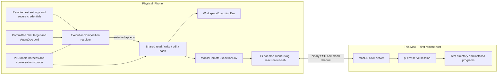

# Remote execution over SSH: implementation handoff

Updated October 6, 2026, against the current working tree. **The architecture is ready for this feature.** The execution refactor, Pi upgrade, and legacy workspace compatibility removal are complete. The remaining work is host settings, a mobile implementation of Pi's public `ExecutionEnv`, and product integration through the existing composition/configuration seams.

The harness, model access, durable conversation storage, and tool orchestration stay on the phone. A chat chooses its on-device workspace or a configured SSH machine. Remote file and shell operations run through the unchanged Pi Env daemon on that machine.

**SSH implementation decision:** use **`@osuki-dev/react-native-ssh`** for the SSH connection and native binary channel. Do not build an application-owned SSH implementation or native SSH bridge. Our custom code implements Pi's `ExecutionEnv` and connects the existing Pi daemon protocol to the library's public API. The library owns SSH encryption, negotiation, authentication mechanisms and channel transport; the app supplies configuration, credential/trust decisions and lifecycle ownership.

The first end-to-end test target is **the physical iPhone connecting to this Mac over SSH**. Native SSH has not yet been built or exercised in this application. This is an implementation handoff, not a claim that remote execution already works.

## What is already ready

The [current architecture and verification record](execution-environments.md) describes the completed implementation. The older [refactor specification](execution-env-refactor.md) and [refactor goal](execution-env-refactor-goal.md) are historical prerequisite documents; their before-state tables are not the current code.

| Existing seam | Current behavior | Remote feature work |
| --- | --- | --- |
| [ExecutionComposition](../src/pi/execution/composition.ts) | Supplies the authoritative `HarnessOptions.env` resolver, policies, extensions, creation hook, and shutdown ownership. | Compose the existing local implementation with a remote implementation and resolve the committed target. |
| [DurableChatService.open](../src/pi/chat-service.ts) | Installs that resolver into the real Pi harness. Shared tools, prompt sections, and `TaskRuntime.env()` use it. | Inject the combined composition through the existing `execution` factory. |
| [Shared file tools](../src/pi/workspace/file-tools.ts), [bash](../src/pi/bash/tool.ts), and [policies](../src/pi/execution/types.ts) | One tool registration; Pi file factories and the shared bash adapter consume `api.env`. Invocation scopes release in `finally`. Edit admission uses public bounded readers. | Supply remote scope ownership and prompt facts. Keep these tool implementations shared. |
| [configureExecution](../src/pi/chat-service.ts) | Atomically commits an application selector and `AgentDoc.cwd`; blocks changes while any conversation task or relevant queued work remains unsettled. | Add the production selector document and expose the command through the runtime and settings UI. |
| [ChatRuntime](../src/chat/chat-runtime.ts) | Accepts composition injection and orders commands per conversation without holding global admission during slow execution/drainage. | Connect the host repository and remote resources to this existing lifecycle. |
| [Independent environment fixture](../tests/helpers/independent-env.mjs) and [composition tests](../tests/execution-composition.test.mjs) | A stock `NodeExecutionEnv` uses the real service/harness, all four tools, direct tasks, durable selection, and forks without local filesystem access. Missing targets fail without fallback. | Retain the independent fixture and add actual SSH integration/device coverage. |

The latest recorded cleanup validation passed **562 application tests and 37 compatibility tests**, with lint and typecheck passing. Earlier native refactor checks covered iOS simulator/Hermes and Android/iOS exports. These establish the application's environment boundary; they do not validate the new SSH module or physical-phone network behavior.

## Architecture and responsibility boundaries



| Owner | Responsibility |
| --- | --- |
| Pi Durable | Public environment contract, harness environment lookup, tools and edit algorithms, durable state/history, task scheduling and replay policy. |
| Pi Env daemon | Remote filesystem system calls, reader/directory handles, line scanning, watching, process execution and process-group cancellation. |
| `@osuki-dev/react-native-ssh` | SSH connection, authentication, host-key verification callback, binary channel transport and disconnection. |
| Application mobile adapter | Implement `ExecutionEnv`; map its client semantics to the documented daemon protocol over the native channel; own mobile resources and typed failures. |
| Application product integration | Host/credential/trust configuration, durable chat selection, composition, committed UI projections and lifecycle. |

`RemoteExecutionEnv implements ExecutionEnv` is the correct precedent. Implement the public interface directly; an application base class or Pi library fork is unnecessary. The Node reference client imports Node modules, and its `Connection` spawns a process rather than accepting an injected native stream. Use its behavior as the reference for the mobile Pi daemon-protocol client, retaining library helpers that are actually portable. Do not assume the Node connection can be dropped into Hermes. [Public contract][execution-env], [reference environment][env-remote], [reference connection][env-connection].

## Implementation work

### 1. Host configuration and durable chat selection

Add a focused remote-host repository and settings screen using existing application storage, SecureStore conventions, and Expo Router. A host has a stable ID, display name, SSH address/port/user, absolute daemon path, default working directory, and credential reference. Keep secrets and accepted host-key material out of conversation documents, model context and logs. The SSH library supplies authentication and verification callbacks; the app owns their persistence and user interaction. Provide add/edit/remove and an explicit connection test. [SSH API][ssh-api].

Keep the per-chat execution selection in a small `defineDoc`: `{ kind: 'local' }` or `{ kind: 'ssh', machineId }`, with local as the initial value. Use `history: 'rewindable'` and `fork: 'asOf'` so it follows historical agent configuration. Keep cwd in `AgentDoc`. Call the existing `configureExecution` transaction to save target and cwd together after old work settles; do not create a parallel cwd store or write execution state directly from React. Explicitly inherit the selector for task-owned conversations in `conversationCreated`, following the existing independent-backend fixture. [Application document contracts][durable-types], [transactional configure][agent-source], [configuration example][configuration-example].

Project the committed target/cwd through the service and runtime. Add the environment choice and working-directory draft to [chat settings](../src/app/chat-settings/[id].tsx), and connect host management from [global settings](../src/app/account.tsx). The [provider](../src/chat/chat-provider.tsx) is the production composition entry point. Settings may inspect configuration without contacting SSH; connection testing and execution are explicit operations.

A deleted or unreachable selected host produces an actionable error while retaining that selection. Host edits must not silently retarget active work: drain affected resources before accepting endpoint/credential changes, or retain an immutable configuration for admitted work and apply the edit to subsequent sessions. The implementation should choose one clear policy and cover it in tests.

Switching execution changes where subsequent tools run; it does not copy files. Local forks retain their existing fresh-workspace behavior. Remote forks inherit the historical target/cwd and see that machine's current files. Durable transcript history is not a remote filesystem snapshot. Do not add legacy-chat conversion, rollout backfills, or preservation layers.

### 2. Mobile environment and daemon client

Keep three focused responsibilities: ownership of the channel returned by `react-native-ssh`, a Pi daemon connection implementing the documented wire contract, and `MobileRemoteExecutionEnv` implementing the public environment contract. These can live under `src/pi/execution/remote/`; module names are flexible. The daemon connection sends Pi protocol messages through the library's channel; it does not implement SSH. Keep host settings and UI out of the adapter, and keep backend selection out of shared tools.

Use the unchanged daemon for the actual filesystem/process operations. The mobile client must preserve the reference behavior for remote path resolution, error mapping, bounded readers, shell output metadata, cancellation and cleanup. The upstream [semantics document][env-semantics] explicitly assigns these client/daemon responsibilities; follow it rather than designing another remote-filesystem abstraction. Implement the full installed public interface, including direct `runtime.env()` use. Report genuinely unsupported operations with the corresponding typed result.

Return a lightweight facade from the resolver. Resolving the environment for prompt metadata or inspecting settings must not open SSH or hold disposable resources. Resolve paths locally where the required remote facts are already known; an operation needing remote metadata may lazily connect and obtain `hello`. Do not assume the phone's home directory or path rules describe the remote machine. Supply truthful remote cwd/capability facts through the existing policy. The environment's `id` must identify its actual file namespace; a cwd change alone does not imply a different namespace. Follow the contract's identity rules rather than reusing the local workspace UUID. [Environment contract][execution-env], [harness resolver][harness-types], [reference path resolution][env-remote].

The composition owns admission, stop and awaited close for both local and remote resources. A tool scope owns only its invocation resources and releases them in `finally`; task callers own `env.cleanup()`. Closing one environment must not terminate unrelated consumers. Avoid speculative pooling: begin with explicit, auditable ownership and share connections only if that ownership remains correct. Do not assume Pi automatically disposes environments. [Existing ownership record](execution-environments.md), [tool execution source][tool-execution].

Keep the existing mobile read/edit/output bounds. Remote files and program output can greatly exceed local workspace limits. The optional `ArtifactWriter` can initially be absent for remote execution; current tools already report unavailable complete output honestly. If implemented, returned remote artifact paths must survive invocation cleanup. Prompt facts must describe the actual choice.

### 3. Native SSH integration

Use **`@osuki-dev/react-native-ssh@0.3.0`**, the selected SSH library and latest npm release when checked on October 6. Its native API supports the required channel:

- `connect({ host, port, username, auth, verifyHostKey, signal, onDisconnected })`.
- `openShell({ term: '', command }, { onData, onStderr, onClosed })` for a command without a PTY.
- Binary `write(Uint8Array | ArrayBuffer)`, plus explicit channel close and connection disconnect.

Supply `onStderr`: the native implementation otherwise routes diagnostic stderr into `onData`, corrupting the framed stdout protocol. Preserve binary bytes and honor the callback-buffer lifetime documented by the package. [Public API][ssh-api], [no-PTY command implementation][ssh-channel], [stderr routing][ssh-stderr].

Add the SSH library and its Nitro dependency through the repository's Expo Agent CLI install workflow. Read the matching Expo 58 guidance and rebuild the native app. Upstream's example uses Expo 57 / RN 0.86.2; this app uses Expo 58.0.3 / RN 0.88.0-rc.3. Compilation and actual Hermes/device operation remain required evidence for the selected library on this exact stack. [Requirements][ssh-readme], [example dependencies][ssh-example].

For phone-to-Mac LAN access, add `NSLocalNetworkUsageDescription` through Expo `ios.infoPlist` and exercise permission grant/denial in the foreground. Directly entering an address does not require Bonjour discovery. Persist native configuration in Expo config, not generated native files. [Apple local network guidance][apple-local-network], [Expo 58 app config][expo-config].

Two specific native behaviors need early validation, before completing the settings UI:

| Unproven behavior | Required investigation |
| --- | --- |
| Write pressure and cancellation | Native writes use a bounded queue and can reject synchronously with `QUEUE_FULL`; the public API has no drain notification. Bound outstanding writes, distinguish rejected from accepted frames, and test a peer that stops reading. Prove close/cancellation still settles. |
| Output pressure | Native output coalescing does not prove aggregate callback backlog is bounded. Exercise large binary transfers and split stdout/stderr on the physical phone, measure memory, and cancel during output. |

These are focused test gates, not a presumption that the SSH library needs patching. The source currently has a 4 MiB pending-write ceiling and a 1,024-command queue; its command pump and close behavior explain the stalled-peer test. [Queue implementation][ssh-writes], [output coalescer][ssh-output].

## First end-to-end environment: this Mac and the physical phone

This Mac is Darwin arm64. Pi Env 1.0.4's published package contains `bin/pi-env-darwin-arm64/pi-env`, so no Rust build is needed for this host. The app's Pi dependencies are already 1.0.4. Use that matching daemon version for the first test. [Package metadata][env-package], [binary selection][env-ssh].

**Daemon deployment assumption:** the machine has SSH enabled and the daemon binary installed. Each connection starts `'<absolute daemon path>' serve --token <fresh hex>` through its non-PTY SSH command channel. Pi speaks framed stdin/stdout to that session; it does not attach to an arbitrary daemon process already running elsewhere. No separate daemon TCP port or service manager is needed for this setup. The mobile Pi daemon-protocol client performs Pi protocol synchronization/hello and liveness. [Wire protocol][env-protocol].

Preparation recipe for the implementation phase; it was not executed while writing this document:

```sh
npm install --prefix "$HOME/.local/share/pi-env-test" --save-exact @earendil-works/pi-env@1.0.4
mkdir -p "$HOME/pi-env-phone-test"
```

This installs the daemon package outside the app repository. Node/npm retrieves it; the shipped Rust binary runs directly. The package has no npm `bin` entry, so use its executable path rather than an `npx pi-env` command. On this Mac, configure:

| Setting | Initial test value |
| --- | --- |
| Address | This Mac's reachable LAN IP or hostname, with the phone on the same network. `localhost` on the phone means the phone. |
| SSH service | macOS **System Settings → General → Sharing → Remote Login**, allowing the chosen account. |
| User | The chosen Mac SSH account; `vikashloomba` if using the current account. |
| Port | The configured SSH port; normally 22. |
| Daemon | `/Users/vikashloomba/.local/share/pi-env-test/node_modules/@earendil-works/pi-env/bin/pi-env-darwin-arm64/pi-env` |
| Working directory | `/Users/vikashloomba/pi-env-phone-test` |
| Authentication/trust | A supported credential for that account and its verified SSH host-key fingerprint. |

Use paths belonging to the chosen account if it differs. The working directory is a starting location, not a filesystem sandbox. [Apple Remote Login setup][apple-ssh], [daemon package][env-package].

During implementation, first prove native connect → trusted host → daemon handshake → filesystem read/write → shell output → close from the phone. Then run the same path through the actual service/harness and shared tools. Finish with a signed standalone iPhone build and verify the feature without a Metro connection.

The protocol sends pings every five seconds. After stdin closes or 30 seconds without incoming bytes, the daemon exits and kills command groups it started. Phone suspension/network loss must therefore be treated as connection loss, not promised background execution. Invalidate old handles and fail uncertain in-flight operations; reconnect for subsequent requests without automatically replaying mutations. [Protocol liveness and cancellation][env-protocol].

## Completion criteria

Use Pi **1.0.4's exported `createEnvConformance` from `@earendil-works/pi-durable/testing`**. It is installed and already used by [local conformance tests](../tests/workspace-env-conformance.test.mjs). Give each remote case a fresh writable test directory and accurate shell/symlink capabilities. Exercise applicable reader, directory, shell and watch cases; report any real unsupported behavior explicitly. Upstream's [SSH conformance test][env-ssh-test] and [differential tests][env-differential] are the reference patterns.

| Area | Evidence required before calling the feature complete |
| --- | --- |
| Native transport | Exact Expo/RN build succeeds; real phone-to-Mac handshake, binary integrity across chunk boundaries, stderr separation, host-key rejection and credential failure work. |
| Real harness routing | All four tools execute through the production remote composition; files and shell effects are independently observed in the Mac test directory. Committed tool results reach the following model request. Direct task environment access works. |
| Durable selection | Local is the default. Target/cwd changes are atomic and reject unsettled work. Reopen, historical forks and owned conversations use the intended selection; removed hosts fail visibly. |
| Backend isolation | Local and remote chats can progress independently. Remote tools do not open the local workspace database. Shared tools do not gain backend branches. |
| Resource lifetime | Connect/operation cancellation, daemon exit, Wi-Fi loss, background/foreground and app relaunch clean up correctly. Stalled writes settle; closed/stale handles cannot address a replacement session. |
| Bounded processing | Large files, growing files, invalid UTF-8 and heavy stdout/stderr preserve existing tool limits and bounded receiving. Measure actual phone memory and cancellation responsiveness. |
| Recovery | Connection loss after a mutation does not claim the command never started and does not automatically retry it. A later operation can establish a clean session. |
| Product flow | Add/edit/remove/test host, trust verification, per-chat choice/cwd, unavailable-host feedback and local-network permission denial are exercised through the UI. |
| Regression/release | Existing app and compatibility suites, Pi remote conformance, Expo lint/typecheck, Android/iOS exports and the physical iPhone scenario pass. Record Android runtime coverage separately when available. |

## Remaining decisions and scope

The architectural decisions are settled: public `ExecutionEnv`, existing composition, shared tools, durable selector plus `AgentDoc.cwd`, and the unchanged Pi daemon. The first implementation milestone should resolve native transport compatibility and pressure/cancellation behavior on the phone-to-Mac path.

The initial release still needs an explicit supported remote-OS/authentication matrix and a host-edit policy while work is active. The first physical test can use this Mac and a single supported credential method; it does not establish Linux, Windows, Android-phone, or other authentication combinations. Choose those commitments from actual product needs and test them rather than implying support from a package's platform list.

Initial scope uses directories already present on configured machines. Automatic daemon provisioning, file synchronization, remote workspace snapshots, interactive terminal UI and continuous background execution are separate capabilities. This document requires no additional local execution refactor or chat compatibility layer.

## Pinned sources

Pi links target stable 1.0.4 at `7c10bd4337495ee613f2224843ecdf349b80d1df`; SSH links target 0.3.0 at `f22c9d7685842afa76815a56d2b8e41923e6cd36`. Both npm release versions were rechecked on October 6, 2026. Re-check relevant changes when upgrading, while keeping the app contract and daemon/protocol test baseline aligned.

- [Pi environment documentation][durable-env-docs] and [sandbox environment example][sandbox-example]: custom environment injection.
- [ExecutionEnv interface][execution-env] and [HarnessOptions/EnvTarget][harness-types]: the production adapter and resolver contracts.
- [Custom state and TaskRuntime contracts][durable-types], [agent configure implementation][agent-source], and [configuration example][configuration-example]: persistence and configuration ownership.
- [Pi Env README][env-readme], [protocol][env-protocol], [semantics][env-semantics], and [reference client][env-remote]: daemon interoperability.
- [SSH API][ssh-api], [native channel][ssh-channel], and [SSH example][ssh-example]: mobile transport integration.

[execution-env]: https://github.com/earendil-works/pi/blob/7c10bd4337495ee613f2224843ecdf349b80d1df/packages/durable/src/env/index.ts
[durable-env-docs]: https://github.com/earendil-works/pi/blob/7c10bd4337495ee613f2224843ecdf349b80d1df/packages/durable/README.md#environment
[harness-types]: https://github.com/earendil-works/pi/blob/7c10bd4337495ee613f2224843ecdf349b80d1df/packages/durable/src/harness/types.ts
[durable-types]: https://github.com/earendil-works/pi/blob/7c10bd4337495ee613f2224843ecdf349b80d1df/packages/durable/src/types.ts
[agent-source]: https://github.com/earendil-works/pi/blob/7c10bd4337495ee613f2224843ecdf349b80d1df/packages/durable/src/harness/agent.ts
[configuration-example]: https://github.com/earendil-works/pi/blob/7c10bd4337495ee613f2224843ecdf349b80d1df/packages/durable/test/examples/07-configuration.ts
[sandbox-example]: https://github.com/earendil-works/pi/blob/7c10bd4337495ee613f2224843ecdf349b80d1df/packages/durable/test/examples/29-sandbox-per-conversation.ts
[tool-execution]: https://github.com/earendil-works/pi/blob/7c10bd4337495ee613f2224843ecdf349b80d1df/packages/durable/src/harness/tool.ts
[env-remote]: https://github.com/earendil-works/pi/blob/7c10bd4337495ee613f2224843ecdf349b80d1df/packages/env/src/remote-env.ts
[env-connection]: https://github.com/earendil-works/pi/blob/7c10bd4337495ee613f2224843ecdf349b80d1df/packages/env/src/connection.ts
[env-package]: https://github.com/earendil-works/pi/blob/7c10bd4337495ee613f2224843ecdf349b80d1df/packages/env/package.json
[env-readme]: https://github.com/earendil-works/pi/blob/7c10bd4337495ee613f2224843ecdf349b80d1df/packages/env/README.md
[env-protocol]: https://github.com/earendil-works/pi/blob/7c10bd4337495ee613f2224843ecdf349b80d1df/packages/env/docs/protocol.md
[env-semantics]: https://github.com/earendil-works/pi/blob/7c10bd4337495ee613f2224843ecdf349b80d1df/packages/env/docs/semantics.md
[env-ssh]: https://github.com/earendil-works/pi/blob/7c10bd4337495ee613f2224843ecdf349b80d1df/packages/env/src/ssh.ts
[env-ssh-test]: https://github.com/earendil-works/pi/blob/7c10bd4337495ee613f2224843ecdf349b80d1df/packages/env/test/ssh-external.test.ts
[env-differential]: https://github.com/earendil-works/pi/blob/7c10bd4337495ee613f2224843ecdf349b80d1df/packages/env/test/differential.test.ts
[ssh-api]: https://github.com/osuki-dev/react-native-ssh/blob/f22c9d7685842afa76815a56d2b8e41923e6cd36/src/index.ts
[ssh-readme]: https://github.com/osuki-dev/react-native-ssh/blob/f22c9d7685842afa76815a56d2b8e41923e6cd36/README.md
[ssh-channel]: https://github.com/osuki-dev/react-native-ssh/blob/f22c9d7685842afa76815a56d2b8e41923e6cd36/rust/rnssh-core/src/shell.rs#L119-L158
[ssh-stderr]: https://github.com/osuki-dev/react-native-ssh/blob/f22c9d7685842afa76815a56d2b8e41923e6cd36/cpp/HybridSshShell.cpp#L56-L63
[ssh-writes]: https://github.com/osuki-dev/react-native-ssh/blob/f22c9d7685842afa76815a56d2b8e41923e6cd36/rust/rnssh-core/src/shell.rs#L197-L265
[ssh-output]: https://github.com/osuki-dev/react-native-ssh/blob/f22c9d7685842afa76815a56d2b8e41923e6cd36/rust/rnssh-core/src/shell.rs#L297-L360
[ssh-example]: https://github.com/osuki-dev/react-native-ssh/blob/f22c9d7685842afa76815a56d2b8e41923e6cd36/example/package.json
[apple-local-network]: https://developer.apple.com/documentation/technotes/tn3179-understanding-local-network-privacy
[apple-ssh]: https://support.apple.com/guide/mac-help/allow-a-remote-computer-to-access-your-mac-mchlp1066/mac
[expo-config]: https://docs.expo.dev/versions/v58.0.0/config/app/#infoplist
